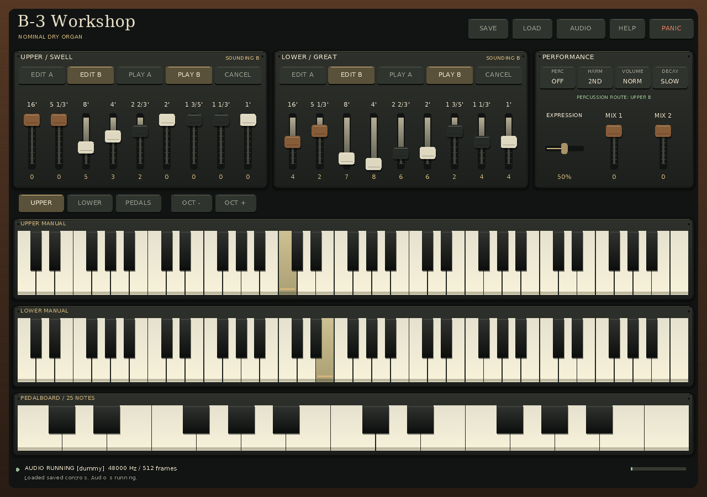

# Hammond B-3 Organ

A project to recreate a vintage Hammond B-3 and Leslie system, guided by the
repository's **500-page research and build atlas**.

**Current stage:** a working nominal dry-organ engine, offline WAV renderer and
optional headless VST3 and native standalone prototypes. The core owns 91 shared, continuously running
sources, two manuals and 25 independently held pedals. Four retained A/B banks,
routing-only Cancel, optional contact travel, partial-key targets and shared
percussion readiness provide early console behavior. Two explicitly nominal
pedal mixtures consume the same source frame. Version-3 control snapshots
preserve musical controls and migrate older states to muted pedals.

The native wrapper exposes three event inputs and 45 stable controls through
generic host parameter controls. It renders identical dry float32 stereo at
44.1, 48 and 96 kHz, reconstructs bounded sample-linear automation, and accepts
state loads through a concurrent UI/audio handoff. The actual Linux bundle has
independent [ABI](docs/VST3_ABI_ACCEPTANCE.md) and
[behavior](docs/VST3_BEHAVIOR_ACCEPTANCE.md) evidence. Native platform, callback,
DAW and device gates are recorded separately; the SDK validator's diagnostics
are retained rather than hidden behind its summary. Ordinary builds remain
SDK-free; use the explicit [optional build](docs/VST3_BUILD.md) for VST3.

The [native standalone](docs/STANDALONE_APP.md) now provides a resizable instrument
window, both manuals and pedals, A/B drawbar editing and selection, percussion,
expression, keyboard/pointer playing, audio settings, and explicit control-file
saving/loading. Its [operational handoff](docs/STANDALONE_HANDOFF.md) records
setup and the current qualification boundary. The [actual window demonstration](examples/demos/standalone-window-v1/README.md)
retains four native backbuffer screenshots and their source/diagnostic identities.
The [chapel audition views](examples/demos/standalone-chapel-v1/README.md)
add reference/minimum-size captures with Upper C4 and Lower E4 held and a complete
explicit documentary registration.
[Scripted workflows](docs/STANDALONE_WORKFLOWS.md), a [source-identified render benchmark](docs/STANDALONE_BENCHMARK.md)
and [chapel registration export](docs/CHAPEL_CONTROLS.md) have independent acceptance.
These software checks use explicit SDL dummy drivers; real-device and
production-release gates remain separate.
The [completed standalone session](docs/development/2026-11-13-next-phases/README.md)
accepted **60 newly dispatched agents in ten logical waves**, including full
500-page atlas coverage. Its [strict completion record](docs/development/2026-11-13-next-phases/completion-check.json)
retains sixty completed rows with no earlier/resumed workers counted again.
Ordinary builds remain SDK-free.



This retained native software-renderer view has matching
[source and runtime provenance](examples/demos/standalone-chapel-v1/provenance.json).

The [final platform audit](docs/reviews/STANDALONE_FINAL_PLATFORM_AUDIT.md)
records all ten successful hosted jobs at code revision
[`6214032f`](https://github.com/tomasedisonn80/Hammond-B3-Organ/commit/6214032f3565f9e221fcf3988e33a22a73bb4ea8):
core Release on Linux/Windows/macOS, Linux sanitizers/leaks, and all three
standalone and VST3 builds. Actual package bytes, relocated execution and
capability limits are retained. The [combined Release gate](docs/reviews/STANDALONE_COMBINED_FINAL_GATE.md)
and [fully instrumented native gate](docs/reviews/STANDALONE_FINAL_INTEGRATION.md)
keep their own exact source scopes and original failure records.

The [scanner continuation](docs/SCANNER_HANDOFF.md) now includes a strict circuit
graph/compiler, independent primary-source review, AC/transient references and
prepared numerical modules. The observed G5 same-hertz failure must be resolved
under the [frozen numerical contract](docs/SCANNER_NUMERICAL_CONTRACT.md) before
Engine integration; discrete parity alone does not close that gate.

An independent [rotary motion and propagation track](docs/ROTARY_SCOPE.md)
develops nominal horn/drum trajectories and emission-time acoustic paths with
separate inputs and numerical references. Its
[new sixty-assignment session](docs/development/2026-11-13-rotary/README.md)
preserves the concurrently active scanner and native standalone work. This
research module does not yet establish a measured Leslie or change dry output.

The independent [capture and calibration toolchain](docs/CALIBRATION_HANDOFF.md)
adds full-stream audio inspection, canonical sample identities, corpus lineage
and split audits, and fixed numerical comparisons. Its
[sixty-assignment session](docs/development/2026-11-13-calibration/README.md)
records the fresh full-PDF reading and separate implementation/acceptance work.
These offline tools prepare M0/M8 evidence; actual hardware acquisition and
physical calibration remain separate gates.

The selected source, contact, percussion and pedal models are **nominal and
unmeasured**. Ideal contacts, percussion off and muted pedals preserve the
original renderer defaults. Full M3, scanner/AO-28 electronics, Leslie acoustics,
specimen calibration, physical-device qualification and the atlas's accessible
custom interface remain open. No software test establishes a measured one-to-one
instrument match. The [project guide](docs/PROJECT_GUIDE.md),
[current status](docs/STATUS.md) and [next steps](docs/NEXT_STEPS.md) distinguish
implemented behavior, executed evidence and the next concrete work.

Start with the [standalone handoff](docs/STANDALONE_HANDOFF.md) for the playable
window, the [calibration handoff](docs/CALIBRATION_HANDOFF.md) for evidence tools,
or the [scanner handoff](docs/SCANNER_HANDOFF.md) for model development. The
[pedal handoff](docs/PEDAL_HANDOFF.md) retains offline rendering, tracing, plotting
and native plugin commands, including the
[three-second pedal phrase](examples/demos/pedal-phrase-v1/README.md). Pedal behavior has its own
[Engine contract](docs/PEDAL_ENGINE.md), [input transaction](docs/PERFORMANCE_INPUT.md),
[schema-3 render evidence](docs/PEDAL_RENDER_EVIDENCE.md),
[trace tool](docs/PEDAL_TRACE.md), [pedal plots](docs/PEDAL_TRACE_PLOTS.md) and
[musical catalog](docs/PEDAL_AUDIO_ACCEPTANCE.md).

The completed [pedal/native session](docs/development/2026-11-13-pedals/README.md)
completed **60 distinct new assignments in ten waves**, including a fresh review
of all 500 atlas pages. All sixty substantive results are accepted; the ledger
retains exact scopes, checks, failures and final publication boundaries. Its [actual-state manifest](docs/development/2026-11-13-pedals/assignments.json)
counts only newly dispatched workers and retains one substantive note per
completed assignment. Both earlier sixty-agent sessions remain historical.
[AGENTS.md](AGENTS.md) makes the documented handoff, meaningful verification,
commit/push and observed remote-result workflow mandatory for future agents.

## Build and test

An independent [capture/calibration-readiness track](docs/CALIBRATION_SCOPE.md)
provides audio-file inspection, corpus split auditing and fixed comparison
evidence, with file-job composition and readiness work continuing. Its [session record](docs/development/2026-11-13-calibration/README.md)
retains sixty newly requested assignments separately from the other active work.
Synthetic tool examples do not supply the missing physical recordings.

Requirements: a C++20 compiler, CMake 3.21 or newer, and Python 3.10 or newer.
The core and authoring compiler need no downloaded audio/GUI framework.

```sh
cmake --preset debug
cmake --build --preset debug
ctest --preset debug
```

The build validates the authoring JSON and generates `build/nominal.b3p`.

Render a two-second dry registration (Linux/macOS single-configuration build):

```sh
cmake -E make_directory out
./build/hammond_render --profile build/nominal.b3p --output out/dry-organ.wav \
  --frames 96000 --sample-rate 48000 --block-size 64 --seed 0 \
  --drawbars 888000000 --note 60 --fail-on-clip
```

The output is stereo PCM16 with identical dry channels. Existing output files
are preserved; choose a new filename for another render. The CLI reports profile
identity, peak, RMS and clipping as JSON. See the [offline contract](docs/RENDER_FORMAT.md)
for event files, strict limits and the hard-link filesystem requirement.

See [build instructions](docs/BUILD.md) for explicit commands, Release and
sanitizer builds, and platform qualification limits.
The [OfflineTools local install](docs/OFFLINE_INSTALL.md) places the renderer,
inspection tools, both trace plotters, compiled profile and event fixtures in a
relocatable prefix of your choice.

## Repeatable audio examples

Listen to the [three-second two-manual and pedal phrase](examples/demos/pedal-phrase-v1/bundle/render.wav).
The [retained package](examples/demos/pedal-phrase-v1/README.md) contains the actual
48 kHz stereo WAV, score, unchanged profile, schema-3 evidence, seven PCM analysis
windows and a source inventory. Its [independent acceptance](docs/reviews/PEDAL_DEMO_ACCEPTANCE.md)
checks every archived source blob, exact input/audio bytes, component renders,
block partitions, relocation and deliberately altered bundles. The recording is
synthetic nominal-model evidence. The [pedal trace plots](docs/PEDAL_TRACE_PLOTS.md)
show separate bounded diagnostic scenarios with their exact CSV identities.

Listen to the [two-second nominal console example](examples/rendered/nominal-console-v2/bundle/render.wav).
Its [evidence package and replay instructions](examples/rendered/nominal-console-v2/README.md)
demonstrate partial key travel, shared percussion, lower-manual independence,
Cancel/reselection and percussion masking. The schema-2 bundle retains the score,
profile, logs, identities and independent PCM checks. Its linked partial-key
CSV/SVG illustrates a **separate 120 ms diagnostic scenario**, not the WAV's score.
The [trace contract](docs/CONSOLE_TRACE.md) and [plot contract](docs/CONSOLE_TRACE_PLOTS.md)
explain exactly what these diagnostics show and how they are reduced for display.

The original [four-second dry-organ example](examples/rendered/nominal-two-manual-v1/bundle/render.wav)
and its [evidence package](examples/rendered/nominal-two-manual-v1/README.md) remain
available for the earlier ideal-contact, percussion-off behavior.

[Five short event fixtures](examples/README.md) exercise both manuals, A4 pitch,
coherent foldback, and bank/Cancel behavior. The [evidence wrapper](docs/RENDER_EVIDENCE.md)
retains exact inputs, renderer hashes, logs and WAV statistics. The independent
[PCM analyzer](docs/AUDIO_MEASUREMENTS.md) measures serialized samples and can
check the steady portion of a declared single-tone fixture. The independent
[bundle verifier](docs/RENDER_VERIFICATION.md) checks retained artifacts, claims
and metrics without trusting the producer’s Boolean assertions. These outputs are
synthetic engineering evidence.

[Core/offline CI](docs/CI.md) covers Linux GCC, macOS AppleClang and Windows
MSVC Release, plus Linux ASan/UBSan with leak checking. The separate
[native workflow](docs/VST3_CI.md) builds and tests actual bundles; it has its own
platform and payload qualification. The [final platform audit](docs/reviews/PEDAL_FINAL_PLATFORM.md)
retains exact revisions, complete test output, artifact identities, actual failed
runs and their repairs. [Current status](docs/STATUS.md) distinguishes published
code, executed checks and pending gates. Neither a workflow dispatch nor a
bundle inventory alone proves plug-in execution or DAW/device readiness.

## Project navigation

| Document | Purpose |
|---|---|
| [Project guide](docs/PROJECT_GUIDE.md) | Practical reading order, workflows, evidence boundaries and session ledgers |
| [Status](docs/STATUS.md) | What is implemented, what passed, and what remains provisional |
| [Next steps](docs/NEXT_STEPS.md) | Next concrete tasks, dependencies and acceptance evidence |
| [Standalone handoff](docs/STANDALONE_HANDOFF.md) | Native window setup, controls, replay, chapel audition, benchmark and current qualification |
| [Scanner handoff](docs/SCANNER_HANDOFF.md) | Numerical source, executed gates and the unresolved same-hertz integration decision |
| [Calibration handoff](docs/CALIBRATION_HANDOFF.md) | Audio/corpus/policy tools, explicit evidence limits and next composition work |
| [Offline and pedal handoff](docs/PEDAL_HANDOFF.md) | Retained render, evidence, plot, install and pinned VST3 commands |
| [Standalone session](docs/development/2026-11-13-next-phases/README.md) | This session's actual assignments, evidence and completion accounting |
| [Remaining M3 and scanner gate](docs/M3_REMAINING_AND_SCANNER_GATE.md) | Concrete model, numerical-oracle and acquisition prerequisites for next development |
| [Pedal session checks](docs/PEDAL_SESSION_CHECKS.md) | Validate the separately completed pedal session's sixty assignments |
| [Previous console handoff](docs/CONTINUATION_HANDOFF.md) | Dated console identities and commands; use current status/next steps for later pedal/native work |
| [Original pedal gate](docs/M3_NEXT_GATE.md) | Retained acceptance contract for the implemented routing kernel; current work is in Next steps |
| [Acceptance matrix](docs/ACCEPTANCE_MATRIX.md) | M0-M9 requirements, actual evidence and open gates |
| [Release readiness](docs/RELEASE_READINESS.md) | Current prototype, unresolved product/distribution gates and retained historical assessment |
| [Retained pedal platform audit](docs/reviews/PEDAL_FINAL_PLATFORM.md) | Named earlier core/native runs, failures, repairs and verified artifact identities |
| [Final session audit](docs/reviews/PEDAL_SESSION_FINAL_AUDIT.md) | Independent completed pedal-session accounting, full source coverage and historical handoff review |
| [Original session handoff](docs/SESSION_HANDOFF.md) | Preserved commands and evidence for the original session's dated checkpoint |
| [Original assignment ledger](docs/development/AGENT_LEDGER.md) | Original 60 assignment slots; separate from the new continuation |
| [Development log](docs/DEVELOPMENT_LOG.md) | Actual changes, commands, results and limitations |
| [Full project plan](docs/PLAN.md) | Atlas M0-M9 implementation sequence and exit gates |
| [Agent instructions](AGENTS.md) | Mandatory workflow and durable handoff for every future agent |
| [Implementation contract](docs/IMPLEMENTATION_CONTRACT.md) | Initial scope and architecture |
| [Profile contract](docs/PROFILE_FORMAT.md) | Typed, bounded authoring/runtime boundary |
| [Engine interface](docs/ENGINE_API.md) | Timing, key ownership, source/mix behavior |
| [Console controls](docs/CONSOLE_EXTENSION.md) | Retained banks and Cancel/panic separation |
| [Control state format](docs/CONTROL_STATE_FORMAT.md) | Bounded control-only save/load |
| [Console dynamics](docs/CONSOLE_DYNAMICS.md) | Independent contacts, shared percussion, timing and evidence boundaries |
| [Console acceptance](docs/CONSOLE_ACCEPTANCE.md) | Independent PCM and evidence-bundle checks for the nominal model |
| [Console traces](docs/CONSOLE_TRACE.md) | Sample-by-sample contact, readiness, routing, phase and audio diagnostics |
| [Trace plots](docs/CONSOLE_TRACE_PLOTS.md) | Bounded standalone SVG views of key motion, contacts, readiness and audio |
| [Model metadata](docs/MODEL_METADATA.md) | Export the actual compiled nominal factory values and units |
| [Internal parameters](docs/PARAMETERS.md) | 45 stable internal control identities; earlier 43 records preserved |
| [Native parameter bridge](docs/PARAMETER_BRIDGE.md) | Allocation-free conversion of normalized controls into fixed Engine targets |
| [Note ownership](docs/NOTE_OWNERSHIP.md) | Bounded channel/note-ID ownership and original-route retention |
| [Manual input transaction](docs/INPUT_PROCESSOR.md) | Retained manual-only ownership facade |
| [Combined input transaction](docs/PERFORMANCE_INPUT.md) | One ordered manual/pedal/control stream with atomic ownership and Engine commit |
| [Pedal note ownership](docs/PEDAL_NOTE_OWNERSHIP.md) | Explicit pedal identities, overlapping owners and scoped releases |
| [Pedal Engine](docs/PEDAL_ENGINE.md) | Actual same-frame routing, nominal voice and tagged diagnostics |
| [Pedal phrase](docs/PEDAL_DEMO.md) | Retained three-second source/inventory/audio package and replay |
| [Pedal plots](docs/PEDAL_TRACE_PLOTS.md) | Bounded provenance-preserving SVGs of positions, buses, contacts and audio |
| [Pedal evidence](docs/PEDAL_RENDER_EVIDENCE.md) | Current schema3 and strict historical schema1/2 verification |
| [Legacy audio compatibility](docs/PEDAL_LEGACY_COMPATIBILITY.md) | Exact local replay of all eight original scores against the frozen starting revision |
| [Native VST3 build](docs/VST3_BUILD.md) | Explicit pinned SDK acquisition, bundle build and validation |
| [Native ABI acceptance](docs/VST3_ABI_ACCEPTANCE.md) | Actual factory, parameters, buses, lifecycle and reference audio |
| [Native behavior acceptance](docs/VST3_BEHAVIOR_ACCEPTANCE.md) | Automation, state, capacity and transactional rejection on the loaded module |
| [Native CI](docs/VST3_CI.md) | Separate platform jobs, complete logs and actual bundle inventories |
| [Host timeline](docs/HOST_TIMELINE.md) | Sample-linear curves, exact discrete thresholds and boundary carry |
| [Concurrent state exchange](docs/STATE_EXCHANGE.md) | Bounded pending restores and coherent UI/audio publication |
| [Sample-rate lifecycle](docs/SAMPLE_RATE_LIFECYCLE.md) | Preserve phases, contact history and shared readiness across supported rate changes |
| [Pedal routing](docs/PEDAL_ROUTING.md) | Documentary 25-by-8 map and prepared four-bus reference routing |
| [Factory comparison](docs/FACTORY_REFERENCE.md) | Two independent Table III readings and complete routing comparison |
| [Factory runtime gate](docs/FACTORY_RUNTIME_ACCEPTANCE.md) | All manual routes exercised against CSV-selected expectations |
| [Console demo](examples/rendered/nominal-console-v2/README.md) | Two-second schema-2 audio bundle and a separate partial-key diagnostic plot |
| [Original demo replay](docs/DEMO_REPLAY.md) | Retained four-second example, independent integrity checks and local replay |
| [M3 acceptance contract](docs/M3_ACCEPTANCE_CONTRACT.md) | Contact, percussion and history requirements behind the implemented nominal console |
| [Capture contract](docs/CAPTURE_FORMAT.md) | Planned/recorded metadata, explicit unknowns and optional byte verification |
| [Acquisition protocol](docs/CAPTURE_PROTOCOL.md) | Prioritized physical captures, admission gates and holdout grouping |
| [Offline format](docs/RENDER_FORMAT.md) | Renderer and event-fixture contract |
| [Numerical bounds](docs/NUMERICAL_BOUNDS.md) | Preparation limits and finite-window drift evidence |
| [Benchmark](docs/BENCHMARKING.md) | Bounded workload timing with explicit limitations |
| [Repository checks](docs/REPOSITORY_CHECKS.md) | Source, navigation, local links and data integrity |
| [Continuation record checks](docs/CONTINUATION_CHECKS.md) | Separate actual assignment states in the [continuation manifest](docs/development/2026-11-13-continuation/assignments.json) and its explicit final completion gate |
| [Dependencies and rights](docs/DEPENDENCIES_AND_RIGHTS.md) | Actual distributed material, provenance, notices and unresolved permissions |
| [Complete atlas review](docs/research/ATLAS_REVIEW.md) | Full 500-page coverage, milestone interpretation and source limits |
| [Source manifest](docs/research/source-manifest.json) | Preserved PDF identity and missing companion assets |
| [Original review notes](docs/development/agent-notes/) | Historical original-session assignments and retained evidence |
| [Completed pedal/native session](docs/development/2026-11-13-pedals/README.md) | Retained sixty-assignment ledger, owned notes, integration records and historical handoff |
| [Console continuation](docs/development/2026-11-13-continuation/README.md) | Historical completed sixty-agent, ten-wave ledger and console integration checkpoints |

## Source and evidence

The [research atlas](Hammond_B3_Leslie_Research_Atlas_500pp.pdf) contains 80 chapters
across 500 pages. Six disjoint review assignments covered every page and visually
checked important tables/figures. The PDF's referenced companion files were not
included in the baseline repository; new code/data are labeled reconstructions.

The baseline generator profile specifies 91 shared sources, explicit 61-by-9 manual
routing, normalized amplitude, proposed initial phases and 12-TET tuning. Hardware
identity, production gearing, pickup calibration, contact timing, circuit response,
rotor behavior and acoustics remain acquisition/validation work. Historical G-G
service readings are not used as oscillator amplitudes.

Two independent direct-image factory-table transcriptions now corroborate every
manual assignment and pedal position in the retained data. Their comparison is
documentary routing evidence; source tuning and physical calibration remain open.
The [dependency and rights inventory](docs/DEPENDENCIES_AND_RIGHTS.md) and
[third-party notices](THIRD_PARTY_NOTICES.md) record applicable source boundaries
and unresolved permissions; this repository has no selected project-wide license.

Every future development session must update status, next steps and the development
log, retain real verification evidence, and commit/push completed work under the
standing repository workflow in `AGENTS.md`.
