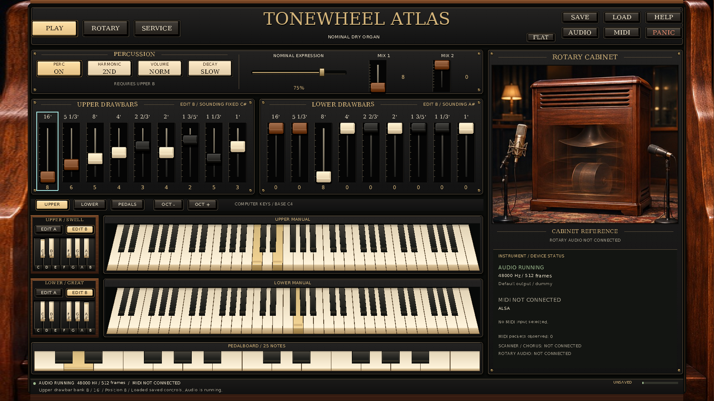
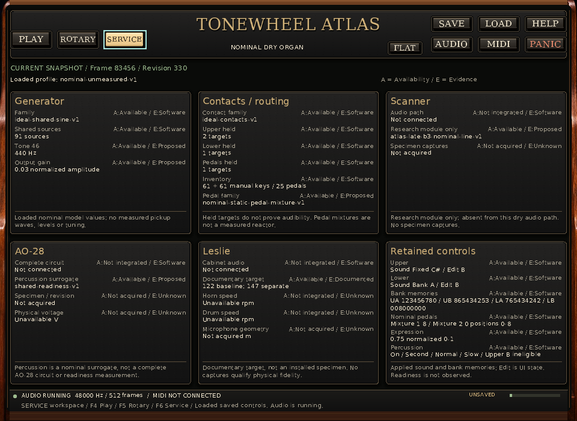
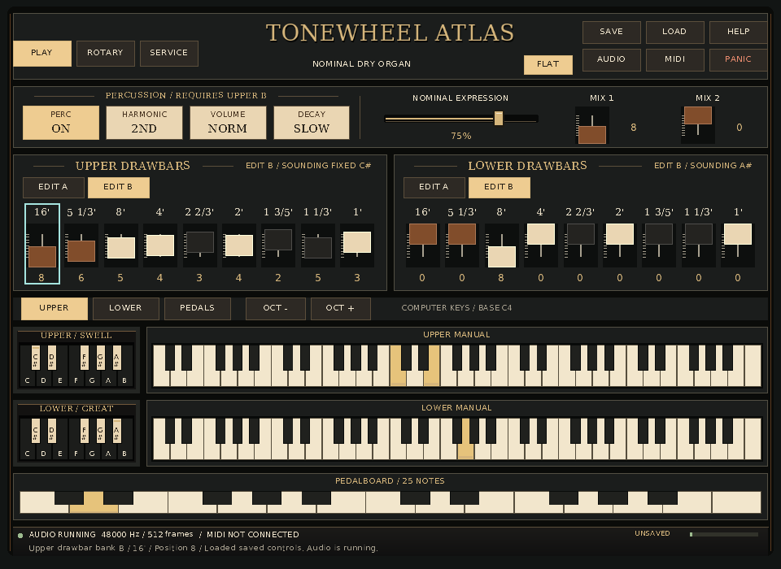

# Hammond B-3 Organ

**Current checkpoint:** all **60 actual assignments in ten waves** are accepted, the [strict record check](docs/development/2026-11-14-interface-continuation/completion-check.json) passed, and [all twelve hosted jobs](docs/development/2026-11-14-interface-continuation/reports/a58-final-head-hosted.json) passed at `a517203`. [The current handoff](docs/INTERFACE_RECOVERY_HANDOFF.md) gives setup, the complete plan, remaining visual/desktop gates and safe recovery of the original local evidence.

A C++20 Hammond B-3/AO-28 and Leslie research instrument, guided by the repository's **500-page atlas**. The current playable product is a **nominal dry organ** with an offline renderer, an optional VST3 adapter, and a native standalone application.

**Current development:** the native application now has **Play, Rotary and Service workspaces**, a complete **Flat mode**, perspective keyboards with shared drawing/hit geometry, and a read-only inspector built from copied state. It retains eighteen documentary fixed registrations, four A/B drawbar banks, Cancel, percussion, expression and two nominal pedal mixtures. The **47 sound parameters**, **`B3CONTROLS4`** writer and readers for versions 1–3 keep their existing meanings. Its 91 continuously running sources serve two 61-key manuals and 25 pedals.

[Build and operate the instrument](docs/INTERFACE_RUNBOOK.md) · [Current status](docs/STATUS.md) · [Next steps](docs/NEXT_STEPS.md) · [Complete M0–M9 plan](docs/PLAN.md) · [Current development record](docs/development/2026-11-14-interface-continuation/README.md)

## Native interface and UI/UX design

The visual target is the atlas's [original cover/page-409 reference](docs/design/atlas-cover-reference.jpg), retained with [exact provenance](docs/design/atlas-reference.json). The live interface uses walnut cheeks, charcoal and brass panels, a centered serif title, raised tablets and drawbar caps, adjacent drawbar racks, and a cabinet composition at wide sizes. The manuals have projected top and front faces; drawing, pointer hit regions and inset focus use shared geometry.



This **final v2 gallery contains eight actual native application captures**, made on 14 November 2026 from published product source `8673713a484c40e26ac7810c7c4cbc22fa874426`. The [gallery and reproduction instructions](examples/demos/standalone-interface-preview-v2/README.md) and [final visual/provenance review](docs/reviews/INTERFACE_FINAL_GALLERY.md) retain the exact source/executable identities, A44 build/package basis, unchanged-input checks, source-subset limits, diagnostics, replay inputs and decoded PNG identities. Concurrent workflow, test-budget and documentation edits are outside that rendered product inventory.

The frame shows Upper fixed C#, Lower adjustable **bank A (preset A#)**, held Upper notes 60/64, Lower note 67 and pedal 3. A live keyboard edit changes the retained Upper B 16-foot drawbar from 7 to 8 while the fixed registration continues sounding; the Lower rack still displays its independently edited bank B. All eight processes passed the capture, applied-control, painted-view, held-owner and joined-shutdown checks. They explicitly used **SDL dummy audio/video and software rendering**, at 48 kHz stereo float with 512-frame buffers; the compiled ALSA MIDI backend opened and enumerated no input. These frames qualify the recorded application path and pixels. Real display/DPI, persistent pointer capture and physical audio/MIDI remain separate gates. The [provisional v1 gallery](examples/demos/standalone-interface-preview-v1/README.md) and [earlier preset captures](examples/demos/standalone-presets-preview-v1/README.md) remain unchanged historical evidence.

| Interface area | Implemented behavior | Reference and evidence boundary |
|---|---|---|
| Header and workspaces | Play, Rotary and Service tabs; Save, Load, Help, Audio, MIDI, Panic and Flat remain visible in every workspace. F4/F5/F6 changes workspace; F7 toggles Flat. | Three tabs follow the reference navigation. The current native title is centered; real tools replace the concept's decorative preset/settings block. |
| Play surface | Four correct percussion choices, expression, two pedal mixtures, nine visible drawbars per manual, independent Edit A/B and four retained banks. | Correct footage, 0–8 values and percussion meanings remain authoritative. Scanner controls are absent because scanner audio is not connected. |
| Manuals and pedals | Two complete 61-key manuals and 25 pedals; perspective top/front faces, visible held state and inset focus. | Flat uses rectangular keys and plain surfaces while retaining the same musical controls. Shared geometry and earlier native raster/input gates are distinct from physical pointer qualification. |
| Reversed preset keys | C Cancel, nine fixed choices C#–A, A# for bank A and B for bank B on each manual. Applied, pending and focused states are distinct. | All 24 keys remain visible. The final renderer enlarges the accidental legends over two lines; small labels still need native display/DPI review. |
| Rotary | Cabinet reference artwork and six read-only facts about the audio path, documentary target, artwork, rotor speeds, microphone geometry and brake. | The cabinet image is explicitly decorative. Cabinet audio is not connected; rotor speed is unavailable, geometry is unacquired, and Stop/brake is not modeled. |
| Service | Six cards and 28 rows cover generator, contacts/routing, scanner, AO-28, Leslie and retained controls. Current, retained, stopped, unprepared and unavailable observations have distinct captions. | Applied sound, UI edit selection, pending requests, availability and evidence remain separate. Unknown physical values appear as unavailable V/rpm or unacquired m, rather than invented zeros. |
| Focus and input | 71 focus stops in Play; ten common stops in Rotary/Service. Each workspace remembers focus. Hidden Play controls reject new activation; original held notes keep their release ownership. | Switching workspace, Flat mode or size does not change the 47 sound parameters, saved-control meaning or note ownership. The gallery exercises keyboard navigation and one live retained-bank edit. |
| Resize | Reference 1672×941, default 1280×900 and minimum 960×700. The Play cabinet column hides below width 1400; compact Edit controls move into the racks; all preset keys remain visible. | The eight decoded PNGs cover Play at all three sizes, Service/Rotary at reference and minimum, and Flat Play at minimum. They are logical/drawable 1:1 captures, not physical high-DPI qualification. |

| Service at the minimum size | Flat Play at the minimum size |
|---|---|
|  |  |

The application renders native labels, live values, cap positions, focus and held indicators; applied sound values come from copied state. Image assets supply decoration. The [workspace](docs/INTERFACE_WORKSPACE_CONTRACT.md), [geometry](docs/INTERFACE_GEOMETRY_CONTRACT.md) and [inspection](docs/INTERFACE_INSPECTION_CONTRACT.md) contracts define that boundary. **Literal 1:1 reference equality remains unmet.** The native panels have smoother gradients and simpler bevels than the concept's textured surfaces and lighting; the separate computer-key row, smaller preset blocks and shallower full manuals allocate space differently. The application adds 25 pedals, 24 reversed presets, status text and real header tools, while omitting the concept's unconnected vibrato, microphone and rotor controls. The cabinet crop is decorative and its native panel is composed differently. The [visual review](docs/reviews/INTERFACE_FINAL_GALLERY.md#comparison-with-the-original-reference) records these remaining differences. Native screen-reader semantics, connected scanner/AO-28/Leslie models and specimen-specific fidelity remain separate product and model gates.

## External MIDI and playing

MIDI is an explicitly enabled build option using locked RtMidi 6.0.0 with a recorded preparation correction. Linux uses ALSA, Windows uses WinMM and macOS uses CoreMIDI. The ordinary build needs no MIDI SDK. An enabled application starts with no selected input; connect one exact, unique port through **MIDI / Ctrl+M** or `--midi-port`.

| Division | Default wire channel | Accepted notes | Drawbar controllers |
|---|---:|---|---|
| Upper | 1 | MIDI 36–96 | CC16–24, retained Upper B bank. |
| Lower | 2 | MIDI 36–96 | CC16–24, retained Lower B bank. |
| Pedals | 3 | MIDI 36–60 → pedal IDs 1–25 | CC16–17, the two nominal pedal mixtures. |

Choose three distinct channels from 1–16. CC11 adjusts shared expression; CC123 releases the selected MIDI division. Steady organ gain does not follow Note On velocity. MIDI and UI have separate note owners, so disconnecting the controller preserves an independently held UI note. Device faults retire old packets and notes; reconnect is explicit after a fault, Panic or audio restart. Arrival order is retained and admitted events apply at the next audio callback boundary.

Computer keys `A W S E D F T G Y H U J K O L P ;` play notes. F1/F2/F3 choose Upper/Lower/Pedals; `[` and `]` change octave. F4/F5/F6 selects Play/Rotary/Service and F7 toggles Flat; computer-piano playing remains available in every workspace. EDIT A/B chooses the bank being edited. Preset A# sounds adjustable bank A and preset B sounds bank B; C# through A select the nine fixed rows for that manual. C cancels its route while retaining the fixed choice, bank memory and held notes. Fixed selections preserve all four editable banks. Upper percussion sounds only on the enabled adjustable Upper B route; switching selections preserves its musical history. Save/Load retain raw control memory and exclude note owners, device selections and transient DSP history.

See the [operating guide](docs/INTERFACE_RUNBOOK.md), [exact input mapping](docs/MIDI_INPUT.md), [backend lifetime contract](docs/MIDI_BACKEND.md) and [optional dependency setup](docs/RTMIDI_BUILD.md). Bounded [`B3MIDIREPLAY1`](docs/MIDI_REPLAY.md) scripts exercise the actual application input path for acceptance; their diagnostics explicitly identify synthetic input.

## Plan, qualification and parallel tracks

The [complete atlas review](docs/research/INTERFACE_ATLAS_REVIEW.md) covers all 500 pages in six disjoint readings. The atlas's ten research waves, implementation milestones M0–M9 and each requested sixty-worker development session have separate meanings. The [current manifest](docs/development/2026-11-14-interface-continuation/assignments.json) records actual dispatched workers and accepted evidence; earlier sessions remain historical.

The current M9 slice connects workspace navigation, perspective/Flat rendering and copied-state inspection to the existing instrument. All **sixty actual assignments in ten waves** are accepted in the current manifest, and the [executed strict check](docs/development/2026-11-14-interface-continuation/completion-check.json) records sixty substantive notes and zero errors. At `a517203`, [all twelve hosted jobs passed](docs/development/2026-11-14-interface-continuation/reports/a58-final-head-hosted.json): each of the four standalone Release jobs passed 38/38 with six workspace methods and thirty actual native processes; the focused native sanitizer/leak job passed thirteen selected suites. The [earlier recovery attempt](docs/reviews/INTERFACE_HOSTED_RECOVERY.md) retains its nine successes and three unexecuted macOS cancellations, while b1's actual macOS 37/38 failure and the final local 146/147 result remain historical. The repaired source, full scripts, command counts, Save assertions and deadlines are unchanged between the recovered and qualified commits. The [recovery record](docs/development/2026-11-14-interface-continuation/reports/root-workspace-recovery.json) names the original local evidence that remains unavailable. Use the [current handoff](docs/INTERFACE_RECOVERY_HANDOFF.md) for setup and next actions; literal visual equality, the full desktop journey, physical devices/hosts, accessibility, timing and specimen fidelity remain open.

| Track | Current boundary and continuation |
|---|---|
| Dry organ and console | Working nominal generator, manuals, pedals, eighteen fixed registrations, retained banks, percussion and control-state migration. Physical contact, gain/loading, expression and circuit calibration remain open. |
| Scanner | Graph/compiler, references and prepared numerical modules exist. Resolve the observed G5 same-hertz failure under the [frozen numerical contract](docs/SCANNER_NUMERICAL_CONTRACT.md) before Engine integration; see [handoff](docs/SCANNER_HANDOFF.md). |
| AO-28 and Leslie electronics | Complete revision-specific electrical graphs, operating points and measured signal boundaries remain required by M5/M6. |
| Rotary acoustics | The independent [motion/propagation track](docs/ROTARY_SCOPE.md) retains separate horn/drum inputs and numerical references; it does not change the current dry output. |
| Capture and calibration | The completed [toolchain](docs/CALIBRATION_HANDOFF.md) validates audio/corpora, declared splits, policies, studies and exact report replay. The [next acquisition plan](docs/CALIBRATION_NEXT_ACQUISITION.md) names the missing real inputs. |
| VST3 | Three event inputs, 47 controls, sample-linear automation and concurrent state handoff have [current integration](docs/reviews/PRESET_VST3_INTEGRATION.md), [independent acceptance](docs/reviews/PRESET_VST3_ACCEPTANCE.md) and [build](docs/VST3_BUILD.md) records. Its custom editor and actual host/device qualification remain product work. |

### Earlier source-identified qualifications

These records qualify their named revisions and preserve earlier failures and platform distinctions. They do not substitute for testing the current interface implementation.

| Record | Retained evidence |
|---|---|
| [Standalone platform audit](docs/reviews/STANDALONE_FINAL_PLATFORM_AUDIT.md) | Ten successful hosted jobs at `6214032f`, including platform builds and package-byte/relocation inspection. |
| [Standalone integrated closure](docs/reviews/STANDALONE_CONCURRENT_CALIBRATION_INTEGRATION.md#published-closure-and-completed-hosted-qualification) | `27209a7f` retained sixty accepted standalone records and all ten hosted jobs: core 103/103, standalone 14/14 per platform, VST3 8/8 Linux and 7/7 Windows/macOS. |
| [Calibration hosted matrix](docs/reviews/CALIBRATION_FINAL_HOSTED.md) | Ten successful jobs at `d7f6100`, including 106/106 core suites in each configured platform job. |
| [Original native window](examples/demos/standalone-window-v1/README.md) and [chapel audition](examples/demos/standalone-chapel-v1/README.md) | Historical native images, control registrations, exact source/runtime provenance and declared dummy-device limits remain unchanged. |

The selected sound models remain **nominal and unmeasured**. The [project guide](docs/PROJECT_GUIDE.md), [status](docs/STATUS.md) and [next steps](docs/NEXT_STEPS.md) distinguish implementation, observed qualification and acquisition. [AGENTS.md](AGENTS.md) gives every future agent the standing workflow: inspect current work, preserve other tracks, test coherent source, update the handoff and actual UI captures, then commit and publish authorized completed changes to `main` with a verified revision.

## Build and test

The independent [capture/calibration toolchain](docs/CALIBRATION_SCOPE.md)
provides audio inspection, complete declared corpus/split auditing, fixed policies,
file jobs, bounded studies, declaration readiness and complete-report replay.
The [runbook](docs/CALIBRATION_RUNBOOK.md) gives source and movable CaptureTools
setup with explicit expected outcomes. The [acquisition sequence](docs/CALIBRATION_NEXT_ACQUISITION.md)
names the actual next inputs; its [session record](docs/development/2026-11-13-calibration/README.md)
keeps this work separate from other tracks. Synthetic examples do not supply
physical recordings or fitting/calibration evidence.

Requirements: a C++20 compiler, CMake 3.21 or newer, and Python 3.10 or newer.
The core and authoring compiler need no downloaded audio/GUI framework.

```sh
cmake --preset debug
cmake --build --preset debug
ctest --preset debug
```

The build validates the authoring JSON and generates `build/nominal.b3p`.

Render a two-second dry registration (Linux/macOS single-configuration build):

```sh
cmake -E make_directory out
./build/hammond_render --profile build/nominal.b3p --output out/dry-organ.wav \
  --frames 96000 --sample-rate 48000 --block-size 64 --seed 0 \
  --drawbars 888000000 --note 60 --fail-on-clip
```

The output is stereo PCM16 with identical dry channels. Existing output files
are preserved; choose a new filename for another render. The CLI reports profile
identity, peak, RMS and clipping as JSON. See the [offline contract](docs/RENDER_FORMAT.md)
for event files, strict limits and the hard-link filesystem requirement.

See [build instructions](docs/BUILD.md) for explicit commands, Release and
sanitizer builds, and platform qualification limits.
The [OfflineTools local install](docs/OFFLINE_INSTALL.md) places the renderer,
inspection tools, both trace plotters, compiled profile and event fixtures in a
relocatable prefix of your choice.

### Native application with MIDI

Install the platform development prerequisites in the [operating guide](docs/PRESET_RUNBOOK.md), then explicitly acquire the two locked dependencies outside the repository:

```sh
python3 tools/acquire_sdl2.py --destination ../SDL2
python3 tools/acquire_rtmidi.py --destination ../rtmidi-6.0.0
cmake -S . -B build-standalone -DCMAKE_BUILD_TYPE=Release \
  -DHAMMOND_BUILD_STANDALONE=ON -DHAMMOND_SDL2_ROOT=../SDL2 \
  -DHAMMOND_ENABLE_MIDI=ON -DHAMMOND_RTMIDI_ROOT=../rtmidi-6.0.0
cmake --build build-standalone --config Release
```

For a Linux/macOS single-configuration build:

```sh
./build-standalone/apps/standalone/hammond_standalone --list-midi
./build-standalone/apps/standalone/hammond_standalone
```

Open MIDI / Ctrl+M to choose an exact input and its three channels. The guide gives Windows and multi-configuration paths, explicit port selection, synthetic acceptance commands, and the [fresh-prefix Standalone installation](docs/STANDALONE_INSTALL.md). `HAMMOND_ENABLE_MIDI=OFF` preserves the unavailable physical-backend configuration and requires no RtMidi checkout; the native window still requires its explicitly acquired SDL2 dependency.

## Repeatable audio examples

Listen to the [three-second two-manual and pedal phrase](examples/demos/pedal-phrase-v1/bundle/render.wav).
The [retained package](examples/demos/pedal-phrase-v1/README.md) contains the actual
48 kHz stereo WAV, score, unchanged profile, schema-3 evidence, seven PCM analysis
windows and a source inventory. Its [independent acceptance](docs/reviews/PEDAL_DEMO_ACCEPTANCE.md)
checks every archived source blob, exact input/audio bytes, component renders,
block partitions, relocation and deliberately altered bundles. The recording is
synthetic nominal-model evidence. The [pedal trace plots](docs/PEDAL_TRACE_PLOTS.md)
show separate bounded diagnostic scenarios with their exact CSV identities.

Listen to the [two-second nominal console example](examples/rendered/nominal-console-v2/bundle/render.wav).
Its [evidence package and replay instructions](examples/rendered/nominal-console-v2/README.md)
demonstrate partial key travel, shared percussion, lower-manual independence,
Cancel/reselection and percussion masking. The schema-2 bundle retains the score,
profile, logs, identities and independent PCM checks. Its linked partial-key
CSV/SVG illustrates a **separate 120 ms diagnostic scenario**, not the WAV's score.
The [trace contract](docs/CONSOLE_TRACE.md) and [plot contract](docs/CONSOLE_TRACE_PLOTS.md)
explain exactly what these diagnostics show and how they are reduced for display.

The original [four-second dry-organ example](examples/rendered/nominal-two-manual-v1/bundle/render.wav)
and its [evidence package](examples/rendered/nominal-two-manual-v1/README.md) remain
available for the earlier ideal-contact, percussion-off behavior.

[Five short event fixtures](examples/README.md) exercise both manuals, A4 pitch,
coherent foldback, and bank/Cancel behavior. The [evidence wrapper](docs/RENDER_EVIDENCE.md)
retains exact inputs, renderer hashes, logs and WAV statistics. The independent
[PCM analyzer](docs/AUDIO_MEASUREMENTS.md) measures serialized samples and can
check the steady portion of a declared single-tone fixture. The independent
[bundle verifier](docs/RENDER_VERIFICATION.md) checks retained artifacts, claims
and metrics without trusting the producer’s Boolean assertions. These outputs are
synthetic engineering evidence.

[Core/offline CI](docs/CI.md) covers Linux GCC, macOS AppleClang and Windows
MSVC Release, plus Linux ASan/UBSan with leak checking. The separate
[native workflow](docs/VST3_CI.md) builds and tests actual bundles; it has its own
platform and payload qualification. The [final platform audit](docs/reviews/PEDAL_FINAL_PLATFORM.md)
retains exact revisions, complete test output, artifact identities, actual failed
runs and their repairs. [Current status](docs/STATUS.md) distinguishes published
code, executed checks and pending gates. Neither a workflow dispatch nor a
bundle inventory alone proves plug-in execution or DAW/device readiness.

## Project navigation

| Document | Purpose |
|---|---|
| [Project guide](docs/PROJECT_GUIDE.md) | Practical reading order, workflows, evidence boundaries and session ledgers |
| [Status](docs/STATUS.md) | What is implemented, what passed, and what remains provisional |
| [Next steps](docs/NEXT_STEPS.md) | Next concrete tasks, dependencies and acceptance evidence |
| [Current interface handoff](docs/INTERFACE_RECOVERY_HANDOFF.md) | Current source, setup, complete M0–M9 boundaries, sixty-worker accounting, recovery and concrete next actions |
| [Earlier standalone handoff](docs/STANDALONE_HANDOFF.md) | Historical native window setup, controls, replay, chapel audition, benchmark and named-revision qualification |
| [Scanner handoff](docs/SCANNER_HANDOFF.md) | Numerical source, executed gates and the unresolved same-hertz integration decision |
| [Calibration handoff](docs/CALIBRATION_HANDOFF.md) | Complete capture pipeline, verified operations, source identities and next acquisition |
| [Offline and pedal handoff](docs/PEDAL_HANDOFF.md) | Retained render, evidence, plot, install and pinned VST3 commands |
| [Standalone session](docs/development/2026-11-13-next-phases/README.md) | This session's actual assignments, evidence and completion accounting |
| [Remaining M3 and scanner gate](docs/M3_REMAINING_AND_SCANNER_GATE.md) | Concrete model, numerical-oracle and acquisition prerequisites for next development |
| [Pedal session checks](docs/PEDAL_SESSION_CHECKS.md) | Validate the separately completed pedal session's sixty assignments |
| [Previous console handoff](docs/CONTINUATION_HANDOFF.md) | Dated console identities and commands; use current status/next steps for later pedal/native work |
| [Original pedal gate](docs/M3_NEXT_GATE.md) | Retained acceptance contract for the implemented routing kernel; current work is in Next steps |
| [Acceptance matrix](docs/ACCEPTANCE_MATRIX.md) | M0-M9 requirements, actual evidence and open gates |
| [Release readiness](docs/RELEASE_READINESS.md) | Current prototype, unresolved product/distribution gates and retained historical assessment |
| [Retained pedal platform audit](docs/reviews/PEDAL_FINAL_PLATFORM.md) | Named earlier core/native runs, failures, repairs and verified artifact identities |
| [Final session audit](docs/reviews/PEDAL_SESSION_FINAL_AUDIT.md) | Independent completed pedal-session accounting, full source coverage and historical handoff review |
| [Original session handoff](docs/SESSION_HANDOFF.md) | Preserved commands and evidence for the original session's dated checkpoint |
| [Original assignment ledger](docs/development/AGENT_LEDGER.md) | Original 60 assignment slots; separate from the new continuation |
| [Development log](docs/DEVELOPMENT_LOG.md) | Actual changes, commands, results and limitations |
| [Full project plan](docs/PLAN.md) | Atlas M0-M9 implementation sequence and exit gates |
| [Agent instructions](AGENTS.md) | Mandatory workflow and durable handoff for every future agent |
| [Implementation contract](docs/IMPLEMENTATION_CONTRACT.md) | Initial scope and architecture |
| [Profile contract](docs/PROFILE_FORMAT.md) | Typed, bounded authoring/runtime boundary |
| [Engine interface](docs/ENGINE_API.md) | Timing, key ownership, source/mix behavior |
| [Console controls](docs/CONSOLE_EXTENSION.md) | Retained banks and Cancel/panic separation |
| [Control state format](docs/CONTROL_STATE_FORMAT.md) | Bounded control-only save/load |
| [Console dynamics](docs/CONSOLE_DYNAMICS.md) | Independent contacts, shared percussion, timing and evidence boundaries |
| [Console acceptance](docs/CONSOLE_ACCEPTANCE.md) | Independent PCM and evidence-bundle checks for the nominal model |
| [Console traces](docs/CONSOLE_TRACE.md) | Sample-by-sample contact, readiness, routing, phase and audio diagnostics |
| [Trace plots](docs/CONSOLE_TRACE_PLOTS.md) | Bounded standalone SVG views of key motion, contacts, readiness and audio |
| [Model metadata](docs/MODEL_METADATA.md) | Export the actual compiled nominal factory values and units |
| [Internal parameters](docs/PARAMETERS.md) | 47 current control identities; the first 45 records retain their meanings |
| [Native parameter bridge](docs/PARAMETER_BRIDGE.md) | Allocation-free conversion of normalized controls into fixed Engine targets |
| [Note ownership](docs/NOTE_OWNERSHIP.md) | Bounded channel/note-ID ownership and original-route retention |
| [Manual input transaction](docs/INPUT_PROCESSOR.md) | Retained manual-only ownership facade |
| [Combined input transaction](docs/PERFORMANCE_INPUT.md) | One ordered manual/pedal/control stream with atomic ownership and Engine commit |
| [Pedal note ownership](docs/PEDAL_NOTE_OWNERSHIP.md) | Explicit pedal identities, overlapping owners and scoped releases |
| [Pedal Engine](docs/PEDAL_ENGINE.md) | Actual same-frame routing, nominal voice and tagged diagnostics |
| [Pedal phrase](docs/PEDAL_DEMO.md) | Retained three-second source/inventory/audio package and replay |
| [Pedal plots](docs/PEDAL_TRACE_PLOTS.md) | Bounded provenance-preserving SVGs of positions, buses, contacts and audio |
| [Pedal evidence](docs/PEDAL_RENDER_EVIDENCE.md) | Current schema3 and strict historical schema1/2 verification |
| [Legacy audio compatibility](docs/PEDAL_LEGACY_COMPATIBILITY.md) | Exact local replay of all eight original scores against the frozen starting revision |
| [Native VST3 build](docs/VST3_BUILD.md) | Explicit pinned SDK acquisition, bundle build and validation |
| [Native ABI acceptance](docs/VST3_ABI_ACCEPTANCE.md) | Actual factory, parameters, buses, lifecycle and reference audio |
| [Native behavior acceptance](docs/VST3_BEHAVIOR_ACCEPTANCE.md) | Automation, state, capacity and transactional rejection on the loaded module |
| [Native CI](docs/VST3_CI.md) | Separate platform jobs, complete logs and actual bundle inventories |
| [Host timeline](docs/HOST_TIMELINE.md) | Sample-linear curves, exact discrete thresholds and boundary carry |
| [Concurrent state exchange](docs/STATE_EXCHANGE.md) | Bounded pending restores and coherent UI/audio publication |
| [Sample-rate lifecycle](docs/SAMPLE_RATE_LIFECYCLE.md) | Preserve phases, contact history and shared readiness across supported rate changes |
| [Pedal routing](docs/PEDAL_ROUTING.md) | Documentary 25-by-8 map and prepared four-bus reference routing |
| [Factory comparison](docs/FACTORY_REFERENCE.md) | Two independent Table III readings and complete routing comparison |
| [Factory runtime gate](docs/FACTORY_RUNTIME_ACCEPTANCE.md) | All manual routes exercised against CSV-selected expectations |
| [Console demo](examples/rendered/nominal-console-v2/README.md) | Two-second schema-2 audio bundle and a separate partial-key diagnostic plot |
| [Original demo replay](docs/DEMO_REPLAY.md) | Retained four-second example, independent integrity checks and local replay |
| [M3 acceptance contract](docs/M3_ACCEPTANCE_CONTRACT.md) | Contact, percussion and history requirements behind the implemented nominal console |
| [Capture contract](docs/CAPTURE_FORMAT.md) | Planned/recorded metadata, explicit unknowns and optional byte verification |
| [Acquisition protocol](docs/CAPTURE_PROTOCOL.md) | Prioritized physical captures, admission gates and holdout grouping |
| [Offline format](docs/RENDER_FORMAT.md) | Renderer and event-fixture contract |
| [Numerical bounds](docs/NUMERICAL_BOUNDS.md) | Preparation limits and finite-window drift evidence |
| [Benchmark](docs/BENCHMARKING.md) | Bounded workload timing with explicit limitations |
| [Repository checks](docs/REPOSITORY_CHECKS.md) | Source, navigation, local links and data integrity |
| [Continuation record checks](docs/CONTINUATION_CHECKS.md) | Separate actual assignment states in the [continuation manifest](docs/development/2026-11-13-continuation/assignments.json) and its explicit final completion gate |
| [Dependencies and rights](docs/DEPENDENCIES_AND_RIGHTS.md) | Actual distributed material, provenance, notices and unresolved permissions |
| [Complete atlas review](docs/research/ATLAS_REVIEW.md) | Full 500-page coverage, milestone interpretation and source limits |
| [Source manifest](docs/research/source-manifest.json) | Preserved PDF identity and missing companion assets |
| [Original review notes](docs/development/agent-notes/) | Historical original-session assignments and retained evidence |
| [Completed pedal/native session](docs/development/2026-11-13-pedals/README.md) | Retained sixty-assignment ledger, owned notes, integration records and historical handoff |
| [Console continuation](docs/development/2026-11-13-continuation/README.md) | Historical completed sixty-agent, ten-wave ledger and console integration checkpoints |

## Source and evidence

The [research atlas](Hammond_B3_Leslie_Research_Atlas_500pp.pdf) contains 80 chapters
across 500 pages. Six disjoint review assignments covered every page and visually
checked important tables/figures. The PDF's referenced companion files were not
included in the baseline repository; new code/data are labeled reconstructions.

The baseline generator profile specifies 91 shared sources, explicit 61-by-9 manual
routing, normalized amplitude, proposed initial phases and 12-TET tuning. Hardware
identity, production gearing, pickup calibration, contact timing, circuit response,
rotor behavior and acoustics remain acquisition/validation work. Historical G-G
service readings are not used as oscillator amplitudes.

Two independent direct-image factory-table transcriptions now corroborate every
manual assignment and pedal position in the retained data. Their comparison is
documentary routing evidence; source tuning and physical calibration remain open.
The [dependency and rights inventory](docs/DEPENDENCIES_AND_RIGHTS.md) and
[third-party notices](THIRD_PARTY_NOTICES.md) record applicable source boundaries
and unresolved permissions; this repository has no selected project-wide license.

Every future development session must update status, next steps and the development
log, retain real verification evidence, and commit/push completed work under the
standing repository workflow in `AGENTS.md`.
