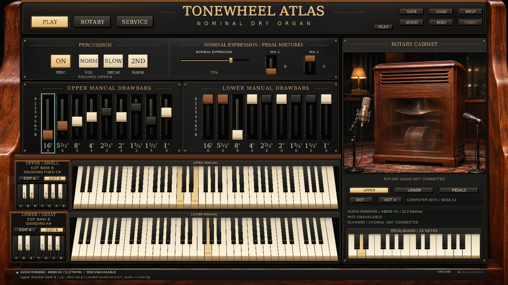
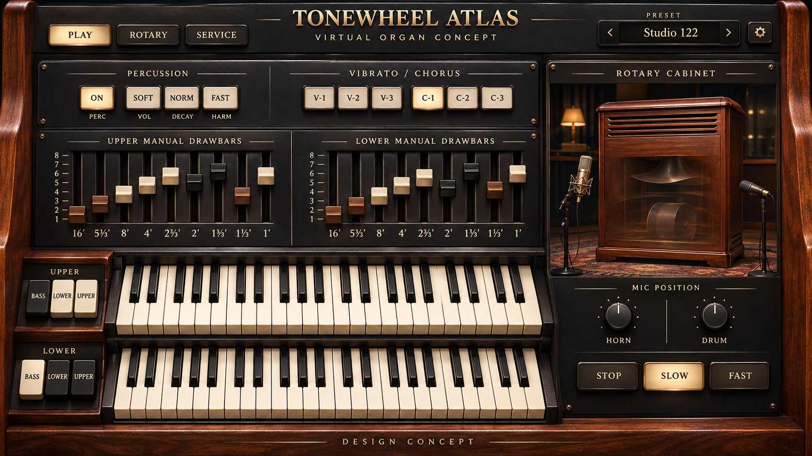

# Hammond B-3 Organ

A C++20 Hammond B-3/AO-28 and Leslie research instrument, guided by the repository's **500-page atlas**. The playable instrument is a **nominal dry organ** with a native standalone application, an offline renderer and an optional VST3 adapter. Its musical core has 91 continuously running sources, two 61-key manuals, 25 pedals, eighteen documentary fixed registrations, four retained drawbar banks, percussion and shared expression.

<!-- console-completion-summary:start -->
<a id="current-development-p1-console-plate-and-library-foundation"></a>
<a id="current-integrated-source"></a>

## Current development: combined reference interface and library foundation

The live interface now combines **T2 rack headings, the T3 revision-2 brass
title, the warmer H1 header and the darker P1 percussion/expression plate**.
The runtime preserves initial MIDI-dialog focus and gives workspace,
presentation and overlay transitions an actual paint opportunity. Live values,
shared hit geometry, complete manuals/pedals, Flat mode and truthful dry-audio
labels remain intact.



[Original reference](docs/design/atlas-cover-reference.jpg) ·
[Direct comparison and all views](#current-native-interface) ·
[Capture provenance](docs/design/native-gallery-console-combined/provenance.json)

**LibraryModel and `UiModel::recall_controls` are implemented foundations.**
They cover catalog/selection/draft state, named operations and acknowledgements,
with Registration and Performance recall policies. The native browser, main-loop
library wiring and a native `--library` option remain absent. Generic Load
continues to restore complete saved controls, including expression.

This heading/title/header continuation completed **60 accepted distinct workers
in ten waves of six**, with fresh textual coverage of **all 500 atlas pages**.
The [actual ledger](docs/development/2026-11-16-heading-title-continuation/assignments.json), [strict record result](docs/development/2026-11-16-heading-title-continuation/reports/helper-worker-strict.json)
and [reading receipt](docs/development/2026-11-16-heading-title-continuation/reports/atlas-reading-coverage.json) retain the evidence.
Follow-ups keep their original identities and add no worker credit.
The [console owner's ledger](docs/development/2026-11-16-console-completion/assignments.json) is a separate record.

### Exact-source delivery

[Source publication](docs/development/2026-11-16-heading-title-continuation/reports/combined-main-publication.json): `54859886268ce83c36f359c43327f7c72a77ae82`,
tree `f5f8f037af301f8b1ff5b9b4a00ff5581647667a`. This is the tested implementation published on main. All sixteen required jobs completed successfully on attempt 1. Later documentation/evidence commits retain a separate source-equivalence boundary; retrieve the actual live HEAD instead of assuming it is this tested commit.

| Workflow | Required jobs | Actual outcome at this source |
| --- | ---: | --- |
| Core | 6 | 6/6 jobs passed: five 209/209 registered CTest suites and full R4 qualification [run 44038196587](https://github.com/tomasedisonn80/Hammond-B3-Organ/actions/runs/44038196587) |
| Native standalone | 6 | 6/6 jobs passed: five normal 78/78 suites; sanitizer 41/41 [run 44038196285](https://github.com/tomasedisonn80/Hammond-B3-Organ/actions/runs/44038196285) |
| Native VST3 | 4 | 4/4 jobs passed: 29 native CTests; actual module validator 47/0 on each platform [run 44038196255](https://github.com/tomasedisonn80/Hammond-B3-Organ/actions/runs/44038196255) |

The [complete terminal matrix](docs/development/2026-11-16-heading-title-continuation/reports/combined-ci-complete.json) records job IDs, attempts and outcomes. Root’s [source/input-equivalence record](docs/development/2026-11-16-heading-title-continuation/reports/combined-final-integrity.json)
identifies the verification stage and inputs compared with this tested source.
Root owns the final staged repository/ledger checks and guarded documentary
publication; use that receipt’s recorded execution and outcome.

Independent completed reviews: [Core](docs/development/2026-11-16-heading-title-continuation/reports/a52-helper-core-hosted/array-successor/combined-main-core/CORE_REVIEW.md) · [Standalone](docs/development/2026-11-16-heading-title-continuation/reports/a53-helper-standalone-hosted/array-successor/combined-main-standalone/review.md) · [VST3](docs/development/2026-11-16-heading-title-continuation/reports/a54-helper-vst3-hosted/array-successor/combined-main-vst3/review.md). Recover actual live HEAD, tree and fresh remote state from the
[checkpoint](docs/development/2026-11-16-heading-title-continuation/CHECKPOINT.md) before new work. A documentation descendant
does not create new native execution or replace any earlier failed result.

**Literal whole-interface 1:1 remains unmet and unwaived.** The
[remaining UI work](#remaining-reference-and-usability-work), [next implementation
sequence](docs/NEXT_STEPS.md) and [full M0–M9 plan](docs/PLAN.md)
retain the native library, real-display/accessibility, connected audio,
physical-calibration and product-release requirements.
Build and operate the app with [Getting started](#getting-started) and the
[normal desktop setup guide](docs/CONSOLE_SETUP_AND_HANDOFF.md).

<!-- console-completion-summary:end -->

<!-- heading-title-continuation-summary:start -->
## Retained heading/header and console evidence

T2 and T3 each retain their separate **158-pair** comparisons; H1 retains
**103/103 canonical criteria** versus 44 before; P1 retains its original
**62 numerical screens and 34 pairs**. The
[UI design table](#what-changed-in-the-ui-design), [source-specific evidence](#source-specific-qualification)
and [development history](docs/DEVELOPMENT_LOG.md) preserve those bounded results,
the original failed candidates and later portability corrections.
The displayed combined gallery has its own source/capture identities.
[Earlier installed H1 captures](docs/design/native-heading-final/README.md)
remain historical evidence; they are not the current P1 composition.
<!-- heading-title-continuation-summary:end -->

The concurrent [UI-delivery continuation](docs/development/2026-11-16-ui-delivery/README.md)
and its [accepted T3 gallery](docs/design/native-gallery-ui-delivery-title/manifest.json)
remain preserved with their own source-specific reviews and worker ledger.
The combined source retains its stricter title-input validation, portable
comparison interfaces and [isolated smoke scheduling](docs/reviews/NATIVE_SMOKE_SCHEDULING_ADMISSION.md).
The H1, P1 and replay evidence retains its own source below; older captures
keep their original identities.


<!-- preset-library-continuation-summary:start -->
## Previous continuation: portable registrations and reference apron

The [previous session](docs/development/2026-11-16-preset-library-continuation/README.md)
read all 500 atlas pages afresh and implements M9 headless registration
inspection/import/materialization, full-state rendering with `--controls`, and
the reference-derived lower apron. The starter pack has **twelve original,
proposed-unmeasured recipes in 24 canonical files**; these are software examples
for the nominal dry Engine, not factory presets or measured instrument profiles.
The requested **60 distinct new workers in ten waves are complete and accepted**;
the [strict record check](docs/development/2026-11-16-preset-library-continuation/reports/final-session-validation.json)
passes with zero errors. Accepted work and source-specific publication evidence belong to the [actual ledger](docs/development/2026-11-16-preset-library-continuation/assignments.json)
and [recovery checkpoint](docs/development/2026-11-16-preset-library-continuation/CHECKPOINT.md).

[Portable registration quick start](#prepare-and-audition-portable-registrations) ·
[Complete operator guide](docs/REGISTRATION_GUIDE.md) ·
[Starter pack](data/registrations/starter-v1/README.md) ·
[Retained thirteen-view gallery](docs/design/native-gallery-preset-v1/README.md) ·
[Full M0–M9 plan](docs/PLAN.md)

At **canonical 1672×941 only**, the apron matches **32,544 exposed reference RGB
pixels** and preserves **56,016 live-footer pixels** exactly. Resizes use the
contract's nearest mapping. The [25-case paired comparison](docs/development/2026-11-16-preset-library-continuation/reports/apron-paired-final.json)
covers 61,780,011 pixels with no forbidden/footer changes and exact procedural
fallback. [Visual](docs/reviews/REFERENCE_APRON_VISUAL_ADMISSION.md) and
[interaction](docs/reviews/REFERENCE_APRON_INTERACTION_ADMISSION.md) admissions
qualify this narrow change. **Literal whole-interface 1:1 remains unmet and
unwaived**; [current images and residuals](#current-native-interface) make the
remaining differences reviewable.

The [verified follow-up publication](docs/development/2026-11-16-preset-library-continuation/reports/followup-publication.json)
is `cc6be852d616ec5887485e3fccc39ddb1db22006`, following `20739f6`. Its tree
`201e38b05901fa30e3d053b9c245829818a5b52e` exactly matches reviewed local commit
`503ed724eaeb3c31eae3c6f31b31cc9a2acd9eb3`; provider commit metadata differs. The later local full run
was **234/235**, followed by a passing focused report-link repair and six passing
Linux path-guard tests. Published Windows qualification now passes **202/202 core
tests and 61/61 native tests**, including the actual Unicode-checkout generator.
Ten executed hosted jobs pass; three macOS jobs had no runner or execution. See
[source-specific qualification](#source-specific-qualification).
<!-- preset-library-continuation-summary:end -->

## Parallel work and retained earlier stages

**Parallel runtime/interface continuation (separate owner):** [this session](docs/development/2026-11-16-runtime-continuation/README.md) has freshly covered all 500 PDF pages and is developing isolated causal contact audio plus reference-derived manual key materials. Its own [sixty-worker ledger](docs/development/2026-11-16-runtime-continuation/assignments.json) and [checkpoint](docs/development/2026-11-16-runtime-continuation/CHECKPOINT.md) record actual progress, validation and next actions. The recovered conversion/typography checkpoint is published as `f56b0f3`. New contracts receive independent admission before implementation; current progress is not final acceptance.

**Earlier conversion/interface continuation:** [this session](docs/development/2026-11-16-conversion-material/README.md)
has completed a fresh reading of all 500 atlas pages and implemented an explicit,
certified offline conversion from the fractional-contact model to the native
integer grid. The Lower drawbar rack now has its own directional material field;
both manual racks now use measured mixed-fraction footage typography. The requested sixty
workers in ten waves are tracked in the [actual ledger](docs/development/2026-11-16-conversion-material/assignments.json),
with recoverable progress in the [checkpoint](docs/development/2026-11-16-conversion-material/CHECKPOINT.md).
This continuation is still in progress; the ledger records actual accepted work.

[Conversion contract](docs/CONTACT_GRID_CONVERSION_CONTRACT.md) ·
[Install the converter](docs/CONTACT_GRID_CONVERSION_INSTALL.md) ·
[Retained T1 application captures](examples/demos/footage-typography-v1/README.md) ·
[Conversion-session scope](docs/development/2026-11-16-conversion-material/SCOPE.md) ·
[Full M0–M9 plan](docs/PLAN.md).

The converter's independent calculation retains all 71 tested inputs: 51 accepted
with exact agreement and 20 explicit refusals. Native comparison passes 557
processes with complete padded state and 19,233 block-count checks. The Lower
comparison preserves all pixels outside its declared surface across 98 genuine
pairs. Its original sampling failure and independently admitted correction are
retained separately. **Literal whole-interface 1:1 remains unmet and unwaived.**

The preceding [streaming/material session](docs/STREAMING_CONTINUATION_CLOSURE.md)
delivered the isolated causal trajectory and Upper-rack material. Its sixty
workers, 210-test gate and published platform results retain their own identities;
they do not count toward this continuation's staffing or current-source qualification.

The preceding [execution continuation](docs/development/2026-11-15-execution-continuation/README.md)
supplies the offline fractional-contact reference and canonical wide composition.
Its [36-fixture/four-factor study](docs/CONTACT_SWITCHING_RESULTS.md) and
[original composition gallery](examples/demos/whole-reference-layout-v1/README.md)
retain their own source identities and limits.

The earlier [audio continuation](docs/development/2026-11-15-audio-continuation/README.md)
adds prepared sparse source leakage with explicit offline gain (M2). Its
[six-file audition](examples/demos/source-leakage-audition-v1/README.md),
independent numerical/lifecycle/CLI checks and
[percussion-stage captures](examples/demos/standalone-audio-preview-v1/README.md)
retain their own source identities. The default dry sound and musical state
remain compatible. Separate harmonic-source work and its original 183-test
baseline remain in the [playable checkpoint](docs/development/2026-11-15-playable-continuation/CHECKPOINT.md)
and [reading record](docs/research/PLAYABLE_ATLAS_REVIEW.md).

The earlier [product continuation](docs/development/2026-11-15-product-continuation/README.md) delivered three practical areas:

| Area | Available now |
| --- | --- |
| **Native MIDI expression and channel modes — M9** | Set CC11 minimum, maximum and Normal/Inverted direction in the MIDI dialog or CLI. Scoped CC120, expression reset CC121 and the existing CC123 preserve distinct ownership and control behavior. [Operating guide](docs/MIDI_EXPRESSION_GUIDE.md) |
| **Live controls and copied state — M9** | Complete fitted footage labels, separate **EDIT BANK** / **SOUNDING** captions, retained drawbar banks and explicit pending/applied state. The current composition relocates these live elements; the MIDI dialog retains explicit calibration and connection state. [Earlier design and evidence](docs/PRODUCT_VISUAL_REFINEMENT.md) |
| **Independent passive crossover — M6** | A four-state ideal Leslie 122 electrical model, native probe, independent analog reference and numerical/lifecycle checks. It remains separate from the playable Engine. [Developer guide](docs/CROSSOVER_DEVELOPER_GUIDE.md) |

The **47 sound parameters**, **`B3CONTROLS4`** writer and readers for versions **1–3** retain their meanings. MIDI calibration is native adapter configuration; it adds no sound parameter or VST3 mapping. Scanner, AO-28 and Leslie audio are not connected to the dry Engine. The [registration compatibility review](docs/reviews/REGISTRATION_COMPATIBILITY_ADMISSION.md), [retained conversion review](docs/reviews/CONVERSION_MATERIAL_COMPATIBILITY.md), [earlier product review](docs/PRODUCT_COMPATIBILITY.md) and [full plan](docs/PLAN.md) preserve these boundaries.

[Get started](#getting-started) · [Play and configure MIDI](docs/MIDI_EXPRESSION_GUIDE.md) · [Interface guide](docs/INTERFACE_RUNBOOK.md) · [Contact reference guide](docs/CONTACT_SWITCHING_GUIDE.md) · [Current status](docs/STATUS.md) · [Next steps](docs/NEXT_STEPS.md) · [M0–M9 plan](docs/PLAN.md) · [Current recovery checkpoint](docs/development/2026-11-16-console-completion/CHECKPOINT.md)

The earlier [product batch record](docs/PRODUCT_CONTINUATION_CLOSURE.md) preserves
its accepted development, strict accounting and remaining requirements. Literal
whole-interface 1:1 matching remains unmet; the actual screenshots below make the
current implementation reviewable.

## Getting started

Use a C++20 compiler, CMake **3.21+** and Python **3.10+**. The native application also needs a C compiler, Git and the platform development packages listed in the [MIDI setup guide](docs/MIDI_EXPRESSION_GUIDE.md). Dependencies are explicitly acquired at locked revisions; ordinary CMake configuration does not download them.

### Build and launch the native application

For a fresh Linux/macOS single-configuration build, run from the repository root:

```sh
python3 tools/acquire_sdl2.py --destination ../SDL2
python3 tools/acquire_rtmidi.py --destination ../rtmidi-6.0.0
cmake -S . -B build-native-midi -DCMAKE_BUILD_TYPE=Release -DBUILD_TESTING=ON \
  -DHAMMOND_BUILD_STANDALONE=ON -DHAMMOND_BUILD_VST3=OFF \
  -DHAMMOND_SDL2_ROOT="$PWD/../SDL2" \
  -DHAMMOND_ENABLE_MIDI=ON -DHAMMOND_RTMIDI_ROOT="$PWD/../rtmidi-6.0.0"
cmake --build build-native-midi --config Release \
  --target hammond_standalone --parallel 3
./build-native-midi/apps/standalone/hammond_standalone --width 1672 --height 941
```

This uses **SDL 2.32.10** and **RtMidi 6.0.0**. Use the acquisition tools' `--verify-existing` option for an existing dependency checkout. Windows/PowerShell commands, platform packages and multi-configuration executable paths are in the [setup guide](docs/MIDI_EXPRESSION_GUIDE.md#build-the-native-application). For keyboard/pointer operation without a physical MIDI backend, omit RtMidi acquisition and `HAMMOND_RTMIDI_ROOT`, and configure with `-DHAMMOND_ENABLE_MIDI=OFF`; SDL is still required. The [Standalone installation guide](docs/STANDALONE_INSTALL.md) describes an explicit relocatable install.

The launch command opens the new composition at its **1672×941 reference size**.
It is active only in **Dimensional Play at width ≥1400 and height ≥820**.
Launching without size options still opens the **1280×900 compact layout**;
Flat, Rotary, Service and smaller windows keep their established arrangements.

No MIDI input is selected automatically. Open **MIDI / Ctrl+M**, choose one exact input name and three distinct channels, then Apply. Alternatively, list inputs before selecting one with `--midi-port`:

```sh
./build-native-midi/apps/standalone/hammond_standalone --list-midi
```

Open **AUDIO / Ctrl+,** to choose audio settings. The initial request is the default output, 48 kHz and a 512-frame buffer; obtained buffer size is not a physical latency measurement. The [interface guide](docs/INTERFACE_RUNBOOK.md) covers playback, state paths, audio recovery and keyboard/pointer controls.

To build the native acceptance inputs before running their tests:

```sh
cmake --build build-native-midi --config Release \
  --target hammond_standalone_test_inputs --parallel 3
ctest --test-dir build-native-midi -C Release --output-on-failure \
  --no-tests=error -R '^test_standalone_'
```

### Build the core and render audio

The default core/offline build needs no downloaded audio, GUI or host framework:

```sh
cmake --preset debug
cmake --build --preset debug --parallel 2
ctest --preset debug
```

The build validates the authoring profile and generates `build/nominal.b3p`. For a two-second dry registration on a Linux/macOS single-configuration build:

```sh
cmake -E make_directory out
./build/hammond_render --profile build/nominal.b3p --output out/dry-organ.wav \
  --frames 96000 --sample-rate 48000 --block-size 64 --seed 0 \
  --drawbars 888000000 --note 60 --fail-on-clip
```

The output is stereo PCM16 with identical dry channels. Existing output files are preserved, so choose a new filename for another render. The renderer reports profile identity, peak, RMS and clipping. See [general builds](docs/BUILD.md), the [offline format](docs/RENDER_FORMAT.md) and [OfflineTools installation](docs/OFFLINE_INSTALL.md).

### Prepare and audition portable registrations

`hammond_registration` lists, inspects, imports and materializes explicit flat
libraries without SDL, a display or an audio device. From the repository root,
these Linux/macOS single-configuration commands prepare Warm Comp with the
demonstration current expression `0.5`, then render it. Use a fresh
`registration-demo` directory; normal use supplies your own saved current controls.

```sh
cmake -S . -B build-registration -DCMAKE_BUILD_TYPE=Release \
  -DBUILD_TESTING=OFF -DHAMMOND_BUILD_STANDALONE=OFF \
  -DHAMMOND_BUILD_VST3=OFF -DHAMMOND_ENABLE_MIDI=OFF
cmake --build build-registration --config Release \
  --target hammond_registration hammond_render --parallel 2
mkdir registration-demo
./build-registration/hammond_registration list \
  --library data/registrations/starter-v1/entries
./build-registration/hammond_registration materialize \
  --library data/registrations/starter-v1/entries \
  --key '02 Warm Comp.b3registration' \
  --current 'data/registrations/starter-v1/entries/01 Quiet Foundation.b3performance' \
  --destination registration-demo/prepared --name 'Warm Current'
./build-registration/hammond_render --profile build-registration/nominal.b3p \
  --controls 'registration-demo/prepared/Warm Current.b3performance' \
  --output registration-demo/warm.wav --frames 24000 --sample-rate 48000 \
  --block-size 64 --seed 0 --note 60 --fail-on-clip
```

| Operation | Expression behavior |
| --- | --- |
| Registration materialization | Requires `--current FILE`; takes only expression from that valid snapshot and every other control from the entry. |
| Performance materialization | Restores the entry's saved expression; `--current` is forbidden. |
| Renderer `--controls`, generic native Load or `--state` | Restores the complete file, including expression, regardless of filename suffix. |

Both materialization scopes produce a new `.b3performance` file. Warm Comp
stores `0.625`, so loading or rendering its original `.b3registration` directly
uses `0.625`. All saved controls restore before score events, including frame
zero; notes, phase and transient histories are not saved. `--controls` conflicts
with explicit `--drawbars`, `--pedal-drawbars` and percussion-control options. Native Load has a separate
[full-state regression](docs/reviews/STARTER_NATIVE_LOAD_ADMISSION.md); this
headless workflow does not establish live browser integration.

Installation is explicit and copy-only; neither component imports a user library
or recalls a recipe. With a fresh prefix:

```sh
cmake --install build-registration --config Release \
  --prefix "$PWD/registration-install" --component RegistrationTools
cmake --install build-registration --config Release \
  --prefix "$PWD/registration-install" --component StarterRegistrations
```

These install the tool/guide and separate 26-file starter package; the renderer
and profile are separate. Existing targets are refused. The [operator guide](docs/REGISTRATION_GUIDE.md)
covers inspection/import, Windows paths, exits, create-only publication, Unicode
path limits, score precedence and relocation. The [32-clip audition report](docs/development/2026-11-16-preset-library-continuation/reports/starter-auditions.md)
links the [complete original archive](docs/development/2026-11-16-preset-library-continuation/reports/starter-auditions-originals.tar.gz):
extract into an empty directory and open its `report.md`. Sixteen suffix pairs
have identical whole-WAV bytes under full-state rendering; they do not test
Registration's expression-preserving materialization.

### Run the offline fractional-contact reference

The M3 research tool resolves continuous key travel and nine independent
hysteretic contacts per key before reducing bandwidth. It produces JSON samples
and exact event records with complete filter tails. It uses Python's standard
library and runs independently of the native application:

```sh
mkdir -p ../contact-reports
python3 -B tools/contact_switching_reference.py \
  --input data/contact-switching/reference-v1/F02-48000-v1.json \
  --factor 256 --output ../contact-reports/F02-48000-L256.json
```

The fixed study covers twelve synthetic recipes at 44.1, 48 and 96 kHz, each at
factors 32, 64, 128 and 256. Convergence is checked across **all 289 output samples**;
the independent continuous reference admits **64 frozen probes per fixture**.
The [qualified installed run](docs/CONTACT_SWITCHING_RESULTS.md) passes in
**21.728 s external process wall time** with **35.262 MiB peak resident memory**.
These observations qualify the named offline experiment. They establish no
causal streaming implementation, full-window atlas `1e-4` grade, physical contact
model or change to Engine/native/VST3 audio.

[Operating guide and full-study command](docs/CONTACT_SWITCHING_GUIDE.md) ·
[Install and relocate ContactReferenceTools](docs/CONTACT_REFERENCE_INSTALL.md) ·
[Frozen model](docs/FRACTIONAL_CONTACT_REFERENCE.md) ·
[Frozen validation protocol](docs/CONTACT_SWITCHING_VALIDATION.md).

### Run the causal contact grid

The new C++20 research module returns exact rational crossing times for nine
hysteretic contacts per key. It supports four keys, three sample rates, explicit
integer targets, persistent anchors, transactional failures and bounded storage.
It is separate from audio synthesis and does not change the nominal dry Engine.

```sh
cmake --preset release
cmake --build --preset release --target hammond_causal_contact_grid_probe --parallel 2
```

The [developer guide](docs/CAUSAL_CONTACT_GRID_GUIDE.md) includes a verified
one-frame example, strict ASCII transport, C++ lifecycle, test commands and the
next audio/filter boundary. Single-frame and irregular blocks preserve exact
results. The original offline model remains a separate, acausal reference;
integer-input exactness does not establish universal binary64 equivalence or a
full-window audio grade.

### Convert a fractional-contact input explicitly

The separate Python utility converts only inputs whose rounded grid preserves
contact/arrival identities, command relationships, complete event ordering and
final contact state within the admitted position and root-time budgets. It emits
a deterministic certificate containing the exact source bits, errors, witnesses,
module hashes and native `CGGRID1` transport. It does not change the live Engine.

```sh
mkdir -p ../contact-grid-reports
python3 -B tools/convert_contact_grid.py \
  --input data/contact-switching/reference-v1/F02-48000-v1.json \
  --output ../contact-grid-reports/F02-48000-grid.json
```

Success is silent with exit 0. A refused conversion returns exit 2 and one JSON
diagnostic; the existing output remains intact before publication. The original
F09 input is intentionally refused at all three rates because rounding changes
an edge/command equality. A certificate proves a bounded synthetic trajectory
comparison; audio reconstruction and physical calibration retain separate gates.

The [five-file installation guide](docs/CONTACT_GRID_CONVERSION_INSTALL.md)
provides copy-only installation and relocation commands. The original 48-file
`ContactReferenceTools` package remains unchanged.

### Audition synthetic source leakage

The optional M2 layer mixes a prepared sparse graph over the same 91 original
source samples before contact routing. Signed donors can contribute while their
own keys are released. Coefficients are **synthetic numerical fixtures**; this
does not claim measured generator coupling. The default renderer and standalone
remain on their existing dry path.

```sh
python3 tools/compile_source_leakage.py \
  --input data/source-leakage/synthetic-pair-demo-v1.json \
  --output out/pair.b3leakage
./build/hammond_source_leakage_probe --input out/pair.b3leakage
./build/hammond_render --profile build/nominal.b3p --output out/leakage-organ.wav \
  --frames 96000 --sample-rate 48000 --block-size 64 --seed 1939 \
  --drawbars 008000000 --note 48 --source-leakage out/pair.b3leakage \
  --leakage-input-gain 0.75 --fail-on-clip
```

The two leakage options are required together. Unsafe source headroom rejects
before output creation; the renderer never reduces the requested gain for you.
The selected path emits schema-5 provenance and bound facts. Musical controls,
parameter identities and control-state files are unchanged.

The [six-file audition](examples/demos/source-leakage-audition-v1/README.md)
compares pair and empty graphs at the **same gain 0.75**, includes a byte-identical
default/empty-gain-one control, and preserves all commands, profiles, scores,
hashes and receipts. Its independent solo PCM calculation observed zero error
within the frozen one-step allowance. [Core/data contract](docs/SOURCE_LEAKAGE_CONTRACT.md)
· [Engine/offline contract](docs/SOURCE_LEAKAGE_AUDITION_CONTRACT.md).
[Install and run the relocatable tools](docs/SOURCE_LEAKAGE_INSTALL.md).

Other development paths have their own setup: [optional VST3 and pinned SDK](docs/VST3_BUILD.md), [independent crossover targets](docs/CROSSOVER_DEVELOPER_GUIDE.md), [CrossoverTools installation](docs/CROSSOVER_INSTALL.md), [rotary waveform CLI](docs/ROTARY_RENDER_CLI.md) and [capture/calibration tools](docs/CALIBRATION_RUNBOOK.md). VST3 requires CMake 3.25+ and its separately acquired SDK; the native interface shown here is the standalone application.

<a id="native-interface-and-uiux-design"></a>

## Native interface and UI/UX

The application follows the atlas's walnut, charcoal and brass [cover/page-409 concept](docs/design/atlas-cover-reference.jpg), with [retained source provenance](docs/design/atlas-reference.json). Controls, labels, drawbar positions, held notes and focus are live application output. The cabinet image supplies decoration; it does not indicate connected Leslie audio.

**The current composition uses a 1672×941 reference canvas**, active only in
**Dimensional Play at width ≥1400 and height ≥820**. The performance band, adjacent
racks, both manuals and cabinet now follow one canonical arrangement. Shared
endpoints drive paint, pointer targets and focus; the keyboard toolbar and
25-note pedalboard sit in the cabinet's right panel. The
[frozen composition contract](docs/WHOLE_REFERENCE_LAYOUT_CONTRACT.md),
[independent geometry/input evidence](docs/development/2026-11-15-execution-continuation/notes/A18.md)
and [current interaction admission](docs/reviews/REFERENCE_APRON_INTERACTION_ADMISSION.md)
separate chosen geometry from observed shaded pixels.

| Landmark | Current canonical geometry at 1672×941 |
| --- | --- |
| Performance band | Top **y125**, bottom **y264**. Percussion and nominal expression/pedal mixtures share this band. |
| Percussion caps | **y177**, **74×52** bounds, at x164/256/337/418; live values above exterior **PERC / VOL / DECAY / HARM** captions. |
| Manual drawbar racks | **y269–508**, sharing x600; slots at y311–461, complete footage **below the rails**, with separate numeric readouts. |
| Upper manual | Panel begins **y528**; playing-key tops begin **y548**. |
| Lower manual | Panel begins **y698**; playing-key tops begin **y718**. |
| Cabinet artwork | **(x1132, y174, width466, height397)** at the reference size; its aspect ratio is preserved when resized. |
| Keyboard toolbar and pedals | Right-panel toolbar **(1140,614,448,64)**; pedalboard **(1138,752,450,110)** below the status rows. |

The previous percussion-row allocation offset is removed in this active layout.
Cap bounds and panel endpoints are software geometry, not measurements of every
bevel or bright photographic edge. The correct ON/OFF, NORM/SOFT, SLOW/FAST and
2ND/3RD meanings remain live. Eligibility follows the applied Upper B route,
independently of the stored ON switch. **EDIT BANK** and **SOUNDING** captions
now sit in the corresponding preset cheek; copied applied controls and pending
edits retain separate cues. Captions and gaps remain inert.

The functional inventory remains **68 ordinary controls, including 24 reversed preset keys**, plus **147 playing keys: 61 Upper + 61 Lower + 25 pedals**. The correct `1 3/5'` footage and drawbar travel from **0 at the top to 8 toward the player** take precedence over errors in the concept image. Keyboard navigation has **71 Play stops**, **ten common stops** in Rotary/Service and **eleven stops** in the MIDI dialog. These counts describe separate views, not additional sound parameters. [Workspace](docs/INTERFACE_WORKSPACE_CONTRACT.md) · [Geometry](docs/INTERFACE_GEOMETRY_CONTRACT.md) · [MIDI dialog](docs/MIDI_EXPRESSION_GUIDE.md#edit-the-midi-dialog)

| Surface | What it does |
| --- | --- |
| **Play** | Two complete manuals, all presets and pedals, nine visible drawbars per manual, independent Edit A/B, four retained banks, percussion, expression and two nominal pedal mixtures. Active wide Dimensional Play places the toolbar and pedalboard in the right cabinet panel; compact Play uses its lower pedal row. |
| **Rotary** | Cabinet reference artwork and read-only facts about the audio path, documentary target, rotor speeds, microphone geometry and brake. Unconnected or unacquired values remain explicit. |
| **Service** | Six copied-state cards and 28 rows for generator, contacts/routing, scanner, AO-28, Leslie and controls. Applied sound, retained memory, pending requests and unavailable evidence remain distinguishable. |
| **Common tools** | Save, Load, Help, Audio, MIDI, Panic and Flat remain available across workspaces. F4/F5/F6 selects Play/Rotary/Service; F7 toggles Flat. |
| **Flat and resize** | Flat retains the complete controls with rectangular keys and plain surfaces. Default size is 1280×900; minimum is 960×700. Shared hit/paint geometry and original note-release ownership survive workspace and presentation changes. |
| **MIDI settings** | Port and channel selection, expression minimum/maximum/direction, Apply, Disconnect and Close. Selected, configured, active and pending states are explicitly different; staged edits are not reported as applied. |

### Current native interface

**These application views show the combined H1 header and P1 performance plate**
with the retained T1/T2 typography, T3 revision-2 title and published semantic-paint
repairs. The [capture provenance](docs/design/native-gallery-console-combined/provenance.json),
[manifest](docs/design/native-gallery-console-combined/manifest.json) and
[source qualification](docs/design/native-gallery-console-combined/inputs/source-qualification.json)
bind the frames to their actual executable, source, inputs and decoded pixels.
The combined painter is `6cf932e7…`; `main.cpp` is the published `0c02c619…`.
The [independent all-frame admission](docs/reviews/CONSOLE_COMBINED_GALLERY_ADMISSION.md)
and [current integration checkpoint](docs/development/2026-11-16-heading-title-continuation/CHECKPOINT.md)
retain capture scope and subsequent qualification. These are the earlier
combined app's actual frames; later test-only source changes preserve its
150 production input identities. The [current local app build](docs/development/2026-11-16-heading-title-continuation/reports/console-integration/combined-local-app-build.json)
from published `5485988` is byte-identical to the captured `3bb46f2f…`
executable; the frames retain their original capture time and provenance.




| Current combined application evidence | View |
| --- | --- |
| Original concept | [Unmodified image and provenance](docs/design/atlas-reference.json) |
| Canonical and active resize | [1672×941](docs/design/native-gallery-console-combined/images/play-reference-1672x941.png) · [1400×820 minimum active](docs/design/native-gallery-console-combined/images/play-minimum-active-1400x820.png) · [1920×1080](docs/design/native-gallery-console-combined/images/play-wide-1920x1080.png) |
| Unequal aspect ratios | [1920×820](docs/design/native-gallery-console-combined/images/play-header-wide-1920x820.png) · [1400×1080](docs/design/native-gallery-console-combined/images/play-header-tall-1400x1080.png) |
| Focus scenes | [Pedal focus](docs/design/native-gallery-console-combined/images/play-pedal-focus-1672x941.png) · [Toolbar focus](docs/design/native-gallery-console-combined/images/play-toolbar-focus-1672x941.png) |
| Compact Play | [Default 1280×900](docs/design/native-gallery-console-combined/images/play-default-1280x900.png) · [Minimum 960×700](docs/design/native-gallery-console-combined/images/play-minimum-960x700.png) |
| Flat | [1672×941](docs/design/native-gallery-console-combined/images/flat-reference-1672x941.png) · [960×700](docs/design/native-gallery-console-combined/images/flat-minimum-960x700.png) |
| Rotary | [1672×941](docs/design/native-gallery-console-combined/images/rotary-reference-1672x941.png) · [960×700](docs/design/native-gallery-console-combined/images/rotary-minimum-960x700.png) |
| Service | [1672×941](docs/design/native-gallery-console-combined/images/service-reference-1672x941.png) · [960×700](docs/design/native-gallery-console-combined/images/service-minimum-960x700.png) |

These are dummy-SDL audio/video, software-rendered application frames from a
MIDI-disabled build. The reference is generated concept art. Runtime counters
can vary; deterministic paired fixtures supply preservation evidence. Stills
establish no real-display/DPI, native input, device or semantic-accessibility
journey. Retained PNGs and their provenance must not be described as retained
original BMPs unless those bytes are actually present.

| Retained stage | Original identity and evidence |
| --- | --- |
| Pre-H1 P1 with recall helper | [Integrated gallery and manifest](docs/design/native-gallery-console-integrated/manifest.json) · [Application qualification](docs/development/2026-11-16-console-completion/reports/integrated-application-qualification.json) |
| Original pre-helper P1 | [Fifteen-view provenance](docs/design/native-gallery-console-p1/provenance.json), app `7b812bbb…` · [P1 visual admission](docs/reviews/PERFORMANCE_PLATE_P1_VISUAL_ADMISSION.md) |
| Published installed H1 application | [1672×941](docs/design/native-heading-final/images/play-reference-1672x941.png) · [960×700](docs/design/native-heading-final/images/play-minimum-960x700.png) · [Provenance](docs/design/native-heading-final/provenance.json), app `1fa2a247…`; its two captures retain losslessly archived original BMPs and exact PNG equality. |
| Original H1 | [All fifteen views](docs/design/native-gallery-header-h1-v1/README.md#all-fifteen-actual-views) · [Provenance](docs/design/native-gallery-header-h1-v1/provenance.json), app `bfe8e36d…`, painter `0bf731a6…`; original BMPs were removed after verified lossless PNG conversion. |
| Heading/title predecessors | [Original session baseline](docs/design/native-gallery-heading-baseline-v1/provenance.json) · [T2](docs/design/native-gallery-heading-t2-v1/provenance.json) · [Accepted T3 revision 2](docs/design/native-gallery-heading-title-v2/provenance.json) · [Genuine pre-H1 captures](docs/design/native-gallery-header-before-v1/provenance.json) |
| Material/type predecessors | [T1 typography](examples/demos/footage-typography-v1/README.md) · [Lower v2](examples/demos/lower-rack-material-v2/README.md) · [Upper](examples/demos/upper-rack-material-v1/README.md) |
| MIDI dialog | [Retained 960×700 calibration view](examples/demos/standalone-product-preview-v1/midi-overlay/images/midi-minimum-960x700.png) |

Each earlier gallery retains its original source and scope; none is a capture
of this combined executable. Its historical passes and failures remain separate
from current qualification.

### What changed in the UI design

| Reference goal | Current implementation and observed evidence |
| --- | --- |
| Rack-heading spacing and baseline | T2 fits the two live serif headings and their flanking rules. Its [158-pair comparison](docs/development/2026-11-16-heading-title-continuation/reports/t2-complete/report.json) preserves pixels outside the declared text/rule area, including clips and inactive layouts; [independent visual admission](docs/reviews/RACK_HEADING_T2_VISUAL.md) covers the actual frames. |
| Brass title weight and relief | T3 revision 2 adds five live text passes while retaining the title geometry and truthful subtitle. Its [158-pair admission](docs/development/2026-11-16-heading-title-continuation/reports/t3-r2-acceptance.json) and [visual review](docs/reviews/TITLE_T3_VISUAL_ADMISSION.md) preserve controls and state. At the frozen encoded Y′≥100 threshold in the title ROI, without a hue filter, the [original H1 review](docs/reviews/HEADER_MATERIAL_H1_VISUAL.md) measures **5,499 title pixels**, versus **5,415** in the reference; the accepted pre-H1 title had **5,512**. The new background affects antialiased edge pixels, and both remain inside the original 4,500–6,000 band. |
| Header lighting and surface | H1 adds a darker left edge, warmer upper-left light, smooth lateral variation and deterministic fine grain inside the existing header. Its original [frozen comparison](docs/development/2026-11-16-heading-title-continuation/reports/h1-candidate-comparison/report.json) passes **103/103** criteria versus **44/103** before. Equal-patch mean brightness error falls from **3.7103 to 0.3675**, and residual RMS error from **1.6673 to 0.3183**. The separate [H1 actual-frame visual review](docs/reviews/HEADER_MATERIAL_H1_VISUAL.md) finds no new seam, band, distracting speckle or lost lettering at all five active sizes. |
| Percussion/expression plate | P1 darkens and finely textures the existing inner performance plate while preserving child controls, eligibility text, focus and geometry. Its original pre-helper [paired comparison](docs/development/2026-11-16-console-completion/reports/p1-paired-v2-summary.json) passes **62 screens, 34 pairs / 70 processes / 74,008,097 pixel positions**, with zero forbidden changes. The separate [P1 visual admission](docs/reviews/PERFORMANCE_PLATE_P1_VISUAL_ADMISSION.md) covers that original fifteen-view application, not the later combined executable. |

These are local encoded-image measurements at each report's frozen inputs,
not a whole-interface similarity score or physical lighting measurements.
H1's original 48 main pairs, 16 clipped companions and four repeats preserve
the admitted exterior, opaque title/control details, focus and complete copied
state. Its 213 protected paths matched only at that original comparison.
P1's paired, first-gallery and timing inputs precede the recall helper. The
[helper transition](docs/reviews/P1_RECALL_SOURCE_TRANSITION_ADMISSION.md)
admits candidate-only numerical checking; it does not rewrite those old pairs.

The [combined source admission](docs/reviews/CONSOLE_SOURCE_RECONCILIATION_ADMISSION.md)
verifies that each material contribution remains byte-identical to its parent
and that the published semantic-paint main is retained. At scale one, 21 empty
rows separate their supports; all 22 reviewed active fixture transforms remain
separated. **Universal nonoverlap is not established:** at an arbitrarily tiny
positive renderer scale, H1 grain and the P1 field can touch the same device
pixel. The admission retains this counterexample without changing either
painter, inventing a lower-scale cutoff or weakening a criterion.

The original [H1 software timing](docs/development/2026-11-16-heading-title-continuation/reports/h1-paint-timing/report.json)
records 1.3–4.5% median growth in three active views without an existing benchmark
investigation flag. P1's separate frozen [eight-process timing batch](docs/development/2026-11-16-console-completion/reports/p1-timing-summary.json)
records no investigation signal. These source-specific shared-host observations
establish neither timing equivalence for the combination nor hardware frame
rate, display smoothness or an audio callback deadline.

### Remaining reference and usability work

**Literal whole-interface 1:1 remains unmet and unwaived.** The separate
[H1](docs/reviews/HEADER_MATERIAL_H1_VISUAL.md),
[P1](docs/reviews/PERFORMANCE_PLATE_P1_VISUAL_ADMISSION.md) and
[whole-interface](docs/reviews/WHOLE_INTERFACE_DELIVERY_ADMISSION.md) reviews
retain the differences below. The [combined-gallery admission](docs/reviews/CONSOLE_COMBINED_GALLERY_ADMISSION.md)
is complete within its stated source and renderer domains; local quiet-patch
agreement cannot close these full-frame requirements.

| Area | Remaining difference and required next evidence |
| --- | --- |
| Lighting and material | Header/performance microtexture, cabinet surrounds, wood falloff and apron joins still differ from the reference's illuminated furniture. Freeze one bounded surface with genuine before/after frames and protected exterior, then review the whole frame. |
| Title and small type | The title remains more uniformly gold, with different letter shapes and shallower relief. Thin rules, preset/utility labels, eligibility text, footer and minimum-size Service rows still need spacing/readability work and actual display/DPI review. |
| Keys, rims, caps and wells | The real 61-key manuals are denser than the illustration; divisions, front depth, bevels, shafts, recesses and contact shadows differ. Recover the manual/rim/cap owners and preserve shared hit geometry, inventory, numeric direction, focus and held-note cues. |
| Functional composition | Save/Load/device tools, nominal expression/mixtures, reversed presets, keyboard targeting, the 25-note pedalboard and live footer differ from illustrated preset, vibrato and microphone controls. Cabinet letterboxing/spacing varies with aspect ratio. Retain truthful controls and unconnected-model labels. |
| Incorrect concept legends | The concept places `NORM` over `DECAY` and `FAST` over `HARM`; those are incorrect live-control meanings. Preserve independent On/Off, Normal/Soft volume, Slow/Fast decay and Second/Third harmonic controls, plus the Upper B eligibility message. [Atlas crosswalk](docs/reviews/CONSOLE_ATLAS_CROSSWALK.md#corrections-and-preserved-boundaries) |
| Native browser and usability | The library foundation is not a browser. Its input/Save/proof integration remains in the [next plan](docs/design/LIBRARY_NATIVE_INTEGRATION_NEXT.md). Real display/DPI, pointer/keyboard, held-note resize, focus and native semantic-accessibility journeys still need observed evidence; Flat remains required. |
| Very small renderer scales | Source review identifies possible H1/P1 device-pixel overlap outside the reviewed transform domain. Preserve this limitation and qualify any future domain change separately. |

The concept's incorrect footage, reversed travel labels and incomplete musical
inventory cannot define the working organ. Preserve the correct **68 controls,
147 playing keys, 24 presets and four banks**. Cabinet artwork and scoped apron
equality do not establish connected Leslie audio or measured instrument fidelity.

### Retained T1 manual footage typography

T1 is implemented and retained in current wide Play. Its
[three actual T1 views](examples/demos/footage-typography-v1/README.md) record that
earlier stage at 1672×941, minimum-active 1400×820 and wide 1920×820. All eighteen manual
labels retain their correct musical strings. Mixed fractions use separate whole
numeral, raised numerator, slash, denominator and apostrophe runs. This changes
painted text only; control geometry and audio state remain unchanged.

The [independent comparison](docs/reviews/FOOTAGE_TYPOGRAPHY_COMPARISON.md)
passes 110 paired frames with zero changed pixels outside the admitted glyph
support, 44 exact whole frames, preserved focus pixels and unchanged material
samples. The [visual admission](docs/reviews/FOOTAGE_TYPOGRAPHY_VISUAL_ADMISSION.md)
checks every label at all three sizes. The [material fixtures](docs/reviews/FOOTAGE_MATERIAL_FIXTURE_TRANSITION.md)
and [product fixture](docs/reviews/FOOTAGE_PRODUCT_FIXTURE_TRANSITION.md)
explicitly version their affected expectations while retaining their original
contrast, state, geometry and other visual requirements. Their original failures
remain available.

The earlier Lower gallery and its failed v1/corrected v2 sampling results remain
historical evidence. The decorative keyboard rim has a separate admitted
contract and genuine pre-edit baseline. Whole-interface 1:1 remains unmet.

### Retained Lower-rack material and measurement correction

The [frozen Lower field](docs/design/LOWER_RACK_MATERIAL_CONTRACT.md) changes only
the inset metal of the Lower registration rack. Its independent comparison
covers 98 genuine pairs and 313,612,634 pixels, with zero changed pixels/channels
outside the source-derived allowance and 37 required whole frames identical.
All 252 opaque-child probes and 25,508 cyan focus pixels are preserved.

The first measurement remains **failed: 33 of 35 screens pass**. An unchanged
opaque drawbar border lies in one supposedly quiet strip. The [independently
admitted amendment](docs/reviews/LOWER_RACK_MATERIAL_V2_ADMISSION.md) removes that
one column from the three affected rectangular samples, retains all original
results and numerical limits, and adds exact checks for 150 border pixels and
16 focus pixels. The [versioned result](docs/reviews/LOWER_RACK_COMPARISON_V2_RESULT.md)
records **98/98 passing pairs and 35/35 corrected inequalities**, with all 166 added foreground pixels preserved. The warmer lower reflection remains an
unmatched residual; corrected sampling cannot establish whole-window equality.

### Retained Upper-rack material comparison

The [frozen material contract](docs/design/UPPER_RACK_MATERIAL_CONTRACT.md)
changes only the inner metal of the Upper rack in active wide Dimensional Play.
A source-derived physical mask was fixed before comparing the genuine old and
new binaries. The [complete compressed result](docs/development/2026-11-15-streaming-continuation/reports/A20-raster-run1/report.json.gz)
records **96 pairs and 307,095,606 pixels**, **zero changed pixels or channels
outside the allowance**, and **37 required whole frames exactly equal**.
There are 216 unchanged opaque child probes and 21,864 unchanged cyan focus
pixels. The smallest ordinary active full frame protects 1,059,289 pixels;
the three tiny resource crops protect zero outside pixels and do not supply
containment evidence for a full view.

The original JPEG and actual reference-size material use the same two frozen
quiet patches. Values below are encoded-image statistics, not physical metal
measurements; the report retains full precision, raw sums and original failures.

| Image screen | Original reference | Previous material | Admitted Upper-stage material | Allowed absolute error |
| --- | ---: | ---: | ---: | ---: |
| Left patch mean | 18.291 | 31.841 | 18.334 | 2.0 |
| Right patch mean | 25.323 | 31.819 | 25.408 | 2.0 |
| Left detrended residual RMS | 1.377 | 0.487 | 1.608 | 0.4 |
| Right detrended residual RMS | 1.563 | 0.622 | 1.468 | 0.4 |
| Right-minus-left mean | 7.032 | −0.023 | 7.074 | 1.5 |

All five screens passed for that Upper-stage candidate; its baseline failed all five.
The [independent comparison admission](docs/reviews/UPPER_RACK_COMPARISON_ADMISSION.md)
separates these narrow measurements from visual acceptance. Earlier composition
comparisons and their original failures remain in the
[previous gallery](examples/demos/whole-reference-layout-v1/README.md).

The [retained Upper-stage gallery admission](docs/reviews/UPPER_RACK_GALLERY_ADMISSION.md)
qualifies that material stage. The [retained whole-interface review](docs/reviews/WHOLE_INTERFACE_DELIVERY_ADMISSION.md)
records that earlier stage; the separate [H1](docs/reviews/HEADER_MATERIAL_H1_VISUAL.md)
and [P1](docs/reviews/PERFORMANCE_PLATE_P1_VISUAL_ADMISSION.md) reviews and
[current residuals](#remaining-reference-and-usability-work) preserve later scope. Native display usability, semantic
accessibility, physical devices, callback deadlines and measured audio/cabinet
fidelity require their own evidence.

The [earlier percussion gallery](examples/demos/standalone-audio-preview-v1/README.md),
[product and MIDI galleries](examples/demos/standalone-product-preview-v1/README.md),
[earlier MIDI views](examples/demos/standalone-product-preview-v1/midi-overlay/README.md)
and [v5 gallery at `487064d2`](examples/demos/standalone-interface-preview-v5/README.md)
retain their historical source and admission boundaries.

## Playing, expression and external MIDI

Computer keys `A W S E D F T G Y H U J K O L P ;` play notes. **F1/F2/F3** selects Upper/Lower/Pedals; `[` and `]` change octave. Computer-piano playing remains available across workspaces. **EDIT A/B** chooses the bank being edited; reversed preset **A#** sounds bank A and **B** sounds bank B. **C#–A** selects one of nine fixed rows per manual. **C** cancels that route while retaining its selection, bank memory and held-note ownership. Enabled Upper percussion sounds only on the adjustable Upper B route. See the [preset operating guide](docs/PRESET_RUNBOOK.md).

The optional physical MIDI input uses ALSA on Linux, CoreMIDI on macOS and WinMM on Windows. Choose three distinct wire channels from 1–16:

| Division | Default channel | Accepted notes | Drawbar controllers |
| --- | ---: | --- | --- |
| Upper | 1 | MIDI 36–96 | CC16–24 edits retained Upper B. |
| Lower | 2 | MIDI 36–96 | CC16–24 edits retained Lower B. |
| Pedals | 3 | MIDI 36–60 maps to pedal IDs 1–25. | CC16–17 edits the two nominal mixtures. |

Steady organ gain does not follow Note On velocity. MIDI and UI have separate note owners, and admitted events apply in arrival order at the next audio callback boundary. MIDI receipt timestamps are not sample-offset automation. [Exact input mapping](docs/MIDI_INPUT.md) · [Backend lifecycle](docs/MIDI_BACKEND.md)

### Set CC11 endpoints and direction

Open **MIDI / Ctrl+M**, choose **EXPRESSION MIN**, **EXPRESSION MAX** and **EXPRESSION DIRECTION**, then Apply. Minimum and maximum are raw controller numbers, with **0 ≤ minimum < maximum ≤ 127**. Normal maps those endpoints to expression 0 and 1 and clamps values outside them; Inverted reverses the result. Defaults **0 / 127 / Normal** preserve the previous mapping exactly. One global expression value is shared by all mapped divisions.

For reproducible startup, append these illustrative options to the native command:

```sh
--expression-min 20 --expression-max 100 --expression-invert
```

With these example endpoints, raw CC11 **40** maps to **0.75** when inverted and **0.25** when normal. These are example settings, not measured physical pedal endpoints. The [expression guide](docs/MIDI_EXPRESSION_GUIDE.md) gives complete launch commands, all eleven modal stops, invalid-input behavior and bounded synthetic reproductions.

Editing or closing the dialog does not apply staged values. Invalid Apply preserves the existing configuration and connection. A healthy identical port/channel/calibration request keeps its connection; changing one retires the old MIDI input, releases MIDI owners, waits for acknowledgment and opens a fresh epoch. **Applying calibration sends no expression change**: the next admitted CC11 uses it. Read the active connection result separately from selected settings. Reconnect after a fault, Panic or audio restart is explicit.

### Channel-mode behavior

| Message on a mapped channel | Accepted value | Native standalone behavior |
| --- | --- | --- |
| **CC11 — Expression** | 0–127 | Uses the active endpoint/direction calibration to update shared expression. |
| **CC120 — All Sound Off** | **0 only** | Retires that division's MIDI owners. In the admitted ideal-contact standalone, contributions with no surviving owner disappear from the first sample after application. Other owners can keep the same key sounding. |
| **CC121 — Reset All Controllers** | **0 only** | Sets global expression to **1.0**, bypassing calibration/inversion. Notes, calibration, routing and the other musical controls remain. |
| **CC123 — All Notes Off** | 0–127 | Releases that division's MIDI owners. Value 0 is the MIDI-defined value; accepting other values is the receiver's retained compatibility extension. |

This is a declared native subset. CC120's immediate-contribution behavior applies to this ideal-contact model; it does not establish finite-contact, effect-tail or VST3 channel-mode support. Global **Panic** retains its separate all-owner scope. The [channel-mode contract](docs/MIDI_CHANNEL_MODE_CONTRACT.md) records admission, ownership and failure behavior.

**Save/Load stores musical controls, including expression, in `B3CONTROLS4`.** MIDI ports, channels and endpoint/direction calibration are volatile adapter settings and are not stored there. Calibration survives ordinary reconnect and audio restart within the process; CLI arguments reproduce it after quitting. Opening MIDI has its existing UI-note release policy; disconnecting MIDI itself preserves independently owned UI notes. [Persistence and recovery](docs/MIDI_EXPRESSION_GUIDE.md#save-disconnect-and-recover)

## Independent Leslie crossover foundation

The implemented **`atlas-leslie-122-ideal-crossover-v1`** models the atlas's selected four-element passive divider with **16-ohm nominal resistor loads**. Its four physical state coordinates track capacitor voltages and inductor currents. The public research API and native probe support bounded processing, checkpoint/restore, stopped sample-rate transitions and frequency-response observations; an independent Python circuit reference checks the electrical topology. [Frozen contract](docs/LESLIE_CROSSOVER_CONTRACT.md) · [Developer workflow](docs/CROSSOVER_DEVELOPER_GUIDE.md)

Native/reference comparisons qualify the declared trapezoidal frequency mapping and numerical/lifecycle behavior. **Same-Hz electrical accuracy remains an open gate** with its observed errors retained in the [characterization and plots](docs/LESLIE_CROSSOVER_CHARACTERIZATION.md). The [report-admission review](docs/reviews/PRODUCT_NUMERICAL_ADMISSION_REVIEW.md) preserves the numerical source, probe and thresholds; the corrected grid count is **126 in-band points out of 130 per response group**. A later plot metadata refresh preserves every decoded pixel. Actual component losses, source behavior, driver impedances and cabinet applicability require physical evidence. The separate [CrossoverTools component](docs/CROSSOVER_INSTALL.md) packages the probe and reference; it is not a public C++ SDK.

There is **no crossover route in Engine**, amplifier model, loudspeaker response or acoustic cabinet output from this work. M6 still requires a coupled, revision-specific electronics model. The independent [R4 waveform continuation](docs/development/2026-11-14-waveform-continuation/CHECKPOINT.md) retains its own implementation and acceptance ownership.

## Whole project plan and what comes next

The objective remains one inspectable engine for an identified B-3/AO-28 and Leslie 122, exposed through standalone and VST3 products. Leslie 147 and other hardware variants need separate profiles. The [complete M0–M9 plan](docs/PLAN.md), [acceptance matrix](docs/ACCEPTANCE_MATRIX.md) and [release assessment](docs/RELEASE_READINESS.md) distinguish implemented engineering from measured fidelity and product release.

| Milestone | Current foundation | Required continuation |
| --- | --- | --- |
| **M0 — Reference and contracts** | Preserved atlas, source identities, nominal profiles, evidence classes and acquisition planning. | Identify specimen/revisions, applicable primary sources, permissions and measured inputs. |
| **M1 — Testable core** | Prepared framework-independent core, bounded event handling, offline render and diagnostics. | Preserve timing, transactional failure, lifetime and coherent-source acceptance as models expand. |
| **M2 — Shared generator** | 91 free-running nominal sources, corroborated documentary routing, and optional prepared synthetic sparse leakage with explicit offline gain. | Acquire geared tuning, pickup waves/levels/phases, loading and leakage evidence. |
| **M3 — Console** | Manuals, pedals, fixed registrations, four retained banks, Cancel, percussion, expression and state4; copied-state LibraryModel/recall helper; separately qualified offline fractional-contact reference, explicit certified conversion and isolated causal integer-grid trajectory. | Independently admit native browser/receipt/input integration; admit causal audio reconstruction and full-window reference grading, then qualify full-organ capacity and Engine/host integration; measure contacts, loaded gains, preset behavior, percussion and expression circuits. |
| **M4 — Scanner** | Graph/compiler, independent references and prepared numerical modules. | Resolve the retained [G5 same-hertz failure](docs/SCANNER_HANDOFF.md) under its frozen contract before Engine integration. |
| **M5 — Organ electronics** | Documentary inventory and signal-boundary work. | Complete revision-specific AO-28 connectivity, operating points, transformers and loaded/nonlinear dry-output validation. |
| **M6 — Leslie electronics** | Independent ideal passive crossover and numerical/lifecycle evidence. | Declare same-Hz criteria, evaluate a separately identified numerical candidate, acquire real loads/losses, then qualify the coupled amplifier/transformer/crossover/driver model. |
| **M7 — Rotary acoustics** | Independent R2 motion/R3 propagation and implemented R4 waveform renderer/CLI. | Complete the waveform owner's remaining independent acceptance; R5 audible policy, R6 runtime integration and physical cabinet evidence remain separate. |
| **M8 — Calibration** | Capture/corpus/split tools, declared comparison policies, studies and report replay. | Execute the [physical acquisition sequence](docs/CALIBRATION_NEXT_ACQUISITION.md), then fit and evaluate held-out evidence with uncertainty. |
| **M9 — Product and release** | Canonical wide Play; Upper/Lower material, T1 footage, T2 headings, T3 title, H1 header, P1 performance plate and reference apron; live controls/workspaces, library foundation, MIDI calibration, optional VST3, portable registration CLI, proposed starter pack, saved-control rendering and explicit installs. | Continue the requested 1:1 visual match and qualify native browser integration, callback retirement, real displays/devices/hosts, accessibility, callback deadlines, licensing and distribution. |

The combined interface and library foundation are described in the
[current source record](#current-integrated-source). Their original numerical,
gallery and timing observations retain separate inputs. Manual/rim/cap,
semantic-entry and browser integration keep their existing owners.
The [whole-window plan](docs/design/WHOLE_WINDOW_REFERENCE_NEXT.md),
[current visual residuals](#remaining-reference-and-usability-work) and
[native journey proposal](docs/design/NATIVE_ACCESSIBILITY_JOURNEY_NEXT.md)
retain the remaining visual, interaction and accessibility requirements.
Each new painter slice needs a genuine baseline, fixed support and independent
admission; earlier product and historical records are not additional current
qualification.

The next concrete work is:

1. **Integrate the native library in dependency order and continue the requested 1:1 interface.** Recover the [current source and actual matrix](#current-integrated-source), then follow the [native integration plan](docs/design/LIBRARY_NATIVE_INTEGRATION_NEXT.md): reviewed Save availability and fresh post-Start proof precede input/gesture/focus hooks, main-loop routing and browser wiring. Preserve original held releases, pending CC11, both recall scopes and final storage authorization. Recover manual/rim/cap owners before another bounded visual change. [Visual residuals](#remaining-reference-and-usability-work), real display/DPI/input and native accessibility remain binding.
2. **Continue M3 from the admitted integer-grid trajectory.** The [causal-grid guide](docs/CAUSAL_CONTACT_GRID_GUIDE.md) describes the implemented four-key, 4096-frame research epoch and its exact event/state acceptance. Freeze and independently admit the next causal audio/filter contract: use of the explicit conversion certificate, absolute source phase, partial-cell integration, latency, full-window grading and reset/tail/flush ownership. Full-organ capacity and Engine/native/VST3 scheduling, lifecycle, allocation and deadlines need separate integration acceptance. A later atlas `1e-4` grade needs an independently admitted full-window reference; the [offline study's](docs/CONTACT_SWITCHING_RESULTS.md) 64 continuous probes cannot supply it. Synchronized gesture/contact/source/dry captures remain a separate physical gate.
3. **Continue M6 through an explicit numerical and physical protocol.** Freeze frequency band, load family, magnitude/phase/complex-error criteria and independent check grid before comparing a new realization. Preserve the current same-Hz results and fixed documentary registry. [Crossover next gates](docs/CROSSOVER_DEVELOPER_GUIDE.md#5-continue-m6-through-explicit-gates)
4. **Preserve the independent model tracks.** Resolve scanner G5; continue R4 integration/publication/final acceptance with its owner; acquire complete AO-28/Leslie electrical and cabinet inputs. Validate the dry organ before fitting downstream cabinet or room effects.
5. **Complete native and release gates with observed evidence.** The [recovery review](docs/reviews/PRODUCT_NATIVE_RECOVERY_REVIEW.md) identifies a source-proven WinMM/CoreMIDI close-error observability gap. Its below-RtMidi fault-injection and checked-close task requires platform callback-retirement evidence; the review observed no hardware failure or use-after-free. Actual DAW/device journeys, native semantic accessibility, deadlines, rights and signed distribution retain separate requirements.

The [current integration checkpoint](docs/development/2026-11-16-heading-title-continuation/CHECKPOINT.md)
and [heading ledger](docs/development/2026-11-16-heading-title-continuation/assignments.json) record this delivery and its
sixty accepted workers. The independent [console checkpoint](docs/development/2026-11-16-console-completion/CHECKPOINT.md)
and [console ledger](docs/development/2026-11-16-console-completion/assignments.json) retain that owner's work and closure. The [product handoff](docs/PRODUCT_HANDOFF.md)
and separate [waveform checkpoint](docs/development/2026-11-14-waveform-continuation/CHECKPOINT.md)
retain their broader operating and ownership boundaries. Atlas research waves,
M0–M9 milestones and development staffing waves are distinct.

## Source-specific qualification

| Current console evidence | Observed scope and boundary |
| --- | --- |
| [Combined source admission](docs/reviews/CONSOLE_SOURCE_RECONCILIATION_ADMISSION.md) | Exact H1/P1 painter composition and published semantic-paint main, with library/helper identities preserved. Source inspection is separate from execution and retains the tiny-scale overlap limitation. |
| [Combined qualification record](docs/development/2026-11-16-console-completion/reports/combined-qualification.json) and [current integration checkpoint](docs/development/2026-11-16-heading-title-continuation/CHECKPOINT.md) | The earlier console run passed 46 build steps, 78 affected tests and 15 captures at its recorded inputs. The current exact-source publication and matrix are [above](#current-integrated-source); they remain separate from that earlier affected selection. |
| [Original integrated full run](docs/development/2026-11-16-console-completion/reports/integrated-first-ctest-result.json) | **246/247**, with the report-link integrity failure retained. Later affected passes cannot replace this original aggregate or qualify changed source by themselves. |
| [Five library suites](docs/development/2026-11-16-console-completion/reports/library-integrated-result.json), [SDK-free review](docs/reviews/CONSOLE_HEADLESS_ADMISSION.md) and [model guide](docs/LIBRARY_MODEL_GUIDE.md) | Bounded model, real Session, storage, helper and combined roundtrip evidence; the guide distinguishes synthetic control proof from real boundaries. No native browser/main integration is established. |

### Retained heading/title/header qualification — 17 November 2026

The following table retains the published track's original sources, outcomes
and then-pending actions. Current combined-source status is recorded above;
these historical rows do not supply a newer aggregate or successor result.

| Heading/title/header continuation evidence | Observed scope |
| --- | --- |
| [T2 publication](docs/development/2026-11-16-heading-title-continuation/reports/t2-publication.json) and [hosted results](docs/development/2026-11-16-heading-title-continuation/reports/t2-hosted-complete.json) | Published `6047723b`, with independently verified tree and parent. All 16 latest hosted job families succeed after one unchanged core sanitizer retry; the first attempt's 15 successes and 15-second timeout remain retained. These results qualify T2 source, not later T3/H1 changes. |
| [T2 admission](docs/development/2026-11-16-heading-title-continuation/reports/t2-acceptance.json) and [replay review](docs/reviews/REPLAY_UI_HISTORY_ADMISSION.md) | 158 genuine raster pairs, 92 complete-model pairs, zero forbidden changes and independent visual admission. The repaired 23-method MIDI CLI suite passes with the musical acknowledgment guard preserved. |
| [T3 revision-2 admission](docs/development/2026-11-16-heading-title-continuation/reports/t3-r2-acceptance.json) | 158 pairs, 1,317 material assertions, 18 density cases and independent visual admission. The rejected original title candidate and its two geometry failures remain separate. |
| [H1 comparison](docs/development/2026-11-16-heading-title-continuation/reports/h1-candidate-comparison/report.json) and [visual admission](docs/reviews/HEADER_MATERIAL_H1_VISUAL.md) | 103/103 criteria, 48 main + 16 companion pairs, four repeats, 10,542 fixture checks including 95 helper probes, 1,317 material assertions and 213 protected inputs; no exterior changes. Fifteen actual app frames pass scoped visual review. |
| [H1 software timing](docs/development/2026-11-16-heading-title-continuation/reports/h1-paint-timing/report.json) | Five serial before/after cases, 30 warmup and 300 measured frames per executable. Active median growth is 1.3–4.5%; no existing benchmark investigation flag. Compact and Flat pixels remain exact. This is no hardware-rate or callback-deadline claim. |
| [Implemented startup-prefix oracle](docs/reviews/WORKSPACE_STARTUP_OBSERVATION_CONFORMANCE.md) and [qualified workspace records](docs/development/2026-11-16-heading-title-continuation/reports/qualified-workspace-records.json) | Independently reviewed acknowledged startup prefixes and stronger copied-state chronology are implemented. All 37 workspace native children pass in the qualified-final run; the semantic-paint repair and musical guards retain their identities. |
| [Qualified-final full result](docs/development/2026-11-16-heading-title-continuation/reports/qualified-final-coherent-results.json) | 240/242, exit 8, 740.263707625 s; 475 code inputs and recorded build inputs unchanged, six serialized tests nonoverlapping. Preset raster times out at 30 s; native MIDI has two missing acknowledgment-window cases. The earlier semantic 240/242 is a different run. |
| [Preset isolated diagnostic](docs/development/2026-11-16-heading-title-continuation/reports/preset-raster-one-isolated.json) and [two MIDI isolated diagnostics](docs/development/2026-11-16-heading-title-continuation/reports/qualified-midi-one-isolated-diagnostics.json) | Exactly one unchanged invocation each passes: 27.517879209 s, 2.031860108 s and 2.037485655 s. Original 30 s / 9 s limits remain. No green full-suite aggregate or exact scheduling cause is inferred. |
| [Fresh installed captures](docs/reviews/FINAL_INSTALLED_CAPTURE_REVIEW.md) and [relocated installation](docs/reviews/FINAL_NATIVE_INSTALL_REVIEW.md) | A55/A56 independently admit two actual current-app captures and the 17-file package at their recorded scope; the original H1 gallery and short-smoke failure remain historical evidence. |
| [Subsequent source and recovery](docs/development/2026-11-16-heading-title-continuation/CHECKPOINT.md) | The current integrated source and actual matrix are [above](#current-integrated-source). Earlier `fba1911`, `03c70c1` and `6287055` publications, failed/cancelled jobs, isolated diagnostics and the separate `ea02c54` Windows result retain their original records. The unchanged preset 30-second guard, 35-minute sanitizer job allowance, complete workloads and strict predicates remain protected. This continuation's 60 accepted workers and strict record closure remain complete. |

The [test-only completion-guard review](docs/reviews/RENDER_RACE_COMPLETION_REVIEW.md)
retains the original sanitizer timeout and measured 45-second repair without
changing assertions or workload. Local ASan/UBSan diagnostics with leak checking
disabled for the recorded environment limitation do not qualify hosted leak
checks. All original failed candidates and failed fixture/checker runs remain
source-bound evidence. Worker-record closure is separate from product acceptance.

### Retained registration/apron qualification — 16 November 2026

| Earlier registration/apron evidence | Observed scope |
| --- | --- |
| [Verified follow-up publication](docs/development/2026-11-16-preset-library-continuation/reports/followup-publication.json) | Published `cc6be852`, tree `201e38b05901fa30e3d053b9c245829818a5b52e`, sole parent `20739f6`; independent provider reads and local fetch confirm the reviewed content. |
| [Native baseline](docs/development/2026-11-16-preset-library-continuation/reports/baseline-qualification.json) and [earlier coherent run](docs/development/2026-11-16-preset-library-continuation/reports/w04-coherent-qualification.json) | 220/220 before implementation; later 230/230 at its recorded inputs. Neither is a rerun of the subsequent 235-test inventory. |
| [Integrated run and report-link repair](docs/development/2026-11-16-preset-library-continuation/reports/w07-integrated-qualification.json) | **234/235 passed in 225.77 s**. The copied audition report had broken local links. Original 101 files/report/manifest were preserved; the derived reader repair passed the focused integrity gate in 3.37 s. No all-pass 235-test run is claimed. |
| [Windows requested-path guard](docs/reviews/WINDOWS_REGISTRATION_PATH_ADMISSION.md) and [hosted admission](docs/reviews/PRESET_FINAL_HOSTED_ADMISSION.md) | Six affected Linux CTests passed in 11.33 s with unchanged Linux binaries. Exact `cc6be852` Windows core passes 202/202 and native passes 61/61, including the actual guard and starter Load tests; Unicode-checkout generation also passes. |
| [Final exact-source hosted matrix](docs/development/2026-11-16-preset-library-continuation/reports/root-final-hosted-observation.json) | Ten Linux/Windows jobs pass, including both sanitizer jobs, native MIDI configurations, VST3 and full R4. Three macOS jobs are cancelled with no runner or executed steps. All three workflow aggregates report failure; the complete matrix remains unqualified. |
| [Headless build admission](docs/reviews/HEADLESS_REGISTRATION_BUILD_ADMISSION.md) | Independent clean Linux build passed 12/12 focused CTests and installed the exact 2+26 files; installed inspection ran without a display. That distinct clean-configuration observation is Linux-only. |
| [Native Load admission](docs/reviews/STARTER_NATIVE_LOAD_ADMISSION.md) | Four actual dummy-SDL processes and two CLI materializations qualify generic full-state Load separately from scope-aware materialization. |

The [final first-head hosted record](docs/development/2026-11-16-preset-library-continuation/reports/first-ci-final-observation.json)
retains the report-link and Windows path failures. The [independent follow-up
admission](docs/reviews/PRESET_FINAL_HOSTED_ADMISSION.md) and root observation
identify the repaired source and retain complete selected Windows/sanitizer logs.
No macOS execution or cancellation cause is established. Source-bound software
results do not establish physical fidelity, native accessibility, callback
deadlines or whole-interface 1:1; worker closure is recorded separately.

### Retained conversion-stage qualification — 16 November 2026

| Earlier conversion continuation evidence | Observed scope |
| --- | --- |
| [Genuine starting gate](docs/development/2026-11-16-conversion-material/reports/baseline-qualification.json) | 210/210 CTests passed before production edits; original binaries/source retained. |
| [Wave-three coherent gate](docs/development/2026-11-16-conversion-material/reports/wave03-qualification.json) | 212/213 passed with 495 source inputs unchanged. The sole archived-link failure remains recorded; its [documentation-only repair](docs/development/2026-11-16-conversion-material/reports/wave03-integrity-repair.json) passes the focused integrity gate. |
| [Repaired converter integration](docs/development/2026-11-16-conversion-material/reports/wave04-converter-qualification.json) | All five registered converter CTest suites pass in 4.41 seconds. Independent numerical, transaction, resource and native scopes remain separately inspectable. |
| [Native converted-input comparison](docs/reviews/CONTACT_GRID_CONVERSION_NATIVE_REVIEW.md) | 557 native processes, 557 complete padded snapshots and 19,233 exact block-count comparisons pass; all 71 input outcomes remain visible. |
| [Resource boundary review](docs/reviews/CONTACT_GRID_CONVERSION_RESOURCE_REVIEW.md) | Actual 4,608 edges, 512 arrivals, 5,634 labels and 4,096 union knots exercised; larger admitted-input knot demand refuses within its bound. |
| [Transaction review](docs/reviews/CONTACT_GRID_CONVERSION_TRANSACTION_REVIEW.md) | Real process interruption and closed-output-pipe checks, strict certificate forgeries and preserved initial failures. |
| [Compatibility](docs/reviews/CONVERSION_MATERIAL_COMPATIBILITY.md) | Original core/state/plugin/reference-package identities preserved; a genuine before/current dry WAV is byte-identical with zero difference across 16,384 PCM samples. |
| [Separate installation](docs/reviews/CONTACT_GRID_CONVERSION_INSTALL_REVIEW.md) | 13 methods and 93 processes pass, including a relocated converter after deleting its private source/build fixture. The original 48-file component remains isolated. |
| [T1 composite local qualification](docs/development/2026-11-16-conversion-material/reports/rim-before-qualified.json) | Fresh all-target build; 218/219 in the initial full run. The sole historical product-label assertion was precisely transitioned, rebuilt, then passed all 76 cases. Every other tracked input remained unchanged. |
| [First published platform matrix](docs/development/2026-11-16-conversion-material/reports/wave04-hosted-complete.json) | 11/13 jobs pass at `3520c96`. All native standalone and VST3 jobs pass; two core jobs expose test path assumptions. [A33 repair](docs/reviews/CONTACT_GRID_CONVERSION_PLATFORM_REPAIR.md) passes locally; exact repaired hosted results are pending. |

That stage's local build used Linux GCC Release, SDL 2.32.10 dummy audio/video,
and MIDI/VST3/sanitizers OFF. The table preserves each receipt's observed outcome
and pending status at its own source; it does not qualify later changes.

### Previous streaming publication

The earlier implementation `af2b747` and Windows I/O repair `2f57723` retain their
[completed 13-job hosted receipt](docs/development/2026-11-15-streaming-continuation/reports/hosted-2f57723-complete.json),
[210-test local qualification](docs/development/2026-11-15-streaming-continuation/reports/final-coherent-qualification.json)
and [closure handoff](docs/STREAMING_CONTINUATION_CLOSURE.md). Original failures
remain available. Those named revisions qualify their own source, not the new
conversion or Lower changes. The earlier platform history below is also retained.

### Earlier product platform qualification

The published repaired product source was **[`80b8cce1773e4c31bf64cb6c2b7f43e8445ec3fe`](https://github.com/tomasedisonn80/Hammond-B3-Organ/commit/80b8cce1773e4c31bf64cb6c2b7f43e8445ec3fe)**,
tree **`d310be065db2bb9b0012c11a0c5ec2beda4c9384`**, with parent c4486ba.
The [publication receipt](docs/development/2026-11-15-product-continuation/reports/checker-portability-publication.json)
records the guarded nonforced update and fetched identity. Its
[required primary hosted qualification](docs/development/2026-11-15-product-continuation/reports/root-final-hosted.json)
passes **all thirteen required jobs** at that exact source. The closing commit
contains documentation and evidence only; the tested code remains 80b8cce.

| Required gate at 80b8cce | Actual result |
| --- | --- |
| Core Release — Linux, Windows and macOS | **157/157 on each platform** |
| Linux core ASan/UBSan/leak checks | **157/157** |
| Native Release — Linux MIDI ON/OFF, Windows and macOS | **48/48 in each of four configurations** |
| Linux native ASan/UBSan/leak checks | **21/21**, with verified instrumented inputs/runtime links |
| Native VST3 — Linux / macOS / Windows | **8/8 / 7/7 / 7/7**; **47/47 plug-in-validator checks** on each platform |
| Complete R4 waveform experiment | **Full mode passed**, with 14 report-admission checks |
| Actual product-session records — Linux Release | **60 accepted/verified agents and notes, ten waves, zero errors** |

[Core and full R4 CI](https://github.com/tomasedisonn80/Hammond-B3-Organ/actions/runs/43674212267) · [Native standalone CI](https://github.com/tomasedisonn80/Hammond-B3-Organ/actions/runs/43674212230) · [Native VST3 CI](https://github.com/tomasedisonn80/Hammond-B3-Organ/actions/runs/43674212303)

The previous c448 matrix completed **11 successful / two failed jobs**. Its new
record checker exposed a macOS temporary-path alias in the failure-injection
tests and incompatible Windows path/descriptor timestamp meanings. The
[macOS reproduction](docs/development/2026-11-15-product-continuation/reports/final-source-macos-portability-repair.json),
[Windows repair](docs/development/2026-11-15-product-continuation/reports/final-source-windows-portability-repair.json)
and [independent review](docs/development/2026-11-15-product-continuation/reports/final-checker-portability-independent-review.json)
retain the original failures and narrow fixes. Four new reader methods cover
30 synthetic subcases; that 23-method module passed locally. The retained
strict ledger still verifies **60 accepted agents, 60 notes, ten waves and zero
errors**, with unchanged manifest/note identities.

The earlier [coherent local build](docs/development/2026-11-15-product-continuation/reports/wave8-coherent-build.json)
passed **180/180 in 507.55 s** over its 366 recorded inputs. The portable checker
and test module now differ in two files; **364 inputs and all three recorded
binaries remain unchanged**. The [affected registered CTest](docs/development/2026-11-15-product-continuation/reports/checker-portability-root-verification.json)
passes in **1.31 s**. No application, model, build or workflow code changed in
this repair. The old 180-test result is not attributed to changed inputs.

That product revision's native material evidence is **1,293 assertions / 109
frames**, and its installed Standalone payloads contain **16 files MIDI-OFF /
20 MIDI-ON**.
Original b9 installation failures, d556 sanitizer build failure and c448 checker
failures remain in [Status](docs/STATUS.md) and the source-specific reports.
Local leak-enabled execution was blocked by ptrace; the
[failure and empty-main control](docs/development/2026-11-15-product-continuation/notes/A25-crossover-allocation.md)
remain separate from hosted success. No new leak exception was added. Dummy SDL,
software raster and synchronous MIDI fixtures do not establish physical devices,
OS callback races, native accessibility, DAW journeys or runtime deadlines.

### Historical evidence retained

| Record | What it qualifies |
| --- | --- |
| [Reference-refinement closure](docs/REFERENCE_REFINEMENT_CLOSURE.md) | The completed earlier sixty-agent session and `fd2f6060` source: 166/166 local tests and thirteen hosted jobs, with its exact receipts and retained earlier failures. |
| [v5 native gallery](examples/demos/standalone-interface-preview-v5/README.md) | Eight actual views at `487064d2`, independently admitted with their original source, executable, state and pixels. It predates current product refinement. |
| [v4 native gallery](examples/demos/standalone-interface-preview-v4/README.md) and [header audit](docs/reviews/REFERENCE_REFINEMENT_HEADER_HOSTED.md) | The earlier `0881d1f4` header source and its separate capture/platform evidence. |
| [Earlier interface recovery](docs/INTERFACE_RECOVERY_HANDOFF.md) | The completed interface session, named-revision qualification and unavailable original local evidence; recovery prose is not replacement artifact bytes. |
| [Full waveform experiment](docs/development/2026-11-14-waveform-continuation/reports/full-waveform/qualification.json) | Its four-rate/24-partition frozen numerical workload. It does not replace the waveform owner’s integration, publication and final acceptance of its separate R4 results, or live integration gates. |
| [Standalone platform audit](docs/reviews/STANDALONE_FINAL_PLATFORM_AUDIT.md), [pedal audit](docs/reviews/PEDAL_FINAL_PLATFORM.md) and [calibration audit](docs/reviews/CALIBRATION_FINAL_HOSTED.md) | Earlier exact-source platform/package and toolchain observations, including their failures, repairs and scope limits. |

Older [v1](examples/demos/standalone-interface-preview-v1/README.md), [v2](examples/demos/standalone-interface-preview-v2/README.md), [v3](examples/demos/standalone-interface-preview-v3/README.md), [original window](examples/demos/standalone-window-v1/README.md) and [chapel audition](examples/demos/standalone-chapel-v1/README.md) remain historical evidence. No older capture or test result is retagged as a current run.

## Repeatable audio examples

These recordings demonstrate the named nominal models and retained inputs; they are synthetic engineering examples.

| Audio | Retained package |
| --- | --- |
| [32 one-second starter auditions](docs/development/2026-11-16-preset-library-continuation/reports/starter-auditions.md) | [Original 101-file archive](docs/development/2026-11-16-preset-library-continuation/reports/starter-auditions-originals.tar.gz), including WAVs, scores and report; 16 identical suffix pairs use full-state `--controls`. |
| [Three-second two-manual and pedal phrase](examples/demos/pedal-phrase-v1/bundle/render.wav) | [Score, profile, schema-3 evidence and replay](examples/demos/pedal-phrase-v1/README.md); [independent acceptance](docs/reviews/PEDAL_DEMO_ACCEPTANCE.md). |
| [Two-second nominal console example](examples/rendered/nominal-console-v2/bundle/render.wav) | [Partial key travel, shared percussion, Cancel/reselection and schema-2 evidence](examples/rendered/nominal-console-v2/README.md). Its partial-key plot is a separate diagnostic scenario. |
| [Original four-second dry organ](examples/rendered/nominal-two-manual-v1/bundle/render.wav) | [Earlier ideal-contact, percussion-off evidence and replay](examples/rendered/nominal-two-manual-v1/README.md). |

[Event fixtures](examples/README.md), [render evidence](docs/RENDER_EVIDENCE.md), the [independent PCM analyzer](docs/AUDIO_MEASUREMENTS.md) and [bundle verifier](docs/RENDER_VERIFICATION.md) explain reproducible rendering and inspection.

## Documentation and source

| Start here | Purpose |
| --- | --- |
| [Project guide](docs/PROJECT_GUIDE.md) | Reading order and the wider technical/documentary index. |
| [Status](docs/STATUS.md), [Next steps](docs/NEXT_STEPS.md), [development log](docs/DEVELOPMENT_LOG.md) | Implemented work, observed checks, open gates and concrete continuation. |
| [Console session](docs/development/2026-11-16-console-completion/README.md), [checkpoint](docs/development/2026-11-16-console-completion/CHECKPOINT.md) and [ledger](docs/development/2026-11-16-console-completion/assignments.json) | Independent P1 and copied LibraryModel/recall work, incoming source and actual owner-local records. This ledger is separate from the sixty-worker heading continuation. |
| [Heading/title/header delivery](docs/development/2026-11-16-heading-title-continuation/README.md), [current checkpoint](docs/development/2026-11-16-heading-title-continuation/CHECKPOINT.md) and [ledger](docs/development/2026-11-16-heading-title-continuation/assignments.json) | Current combined-source integration and publication, exact setup, sixty accepted workers, retained T2/T3/H1/runtime evidence and concrete next work. |
| [Retained registration/apron session](docs/development/2026-11-16-preset-library-continuation/README.md) | Earlier portable-library, rendering, pack and apron delivery with its own source-specific evidence. |
| [Registration operator guide](docs/REGISTRATION_GUIDE.md), [starter pack](data/registrations/starter-v1/README.md) and [audition archive](docs/development/2026-11-16-preset-library-continuation/reports/starter-auditions-originals.tar.gz) | Portable preparation, scope/expression semantics, explicit installation and reproducible full-state rendering. |
| [Retained streaming/material session](docs/development/2026-11-15-streaming-continuation/README.md), [scope](docs/development/2026-11-15-streaming-continuation/SCOPE.md) and [checkpoint](docs/development/2026-11-15-streaming-continuation/CHECKPOINT.md) | Earlier M3/M9 implementation, ownership and exact-source evidence. |
| [Complete M0–M9 plan](docs/PLAN.md), [acceptance matrix](docs/ACCEPTANCE_MATRIX.md), [release readiness](docs/RELEASE_READINESS.md) | Whole-project dependencies and evidence required to finish. |
| [Interface guide](docs/INTERFACE_RUNBOOK.md), [expression guide](docs/MIDI_EXPRESSION_GUIDE.md), [preset guide](docs/PRESET_RUNBOOK.md) | Current standalone operation, controller calibration and registration/state behavior. |
| [Contact reference guide](docs/CONTACT_SWITCHING_GUIDE.md), [installation](docs/CONTACT_REFERENCE_INSTALL.md), [results](docs/CONTACT_SWITCHING_RESULTS.md) | Offline M3 operation, relocated package, frozen numerical admission and remaining causal/physical gates. |
| [Causal contact grid guide](docs/CAUSAL_CONTACT_GRID_GUIDE.md), [contract](docs/CAUSAL_CONTACT_GRID_CONTRACT.md) | Exact integer-input trajectories, lifecycle, native transport, tests and remaining filter/integration work. |
| [Parameters](docs/PARAMETERS.md), [control state](docs/CONTROL_STATE_FORMAT.md), [Engine API](docs/ENGINE_API.md) | Stable sound identities, state4/readers 1–3 and core timing/ownership. |
| [Scanner handoff](docs/SCANNER_HANDOFF.md), [crossover guide](docs/CROSSOVER_DEVELOPER_GUIDE.md), [waveform checkpoint](docs/development/2026-11-14-waveform-continuation/CHECKPOINT.md) | Separate model implementations, source-specific evidence and remaining numerical gates. |
| [Calibration handoff](docs/CALIBRATION_HANDOFF.md) and [next acquisition](docs/CALIBRATION_NEXT_ACQUISITION.md) | Existing capture tooling and missing real inputs. |
| [Build instructions](docs/BUILD.md), [VST3 build](docs/VST3_BUILD.md), [core CI](docs/CI.md), [native CI](docs/VST3_CI.md) | Reproducible configurations and separate platform/adapter qualification. |
| [Complete atlas review](docs/research/ATLAS_REVIEW.md), [chapter index](docs/research/chapter-index.json), [source manifest](docs/research/source-manifest.json) | Full 500-page coverage, source identity, interpretations and missing companion assets. |
| [Original session handoff](docs/SESSION_HANDOFF.md), [earlier refinement handoff](docs/REFERENCE_REFINEMENT_HANDOFF.md) | Preserved dated commands and evidence; use the active checkpoint for current work. |
| [Agent instructions](AGENTS.md), [repository checks](docs/REPOSITORY_CHECKS.md) | Standing continuation/publication workflow and read-only source/link integrity checks. |

The unchanged [research atlas](Hammond_B3_Leslie_Research_Atlas_500pp.pdf) contains 80 chapters across 500 pages. The original [complete review](docs/research/ATLAS_REVIEW.md) and the console session's [six fresh reading records](docs/development/2026-11-16-console-completion/reports/atlas-reading-coverage.json) cover every page; the [earlier streaming readings](docs/development/2026-11-15-streaming-continuation/reports/atlas-reading-coverage.json) retain their own identities. Coverage does not independently validate all underlying manufacturer sources or supply physical measurements. Referenced companion files absent from the baseline remain absent; new code/data retain reconstruction identities.

The nominal generator uses 12-TET, ideal shared sine sources, proposed phases and normalized amplitude. Two independent direct-image factory-table transcriptions corroborate the retained routing in the [factory comparison](docs/FACTORY_REFERENCE.md). They do not calibrate tuning, pickup levels, contact timing, circuits, rotors or acoustics. Historical G-G service readings are not oscillator amplitudes.

The [dependency and rights inventory](docs/DEPENDENCIES_AND_RIGHTS.md) and [third-party notices](THIRD_PARTY_NOTICES.md) retain provenance and unresolved permissions. **No project-wide license has been selected.** Future work follows [AGENTS.md](AGENTS.md): recover the whole plan, preserve concurrent work, continue a dependency-ready phase, retain actual verification, update setup/status/next steps/log and current UI captures, then commit and publish authorized completed work with a verified revision.
