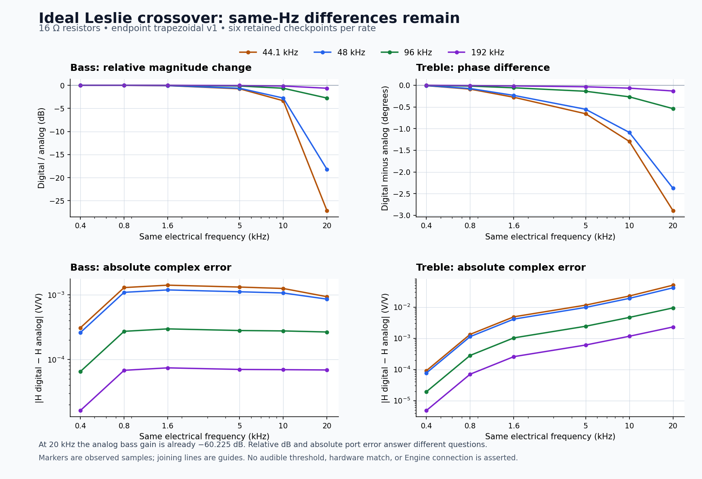

# Leslie crossover: numerical agreement and same-Hz differences

The independent four-state crossover now agrees with its declared trapezoidal
recurrence, including actual processed sine output. **Its same-Hz analog accuracy
has been characterized, but no audible or physical-fidelity acceptance has been
declared.** This distinction matters most near the upper end of the tested band.
The model remains outside Engine; it adds no cabinet sound to the playable organ.

This document interprets the
[coherent native acceptance report](development/2026-11-15-product-continuation/reports/crossover-response-acceptance.json)
for the [frozen v1 contract](LESLIE_CROSSOVER_CONTRACT.md). The plotted experiment
uses the documentary L/C values and **16-ohm constant resistors at both loads**.
It does not use measured loudspeaker impedances, winding losses, amplifier source
impedance, acoustic responses or a specimen-specific component fit. Those fields
remain explicitly unknown in the
[registry](../data/crossover/leslie-122-ideal-v1.json).

## What the numerical pass establishes

The realization is `physical-trapezoidal-leslie-crossover-v1`, with endpoint
trapezoidal integration and no prewarping, oversampling or compensating filter.
For a digital frequency $f$, its steady response corresponds to the continuous
ideal circuit at

$$
f_a=\frac{f_s}{\pi}\tan\!\left(\frac{\pi f}{f_s}\right).
$$

The independent gate compares native response and settled output with the nodal
reference at **$f_a$**. Its maximum normalized errors are
`2.0923475127225402e-13` for response and `3.429777428091277e-13` for sine fits,
inside the frozen `2e-10` and `2e-8` budgets. The report retains 9,360 response-port
comparisons and 864 sine/half-window comparisons across four rates, six resistor
pairs and 96 sine experiments. These are results for the declared numerical
realization, not comparisons with hardware.

A separate same-Hz comparison holds the physical frequency **$f$** fixed on
both sides. For each complex load gain $H$, this document uses:

$$
\Delta_m=20\log_{10}\frac{|H_d(f)|}{|H_a(f)|},\qquad
\Delta_\phi=\arg\frac{H_d(f)}{H_a(f)},\qquad
E_{\rm abs}=|H_d(f)-H_a(f)|.
$$

Phase is the signed principal difference in degrees. Absolute gain error is V/V;
the corresponding input-admittance error is A/V. The accepted report also retains
$E_n=E_{\rm abs}/\max(1,|H_a|)$, evaluated independently for each SI-valued
quantity. The plot restores the denominator before labeling a value as absolute
error. Treble gain slightly exceeds unity at some frequencies, so copying its
normalized error directly into an absolute-error column would be incorrect.

## The retained nominal observations



The figure uses **six retained checkpoints per rate**: 400, 800, 1,600, 5,000,
10,000 and 20,000 Hz. Markers identify the observations; joining lines are visual
guides. It is not a new native sweep or a continuous-frequency error envelope.
The source report separately records maxima over its 124-point 10–20,000 Hz grid;
those finite-grid maxima are not proofs of a maximum between samples.

At the atlas's 800 Hz reference point, the differences are:

| Sample rate | Treble magnitude change | Treble phase change | Bass magnitude change | Bass phase change |
|---|---:|---:|---:|---:|
| 44.1 kHz | +0.014342 dB | −0.088756° | −0.014603 dB | −0.086923° |
| 48 kHz | +0.012106 dB | −0.074905° | −0.012324 dB | −0.073368° |
| 96 kHz | +0.003026 dB | −0.018712° | −0.003078 dB | −0.018339° |
| 192 kHz | +0.000757 dB | −0.004677° | −0.000769 dB | −0.004584° |

Agreement around 800 Hz alone does not characterize the rest of the band. At
20 kHz the same nominal experiment gives:

| Sample rate | Bass magnitude change | Absolute bass error, V/V | Treble magnitude change | Treble phase change | Absolute treble error, V/V |
|---|---:|---:|---:|---:|---:|
| 44.1 kHz | −27.149142 dB | 9.316571e−4 | −0.004161 dB | −2.892074° | 5.048634e−2 |
| 48 kHz | −18.201744 dB | 8.546096e−4 | −0.003815 dB | −2.376124° | 4.148222e−2 |
| 96 kHz | −2.763304 dB | 2.655710e−4 | −0.001181 dB | −0.538838° | 9.409518e−3 |
| 192 kHz | −0.636216 dB | 6.883531e−5 | −0.000306 dB | −0.131807° | 2.301840e−3 |

The continuous ideal bass gain at 20 kHz is only `0.000974419701788799 V/V`,
or **−60.225079 dB**. At 44.1 kHz the digital magnitude is approximately
`0.0000427847466611 V/V`, or −87.374221 dB. The −27.149 dB difference therefore
describes a large **relative** change in an already attenuated port. For a
one-volt sinusoidal input, its complex output difference has magnitude about
0.932 mV. This calculation supplies neither a masking argument nor an audibility
threshold; actual input levels and downstream transfer functions are absent.

Conversely, a small magnitude difference does not imply a small complex error.
At that same 44.1 kHz/20 kHz point, treble magnitude changes by only −0.004161 dB,
but its −2.892074° phase shift produces an absolute complex difference of about
0.05049 V/V. Reporting only magnitude would hide that part of the discrepancy.
The input-admittance difference at this point is `6.2890254e-5 A/V`; the analog
admittance magnitude is about `0.06256275 A/V`. The input port therefore needs its
own loading criterion, not a threshold inferred from either output gain.

These calculations use the retained native metrics and the source-matched nodal
reference. They describe separate electrical ports. No complementary output sum,
acoustic driver polarity, amplifier power or horn/drum acoustic response is
inferred.

## Preserve the actual near-DC finding

The initial independent acceptance found eight failures in the **Python nodal
current calculation**, not in native processing. At 1e−8 Hz with a one-ohm bass
load, subtracting nearly equal node voltages before dividing by the inductor
impedance lost a `3.25450149356e-10` imaginary A/V term. Native and the separate
series/parallel reference already agreed within `5.77e-15`.

A19 corrected the nodal oracle by summing edge-stamped current returning to
reference node B. The new 144 near-DC polynomial/series/KCL comparisons have
maximum normalized error `2.2204502844110104e-16`. The
[original failed report](development/2026-11-15-product-continuation/reports/A19-initial-oracle-cancellation.json),
[failure log](development/2026-11-15-product-continuation/reports/A19-initial-oracle-cancellation.txt)
and [repair record](development/2026-11-15-product-continuation/notes/A19-crossover-response.md)
remain retained. This repair improves the oracle's conditioning; it does not
remove the trapezoidal frequency mapping or the same-Hz differences above.

## Next numerical and physical gates

The next step is a **versioned electrical-accuracy protocol**, followed by an
explicit candidate experiment. It should define the intended input reconstruction,
external rate, frequency band, load family and port quantities before evaluating
another realization. Declare magnitude/phase criteria where gain is above a
specified floor, absolute complex criteria where it is attenuated, and an
independent input-admittance criterion. Select the floors and tolerances from the
intended signal boundaries and evidence; this document supplies no measured or
audible thresholds. Keep a separate check grid and include precharged transients,
state-preserving rate changes, numerical energy behavior and runtime cost.

| Candidate or prerequisite | Concrete experiment | What remains to establish |
|---|---|---|
| Higher circuit rate | Compare an explicitly reconstructed input at an admitted higher rate, retaining both port phase and magnitude | The existing 48→192 kHz comparison is not a tested 4× resampling pipeline. Input reconstruction, conversion filters, latency, state semantics and CPU cost need their own checks. A 44.1→176.4 kHz path is outside v1's admitted rates. |
| Prewarping | State a selected electrical frequency and evaluate a separately identified realization against the entire declared band | A single match point cannot make the nonlinear frequency map identical at every frequency. Preserve the documentary L/C registry and report the numerical change rather than silently changing v1 values. |
| Another discretization | Specify its input hold/reconstruction and physical-state transition semantics, then compare steady and transient port behavior | An exact state transition under a different input reconstruction answers a different experiment. Conservation, rejection and rate-transition obligations must be stated for that method. |
| Physical circuit evidence | Independently transcribe the applicable primary drawing and acquire an identified assembly's component/loss and complex-driver data with uncertainty | The atlas documentary values and ideal resistors do not establish actual loads. Keep 052803 and the later 113860 context distinct; unknown parasitics are not zero measurements. |
| Coupled amplifier and drivers | Define the differential ports and solve the source/load interaction with the M6 power stage and transformer | The present imposed-voltage fixture does not model source impedance, feedback, actual loudspeaker current or a complete Leslie amplifier. |

Preserve v1, its IDs and its evidence as a reproducible reference. An alternate
method or a fitted physical profile needs a new reviewed identity and its own
comparison; a better nominal curve alone does not authorize connection to Engine.
The [whole-project plan](PLAN.md) still requires complete dry-organ validation
before downstream cabinet fitting, separate M7 effect ownership and acquired M8
evidence for a specimen-specific fidelity claim.

## Reproduce this characterization

From the source checkout, Python 3.10+ and the optional Matplotlib authoring
dependency are sufficient. The command reads the retained report and its exact
source-matched reference, computes the absolute-error scaling at the six stored
frequencies, checks magnitude/phase consistency, and writes a new PNG. It runs no
native executable and does not repeat the acceptance suite.

```sh
cmake -E make_directory out/crossover
python3 tools/plot_crossover_characterization.py \
  --acceptance-report docs/development/2026-11-15-product-continuation/reports/crossover-response-acceptance.json \
  --output out/crossover/same-hz-nominal-v1.png
```

An existing output is refused. Changed report source identities are refused;
regenerate and review the affected acceptance evidence before publishing a new
characterization. The PNG embeds the exact report, source, binary and plotter
SHA-256 identities, the 24 plotted observations and Matplotlib version. These
are reproducibility metadata, not an independent source-to-binary attestation.
The [A28 handoff](development/2026-11-15-product-continuation/notes/A28-crossover-characterization.md)
records the actual authoring and verification results.
