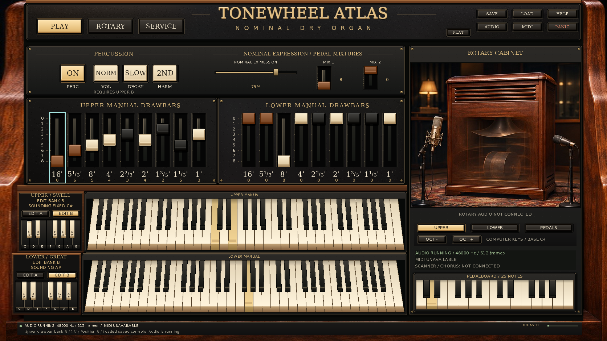

# Actual H1 header-material application gallery

**Captured 17 November 2026, 01:47:30–01:48:12 UTC.** These fifteen PNGs show
the real native application with T2 rack headings, the accepted T3 revision-2
title and corrected H1 header material. The unchanged
[atlas cover/page-409 reference](../atlas-cover-reference.jpg) supplies visual
direction. **Literal whole-interface 1:1 remains unmet and unwaived.**

This README is a **later human-readable guide outside the immutable capture
manifest**. It does not change or replace the [manifest](manifest.json),
[provenance](provenance.json), or any of their 69 recorded payloads. In particular,
the capture-time visual-review status remains historical metadata; the later
[independent A35 review](../../reviews/HEADER_MATERIAL_H1_VISUAL.md) records
scoped visual admission. Root's [current checkpoint](../../development/2026-11-16-heading-title-continuation/CHECKPOINT.md)
records subsequent integration, installed-workflow, publication and hosted gates.

[Unmodified reference](../atlas-cover-reference.jpg) ·
[Genuine accepted-T3 before](../native-gallery-header-before-v1/images/play-reference-1672x941.png) ·
[README UI design and residuals](../../../README.md#current-native-interface)

## All fifteen actual views

The capture tool retained the original thirteen cases and appended the final
two unequal-aspect views through `--include-header-aspects`. Each view has its
own diagnostics, retained input records and decoded-pixel identity in the
provenance. The before links point to genuine captures of the immediately
preceding accepted T3 executable, not a candidate-generated “before” mode.

| View | Dimensions | Images | Inspection purpose |
| --- | --- | --- | --- |
| Reference Play | 1672×941 | [Actual H1](images/play-reference-1672x941.png) · [Genuine before](../native-gallery-header-before-v1/images/play-reference-1672x941.png) | Canonical active composition; Upper drawbar focus. |
| Minimum active Play | 1400×820 | [Actual H1](images/play-minimum-active-1400x820.png) · [Genuine before](../native-gallery-header-before-v1/images/play-minimum-active-1400x820.png) | Smallest active reference composition. |
| Wide Play | 1920×1080 | [Actual H1](images/play-wide-1920x1080.png) · [Genuine before](../native-gallery-header-before-v1/images/play-wide-1920x1080.png) | Expanded active composition. |
| Default Play | 1280×900 | [Actual H1](images/play-default-1280x900.png) · [Genuine before](../native-gallery-header-before-v1/images/play-default-1280x900.png) | Established compact arrangement; H1 inactive. |
| Minimum Play | 960×700 | [Actual H1](images/play-minimum-960x700.png) · [Genuine before](../native-gallery-header-before-v1/images/play-minimum-960x700.png) | Minimum supported window; H1 inactive. |
| Toolbar focus | 1672×941 | [Actual H1](images/play-toolbar-focus-1672x941.png) · [Genuine before](../native-gallery-header-before-v1/images/play-toolbar-focus-1672x941.png) | PEDALS keyboard-target focus and footer context. |
| Pedal focus | 1672×941 | [Actual H1](images/play-pedal-focus-1672x941.png) · [Genuine before](../native-gallery-header-before-v1/images/play-pedal-focus-1672x941.png) | Final pedal focus and footer context. |
| Reference Flat | 1672×941 | [Actual H1](images/flat-reference-1672x941.png) · [Genuine before](../native-gallery-header-before-v1/images/flat-reference-1672x941.png) | Rectangular keys and plain surfaces; H1 inactive. |
| Minimum Flat | 960×700 | [Actual H1](images/flat-minimum-960x700.png) · [Genuine before](../native-gallery-header-before-v1/images/flat-minimum-960x700.png) | Compact Flat controls; H1 inactive. |
| Reference Rotary | 1672×941 | [Actual H1](images/rotary-reference-1672x941.png) · [Genuine before](../native-gallery-header-before-v1/images/rotary-reference-1672x941.png) | Read-only path and cabinet facts; H1 inactive. |
| Minimum Rotary | 960×700 | [Actual H1](images/rotary-minimum-960x700.png) · [Genuine before](../native-gallery-header-before-v1/images/rotary-minimum-960x700.png) | Compact Rotary inspection; H1 inactive. |
| Reference Service | 1672×941 | [Actual H1](images/service-reference-1672x941.png) · [Genuine before](../native-gallery-header-before-v1/images/service-reference-1672x941.png) | Copied-state service cards; H1 inactive. |
| Minimum Service | 960×700 | [Actual H1](images/service-minimum-960x700.png) · [Genuine before](../native-gallery-header-before-v1/images/service-minimum-960x700.png) | Dense compact service information; H1 inactive. |
| Wide, shallow Play | 1920×820 | [Actual H1](images/play-header-wide-1920x820.png) · [Genuine before](../native-gallery-header-before-v1/images/play-header-wide-1920x820.png) | Additional unequal-aspect header comparison. |
| Narrow, tall Play | 1400×1080 | [Actual H1](images/play-header-tall-1400x1080.png) · [Genuine before](../native-gallery-header-before-v1/images/play-header-tall-1400x1080.png) | Additional unequal-aspect header comparison. |

## What the images establish

H1 changes only the existing active header interior. Its darker left edge,
warmer upper-left illumination, smooth lateral variation and fine grain bring
that surface closer to the original. The live title, subtitle, rules, utility
controls and focus retain their positions. A35 directly inspected all fifteen
frames and whole-header strips at all five active dimensions; its
[review](../../reviews/HEADER_MATERIAL_H1_VISUAL.md) found no new seam, band,
repeated texture, distracting speckle, lost lettering or displaced shadow.

The independent [controlled comparison](../../development/2026-11-16-heading-title-continuation/reports/h1-candidate-comparison/report.json)
passes 103/103 frozen reference criteria versus 44/103 before. It separately
checks 48 main pairs, 16 companions, four repeats, complete copied state,
opaque child/focus preservation and zero changes outside the admitted area.
The image metrics are encoded RGB/Y′ statistics, not physical metal or light
measurements. Current title density is 5,499 pixels at the frozen threshold,
compared with 5,415 in the reference and 5,512 in accepted pre-H1 T3; the field
changes antialiased edge blending without changing the five title passes.

The [separate timing run](../../development/2026-11-16-heading-title-continuation/reports/h1-paint-timing/report.json)
records five before/after software cases with unchanged inputs and no existing
benchmark investigation flag. The three active median changes are +4.47%,
+3.24% and +1.26% at 1400×820, 1672×941 and 1920×1080. Separate-process timing
contains scheduler noise and establishes no hardware frame rate or callback
deadline. It is not inferred from these still images.

## Capture identity and limits

| Input | SHA-256 |
| --- | --- |
| Current application | `bfe8e36d16f4c5fd15009f2fc4707c06c93388f40870dc9f84696d3367447e7b` |
| Current painter | `0bf731a692b7cb7c88c200afea86f4ca14239f20a7000f06be484f2a11ebc20d` |
| Genuine before application | `010d43dc764d627733b29093cc8436010fba6922a98a547cc8a1ad69006dc8e3` |
| Genuine before painter | `10865a6bad39bc0a254b8b3f4cf6b013bef48770a2b39c7e9f9a70f438d56366` |
| Original reference JPEG | `9d802c3577367a904516fdd90dd51effb73bc3d0c692c1c7a2fa29699d54a187` |
| Capture manifest | `edda49da4ee2fa819764bac1a80a70d12efaedee6ea25c4965bee5c54830f250` |
| Capture provenance | `3eec905282f32d4f02a97f1b7a7a601b36b928b04b59543c0124f1656eb7d58c` |

Capture used Linux Release, SDL 2.32.10 dummy audio/video, the software renderer
and a MIDI-disabled build. Full commands, tool/dependency identities, selected
controls, source inventories and per-frame validation belong to the provenance.
The capturer recorded verified lossless BMP-to-PNG conversion, then removed the
BMP files. Retained PNGs and decoded pixels remain inspectable; removed original
BMP bytes are not claimed available. Runtime meters/counters vary between real
captures. Exact-state preservation belongs to the controlled paired fixtures.

To make a later gallery, qualify its actual source/build/executable first and
capture into a new directory. Retain this complete packet and the genuine
before packet; do not rewrite their provenance to represent a later build.
Normal desktop build and launch commands are in the
[repository README](../../../README.md#getting-started). Dummy-SDL capture is a
separate software recovery/verification configuration.

## Remaining differences

The native title remains more uniformly gold, with different letter shapes and
shallower relief. Manual divisions/fronts, rims, cap bevels, shafts, wells,
shadows, wood lighting, thin rules and small utility/footer text still differ.
The taller view also has a different cabinet-space allocation. The real utility
tools, expression/mixtures, reversed presets, keyboard targeting, pedalboard and
footer differ from the concept's illustrated preset/vibrato/microphone controls.

Preserve truthful live labels and the correct 68 controls, 147 playing keys,
24 presets and four banks while continuing those separately owned design tasks.
The cabinet image is decoration; scanner, AO-28 and Leslie audio remain
unconnected to the nominal dry Engine. This gallery establishes no real-display,
DPI/input, native-accessibility, physical-device, DAW, measured-fidelity or signed
release result. Those requirements and whole-interface 1:1 remain open.
