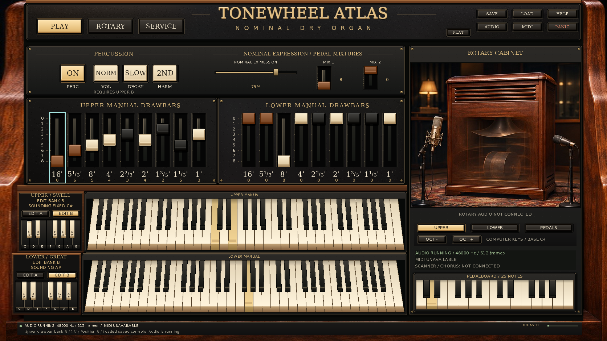

# Current installed heading and header captures

These are two actual frames from the relocated installed application
`1fa2a247e6e90379540ad431776241a885b93223430ac3b0798480d58e96a28a`, with
main `0c02c619…` and unchanged H1 painter `0bf731a6…`. The standalone uses
dummy SDL audio/video and the software renderer; this is not physical-device,
native accessibility, measured-instrument or whole-interface 1:1 qualification.

| Actual view | Image |
| --- | --- |
| Canonical 1672×941 | [PNG](images/play-reference-1672x941.png) |
| Minimum 960×700 | [PNG](images/play-minimum-960x700.png) |

The [provenance](provenance.json) pins 148 production sources, 15 build inputs,
the installed executable, unchanged validator, exact controls and 66-event
replay. Both original 1,800 ms journeys retain Upper 60/64, Lower 67 and pedal 3
while editing the retained Upper-B 16-foot drawbar from 7 to 8. Complete controls,
clean lifecycle, final acknowledgment and actual screenshot state pass the
existing capture validator. Installation is documented in the
[fresh-prefix receipt](../../development/2026-11-16-heading-title-continuation/reports/final-native-install.json).

The [13-file immutable manifest](manifest.json) covers the original capture
payload; this later guide is deliberately outside that packet. Native BMP bytes
are retained losslessly in each `.bmp.gz`, and every decoded PNG pixel is equal
to its original BMP. Reproduce into a new directory using the root-owned
[capture driver](../../development/2026-11-16-heading-title-continuation/capture_final_application.py)
and the explicit arguments recorded in provenance.

The [independent review](../../reviews/FINAL_INSTALLED_CAPTURE_REVIEW.md) directly
inspected both images and the reference. The canonical frame is pixel-identical
to the original H1 gallery's canonical frame. At minimum size only ten footer
peak-meter pixels differ; all other pixels match. The new captures establish
current executable provenance without changing old records.

The [original fifteen-view H1 gallery](../native-gallery-header-h1-v1/README.md)
retains its wider resize, Flat, workspace and focus coverage with captured
app `bfe8e36d…`. Its original BMPs were not retained. Wood illumination,
key/cap/title relief and small-text differences remain; literal whole-interface
1:1 is unmet and unwaived.
