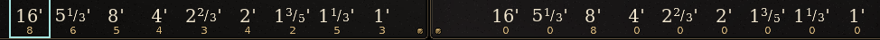
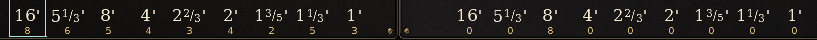
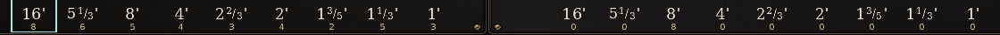

# T1 footage typography — independent actual-image admission

**A32 admits scoped T1 typography at the three reviewed sizes.** All eighteen
manual footage labels are complete, their fraction parts remain distinguishable,
and the nearby numeric values stay separate. No new collision, missing text or
disrupted whole-frame hierarchy was observed. This accepts the narrow
[T1 contract](../design/FOOTAGE_TYPOGRAPHY_CONTRACT.md); literal whole-interface
1:1 correspondence with the reference remains unmet.

The decision combines actual-image inspection with the independent
[110-pair preservation result](FOOTAGE_TYPOGRAPHY_COMPARISON.md), A28's
[reversible production-source audit](../development/2026-11-16-conversion-material/reports/A28-source-audit.json),
and the separately admitted
[material-fixture assertion transition](FOOTAGE_MATERIAL_FIXTURE_TRANSITION.md).
The visual decision does not widen the glyph allowance, replace the native
checks, or infer audio or device behavior from an image.

## Reviewed inputs and identity

A32 individually viewed the complete original
[1672×941 reference](../design/atlas-cover-reference.jpg) and all three complete
candidate PNGs from the actual executable. A second inspection used native-pixel
label-band crops from each actual PNG. These analysis crops contain unchanged
source pixels: no resizing, compositing, annotations or color adjustment was
used. They supplement, rather than substitute for, full-window inspection.

The [root capture receipt](../development/2026-11-16-conversion-material/reports/typography-candidate-captures.json)
retains exact commands, copied state/replay inputs, diagnostics, source and
executable hashes. A32's
[independent input readback](../development/2026-11-16-conversion-material/reports/A32-visual-input-bindings.json)
passed all 28 identity checks, including every source/input file, executable,
PNG/BMP/diagnostic hash, expected dimensions, decoded RGBA identity and equality
between each PNG and its original BMP. The stable full-frame copies are in the
[actual T1 gallery](../../examples/demos/footage-typography-v1/README.md).

| Input | SHA-256 |
| --- | --- |
| Reference JPEG | `9d802c3577367a904516fdd90dd51effb73bc3d0c692c1c7a2fa29699d54a187` |
| Candidate production painter | `a88e7576700ae306769849ceda36993969a61e848c015ba4fb98fa9c4a7e8cfa` |
| Actual application executable | `e62d62109c76890e7b471b486cfc2f69929d0dcec4570e070b2da06da22e1012` |
| [Reference-size actual PNG](../../examples/demos/footage-typography-v1/images/play-reference-1672x941.png) | `a5c39b07aec1bbf6e49cc2cc0617bdef678c0f221fa650017f03dff0974c467e` |
| [Minimum active actual PNG](../../examples/demos/footage-typography-v1/images/play-minimum-active-1400x820.png) | `9c099e0e7d5a2e05db68143a8788bfd71db7cf18bcf3aa7407303b02766db1c1` |
| [Unequal-scale actual PNG](../../examples/demos/footage-typography-v1/images/play-wide-1920x820.png) | `5aa15c5e121c222cc346c87a18193e6184f1164c72f632d105e3e5093103e484` |

The captures use dummy SDL drivers, the retained Lower-gallery state/replay,
and the changed actual application. They are not synthetic mockups. Runtime
counters and meters differ between captures, so these full application images
are not presented as identical-state before/after comparisons. The independent
copied-state native fixtures supply that separate exact comparison.

## Native-scale findings

At **1672×941**, ordinary labels have a larger and lower ink placement than the
prior fitted label. The mixed labels show a full-size whole numeral, raised
numerator, intervening slash, lowered denominator and full-size apostrophe. The
label row is visually coherent across the Upper and Lower racks. The Upper
first-drawbar cyan focus outline remains distinct from `16'` and its value.

At **1400×820**, all four mixed fractions in each rack remain distinguishable
at the native source-pixel scale. The numerator and denominator are small, as
expected at the minimum wide layout, but each slash and apostrophe survives and
the raised/lowered hierarchy is visible. The ordinary labels remain legible.
Values below them do not merge with the fraction denominators or apostrophes.
This observation qualifies these exact software pixels, not arbitrary display
scaling or a physical user's minimum readable size.

At **1920×820**, greater horizontal spacing does not stretch the glyphs.
Typography follows the minimum-axis font scale while centering follows the
mapped label boxes. The complete fractions stay grouped, have clear neighboring
separation, and retain the same hierarchy as the other sizes. The label and
value rows remain separate.

The following table records every label in both manuals at all three sizes.
“Complete” means every ordinary character, including the apostrophe, was
visible. “Five parts” means the whole numeral, numerator, slash, denominator
and apostrophe were individually visible; all five remained grouped as one
label. Every entry also passed the visual value-separation and clipping check.

| Manual / index | Correct complete ASCII label | 1672×941 | 1400×820 | 1920×820 |
| --- | --- | --- | --- | --- |
| Upper / 0 | `16'` | Complete | Complete | Complete |
| Upper / 1 | `5 1/3'` | Five parts | Five parts | Five parts |
| Upper / 2 | `8'` | Complete | Complete | Complete |
| Upper / 3 | `4'` | Complete | Complete | Complete |
| Upper / 4 | `2 2/3'` | Five parts | Five parts | Five parts |
| Upper / 5 | `2'` | Complete | Complete | Complete |
| Upper / 6 | `1 3/5'` | Five parts | Five parts | Five parts |
| Upper / 7 | `1 1/3'` | Five parts | Five parts | Five parts |
| Upper / 8 | `1'` | Complete | Complete | Complete |
| Lower / 0 | `16'` | Complete | Complete | Complete |
| Lower / 1 | `5 1/3'` | Five parts | Five parts | Five parts |
| Lower / 2 | `8'` | Complete | Complete | Complete |
| Lower / 3 | `4'` | Complete | Complete | Complete |
| Lower / 4 | `2 2/3'` | Five parts | Five parts | Five parts |
| Lower / 5 | `2'` | Complete | Complete | Complete |
| Lower / 6 | `1 3/5'` | Five parts | Five parts | Five parts |
| Lower / 7 | `1 1/3'` | Five parts | Five parts | Five parts |
| Lower / 8 | `1'` | Complete | Complete | Complete |

The retained [per-label observation receipt](../development/2026-11-16-conversion-material/reports/A32-visual-observations.json)
contains these 54 visual observations plus A29's exact per-character bright-ink
counts and canonical label bounds. In particular, `1 3/5'` is preserved in both
manuals. Visual fidelity does not justify copying an incorrect musical string
from the concept art.

### Unscaled analysis strips

These are cropped analysis aids, not complete application captures. The linked
files retain native source pixels and their crop rectangles and hashes are in
the input readback receipt.

1672×941 source:

1400×820 source:

1920×820 source:

## Relation to measured ink and protected content

A29's canonical case observations agree with this visual reading. All ordinary
labels now occupy the y473–488 ink neighborhood. Mixed labels occupy y472–488,
with the `5 1/3'` rows ending at y487. All eighteen labels have nonempty bright
ink for every character. Each has more sampled bright ink than its historical
fitted counterpart; the exact 18-row bounds/count table remains in
[A29's comparison](FOOTAGE_TYPOGRAPHY_COMPARISON.md#canonical-per-label-ink-observations).
Those descriptive counts are not treated as a universal readability score.

The stronger preservation evidence is the complete 110-pair result: 295,560
changed pixels all lie inside independently declared glyph support, with zero
escaping pixels/channels, 44 exact whole frames, 100,433 exact cyan-focus pixels
and twelve exact material samples. The updated historical material fixtures
also pass all 30 Upper and 32 Lower cases with their original contrast,
value/heading, opaque-child, focus, clip and state requirements intact.

Full-frame inspection found no new collision or disruption in the header,
percussion area, drawbar tracks/caps, keyboards, cabinet/sidebar, or footer.
Visual recollection is not the proof of byte preservation outside the labels;
the independent source and paired-raster gates provide that proof over their
declared matrix.

## Remaining design work and handoff

The reference still differs visibly in header wording and controls, some panel
and drawbar-cap styling, keyboard geometry/material, preset-key structures and
the decorative keyboard rims. The candidate also honestly exposes functional
state and unconnected audio subsystems absent from the concept artwork. T1
only improves the footprint and hierarchy of manual footage typography; it
does not resolve those other design differences.

Root may accept this scoped stage with the passed comparison and versioned
fixture transition. Before the next admitted rim change, retain genuine
accepted-stage source and native executables, then apply the rim's own contract,
source/manifest preflight, independent fixture and paired comparison. Preserve
all earlier failures and protocol versions.

No physical display/DPI, semantic OS accessibility, live audio/MIDI-device,
physical specimen or whole-interface 1:1 claim is made by this review.
