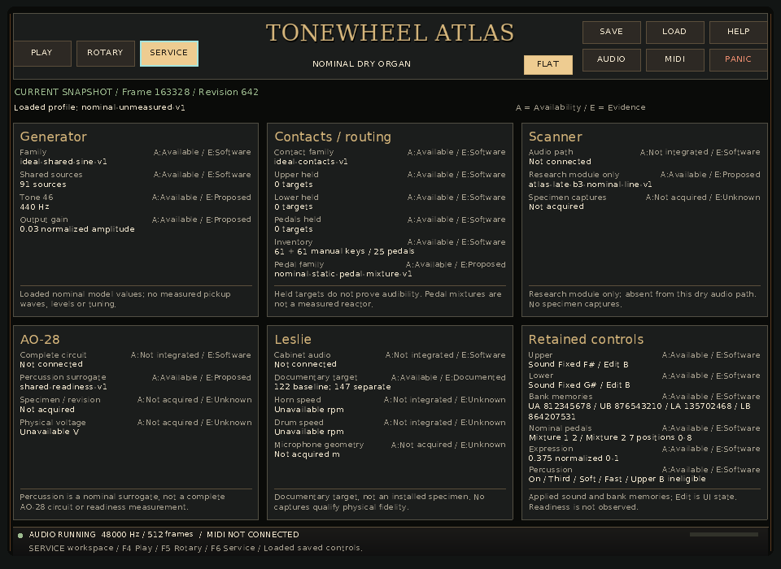
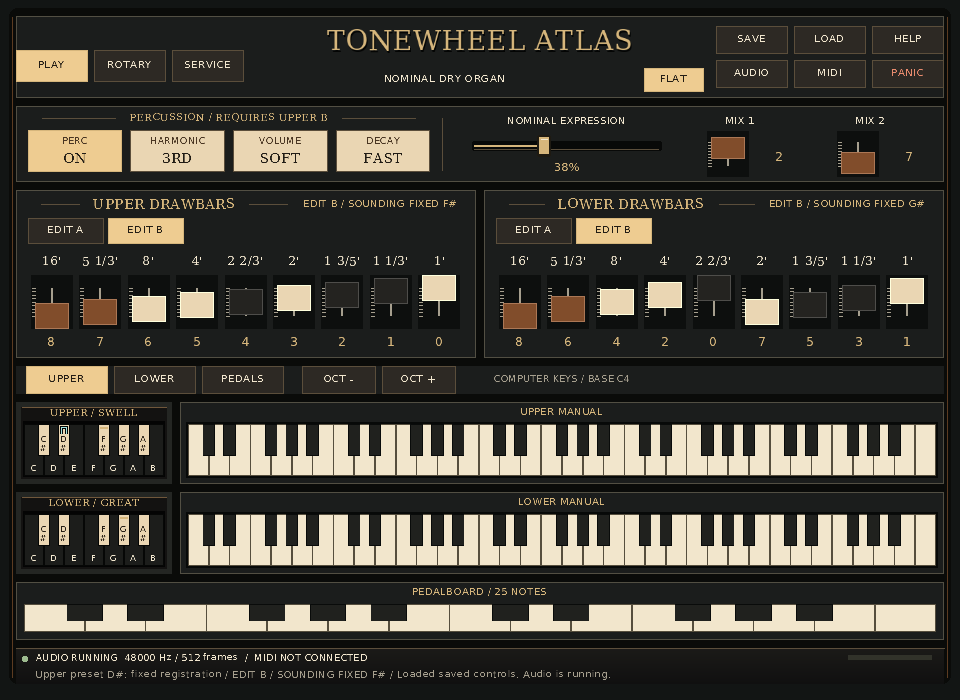

# Final native operator flow — A37

**Outcome: both bounded native cases pass on the released A34+A36 application.**
The corrected preset legends and Load notice remain useful during the current
guide's navigation, editing and persistence workflow. No further guide or
production correction was found in this scope. The [result and diagnostics](../development/2026-11-14-interface-continuation/reports/a37-operator-evidence/result.json)
and [compact identity record](../development/2026-11-14-interface-continuation/reports/a37-final-operator-flow.json)
retain the actual commands, inputs, assertions and hashes.

## Identified source and execution

After A36 released source/build/CPU, A37 copied its executable into a private
directory and verified SHA-256
`bd4991a3b45543a01c9ce435da140af848d45f28ff535699397706e5d3925dc2`
before and after both launches. All **327** source inputs matched the successful
[A36 build](../development/2026-11-14-interface-continuation/reports/a36-build.json)
before and after execution. Published HEAD was `aea58bb85bc66a5feaff66a0b8a388e7c3f9e630`;
it alone does not contain the then-working A34/A36 corrections. This is a fresh
qualification of those identified executable bytes, not an inherited A30 pass.

Both processes used dummy SDL audio/video, software rendering, private writable
state paths and the existing nine-second process deadline. The script reuses
A30's strict schema/lifecycle helpers and independent literal controls. No
build, exhaustive raster/model suite or PCM comparison was repeated.

## Observed journey

| Case | Actual result |
|---|---|
| Navigation → edit → Save → live Load | Passed in 3.66 s. Held Upper note 60 survives Service, Flat, Rotary and Play. EDIT A and drawbar 1's `0→8` change preserve Fixed F#. Explicit preset B changes the route; live Load restores the saved fixed route without releasing the note. Original key-up releases it. Only five ordinary note/control commands occur. |
| Minimum Flat, focused D# | Passed in 1.46 s. Exact saved controls restore at 960×700. Tab focuses D#; visiting Service/Rotary and returning restores that focus. Fixed F# keeps sounding. Navigation/focus emit only the note-on/off commands and leave saved bytes unchanged. |

Save produces exact canonical state4 bytes, SHA-256
`c921ed04fd743fdde01ac300bf4cab34b7f6406f4007cc497f2a873e689e46a3`.
The other bank values, fixed memories, pedals, expression and percussion match
the literal expectations. Each process starts one audio lifecycle, finishes
acknowledged with no pending controls/Save, reports zero application/audio
errors, and joins a stopped, unheld Session. Native MIDI discovery was not opened.

## Literal visual feedback

Load was requested at **2460 ms** and acknowledged at **2548 ms** while note 60
remained held. The **3550 ms** Service capture shows **CURRENT SNAPSHOT**,
**Sound Fixed F# / Edit B**, and **Loaded saved controls.** Diagnostics separately
confirm `controls_pending=false`; they do not record the footer string.

| Actual minimum Service after Load | Actual minimum Flat Play after focus restoration |
|---|---|
|  |  |

A37 opened both PNGs. The second shows stacked accidental characters, distinct
D# focus ink and the full semantic footer alongside the applied F# caption.
Both manuals, pedals and ten header actions remain visible. PNGs were reopened
and matched to every decoded BMP pixel before deleting only these temporary
BMPs. Nine-unit caps remain small; physical readability is a separate question.

## Next action and limits

Root should carry this source into the coherent final gate and A46's new gallery;
A42 retains persistent native pointer capture. The current runbook's tested
steps agree with these observations. A30's original ALSA failure remains intact;
the optional MIDI waiting-string candidate was not independently exercised and
is not an established defect. Physical devices, native display/accessibility,
callback deadlines, reference equality and instrument fidelity remain outside
these two software observations.
