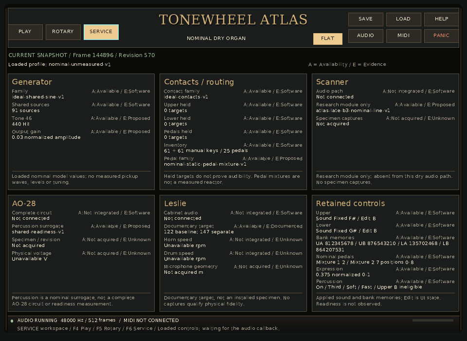
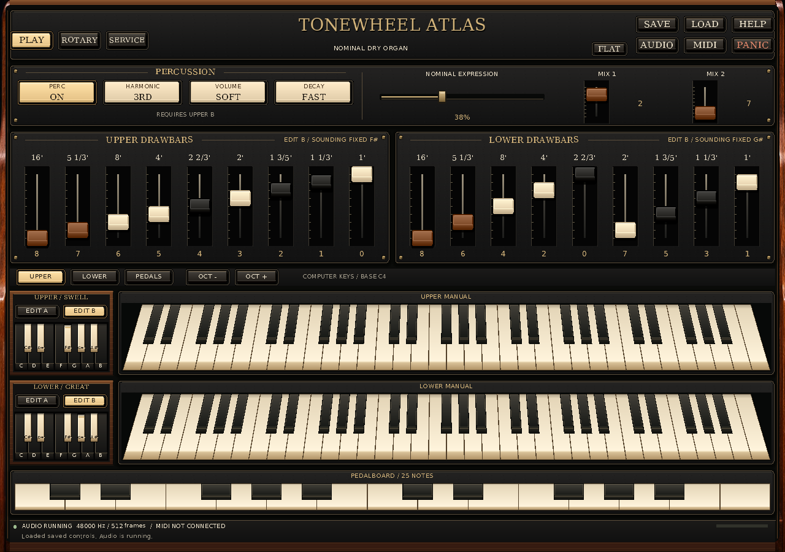

# Native interface operator audit — A30

**Outcome:** four normal native operator scenarios passed. A fifth scenario
retains an actual ALSA discovery failure and verifies safe **No input** recovery;
it is **not** a passing native MIDI replay. Two CLI admission checks also behaved
as documented. This scoped audit found one missing guide distinction and one
stale post-Load status message. No production or shared guide files were edited.

The [machine-readable audit](../development/2026-11-14-interface-continuation/reports/a30-operator-audit.json)
and [complete scenario result](../development/2026-11-14-interface-continuation/reports/a30-operator-evidence/result.json)
retain commands, diagnostic assertions, source/guide identities and output hashes.

## Exact executable and scope

The audited application was the current interface overlay over published
`5d81199a9822874b55f3b0a124715cbd6eadf0e5`. That published commit alone does
**not** contain this interface. Its matching earlier build report is retained in
the [A20 gallery input](../../examples/demos/standalone-interface-preview-v1/inputs/source-qualification.json).

The executable was copied from
`/workspace/scratch/601951e27dc3/build-native/apps/standalone/hammond_standalone`
to `/tmp/a30-operator-pinned/hammond_standalone` before A28's concurrent rebuild.
The copy matched before and after every launch:

```text
005db1e2006bd1929e07dff3acaa40a5a6e6fa60a2bc8f07eb992d972b04b364
```

At final audit recording, A28's shared executable had changed to
`55b0947985ee562cce3d04eae66cc4d44f805420f475dd578f00373dd2bef6cd`.
**This audit does not qualify that rebuilt executable.** No shared build was
configured, built or changed by A30. The audited operating guide digest was
`cee311e98e477aa9e330b3d1060dd04668bafcf6150e1c964570538d9f34e7a5`.

All five windowed runs used explicit `SDL_VIDEODRIVER=dummy` and
`SDL_AUDIODRIVER=dummy`, isolated `/tmp/a30-*` files and a nine-second process
deadline. The new scenarios reuse strict test-side schema/lifecycle helpers and
literal state fixtures; they do not rerun the exhaustive workspace suite or use
production layout/serialization code as an expectation oracle.

## Observed operator journey

| Scenario | Result and substantive checks |
| --- | --- |
| First launch, Service → Rotary → Play | Passed, 2.47 s. Absent state gives documented `888000000` / `008000000` / `80` audition defaults. Read-only body clicks and F4–F7 produce no control commands. Upper A remains MIDI note 60 through view changes, releases on its original modified key-up, and the state file remains absent. |
| Deliberate edit, Save and live Load | Passed, 3.25 s. While Upper F# is selected and note 60 held, EDIT A and its first drawbar change `0 → 8` preserve the fixed route. Selecting preset B deliberately changes the applied route; Ctrl+O restores fixed F# without releasing the held note. Save writes exact canonical state4. Final view is Service/Flat at 960×700. |
| Cold reload | Passed, 0.80 s. Exact saved bytes restore all sound controls, zero held targets and default Play/Dimensional at 1280×900. The prior Service/Flat/minimum-size view does not return. |
| Help and audio safe stop | Passed, 3.34 s. Help/Audio release UI holds; old physical-key repeats stay suppressed until release. F4–F7 do not act underneath the modal. Audio Apply changes 48 kHz/512 to 44.1 kHz/2048, retains every control, starts exactly one additional lifecycle and permits a fresh note. The copied frame clock visibly restarts. |
| MIDI No input | **Native replay failed, retained**, 2.41 s. This container cannot create an ALSA sequencer client. The modal still accepts No input Apply, Disconnect and Close; a fresh keyboard note plays afterward. All controls and saved bytes remain exact. No input epoch, port, callback packet or decoder action is created. |

The four normal runs have zero application errors and empty stderr. All five
have finite strict-schema diagnostics, zero audio render/format/nonfinite/
overrange failures, acknowledged final controls, no pending Save/controls,
empty explicitly released targets before shutdown, and stopped/unheld joined
Sessions afterward. Audio callback counts were 214, 287, 66, 213 and 214;
they demonstrate software callbacks only. Modal release commands deliberately
explain why their note-on/off counts do not pair one-for-one.

The saved file SHA-256 is
`c921ed04fd743fdde01ac300bf4cab34b7f6406f4007cc497f2a873e689e46a3`.
The only saved difference from the literal input fixture is Upper bank A's first
drawbar. Fixed F#/G#, selected-bank memory, the other 35 manual drawbar values,
pedal mixtures, expression and percussion remain exact.

`--help` succeeded with deliberately invalid SDL drivers; uppercase
`--workspace Service` rejected with exit 2 before initialization. The CLI's
default/minimum dimensions, lower-case workspace values, Flat option, F4–F7,
explicit Save and startup registration agree with the guide. Native Help's
corresponding text was source-inspected; its open/close and shortcut gates were
executed, but this audit does not claim a separate Help raster/readability pass.

## Guide findings and precise next actions

### A30-G1 — Explain native MIDI discovery in a dummy SDL run

Add the following distinction under **MIDI discovery and recovery** in
`docs/INTERFACE_RUNBOOK.md`; the bounded-check section can point to it:

> Dummy SDL audio and video do not replace the compiled native MIDI backend.
> On Linux without an accessible ALSA sequencer, opening MIDI settings can report
> “Cannot enumerate MIDI input ports” even when No input is selected. Leave No
> input selected and use Apply or Disconnect, then Close to resume computer
> playing. Correct the native MIDI environment before reopening the dialog to
> request another discovery.
>
> The discovery error remains in diagnostics after that recovery. A scripted
> `B3UIREPLAY1` run that records it returns nonzero with `replay.passed=false`.
> Preserve that failure. Ordinary dummy runs that do not need MIDI discovery
> can leave the dialog closed; explicit synthetic MIDI replay has its separately
> documented script-controlled route.

Observed failure evidence is retained in
[stderr](../development/2026-11-14-interface-continuation/reports/a30-operator-evidence/05-midi-no-input/stderr.txt)
and [full diagnostics](../development/2026-11-14-interface-continuation/reports/a30-operator-evidence/05-midi-no-input/diagnostics.json):
`open /dev/snd/seq failed: No such file or directory`; discovery
requests/started/completed/failures are `1/1/1/1`; `replay.completed` and
`final_acknowledged` are true, but `replay.passed` is false and exit is 1.
The two retained application errors are the discovery cause and the final replay
failure. This is a capability distinction, not evidence of a new MIDI defect.
Root will amend the guide after A29's package source-byte check is released.

### A30-G2 — Replace or qualify the stale Load waiting message

After Ctrl+O at 2100 ms, the applied state is acknowledged at 2186 ms. At the
3166 ms screenshot, Service says **CURRENT SNAPSHOT**, the diagnostic
`controls_pending` is false, and the bottom strip still says
**Loaded controls; waiting for the audio callback.** The image makes this
operator ambiguity directly reviewable.

The source is `Application::load_state()` in `apps/standalone/main.cpp`, which
passes that literal text to `message()`. `message()` sets a six-second
`status_until_`; `render_frame()` expires it by time, while the status renderer
in `apps/standalone/InstrumentView.cpp` continues to display `info.status_message`
after the independent copied/applied state advances. A36 owns the concrete
status correction/clarification. The guide's **Registrations, applied values and
pending edits** section should continue to identify the actual pending outlines
and copied-state banner; do not infer pending control work from this old timed
status sentence. A30 did not edit this production path.

## Two reviewed captures

| Minimum Service, after live Load | Default Play, after cold reload |
| --- | --- |
|  |  |

Both show the ten documented common header actions. The minimum Service image
shows six cards and **Sound Fixed F# / Edit B**; the default Play image shows
the corresponding rack caption, both manuals, pedals and all preset positions.
The two PNGs were reopened and compared to their source BMPs for mode, size and
every decoded pixel byte before deleting only A30's BMPs. Original BMP, PNG and
decoded-pixel hashes remain recorded. The entire retained scenario payload is
355,563 bytes. A27's known small accidental-label finding remains assigned to
A34 and was neither duplicated nor repaired here.

## Reproduction and remaining limits

Actual invocation from `/workspace/scratch/601951e27dc3/Hammond-B3-Organ`:

```sh
python3 docs/development/2026-11-14-interface-continuation/reports/a30-operator-journey.py \
  --executable /tmp/a30-operator-pinned/hammond_standalone \
  --output docs/development/2026-11-14-interface-continuation/reports/a30-operator-evidence
```

The script requires a fresh output directory and the exact pinned digest. Each
case retains its actual command, input, initial/final state where applicable,
diagnostics and stdout/stderr. A later renderer must receive a new identified
audit rather than inheriting these images or results.

No physical audio/MIDI, audible fidelity, callback deadline, native accessibility,
real display/DPI or literal reference-image equality is established. Dummy
`SDL_CaptureMouse` immediately fails, so these button clicks supply no persistent
native pointer-capture evidence. Existing exhaustive independent gates retain
their own scope; the next actions are the two assigned documentation/status
changes and coherent qualification of the newer executable.
