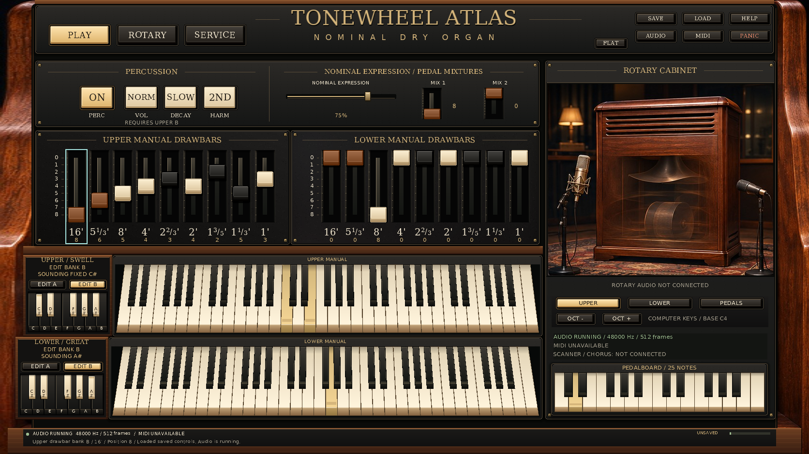

# Manual footage typography — actual application gallery

These three actual native screenshots show the accepted T1 manual-label stage after Lower material. Correct full musical strings remain live text; mixed fractions use independently admitted numerator, slash, denominator and apostrophe runs. All18label/size observations per image retain separation from values and focus.

| Actual view | Capture |
| --- | --- |
| Reference1672×941 | [Full PNG](images/play-reference-1672x941.png) |
| Minimum active1400×820 | [Full PNG](images/play-minimum-active-1400x820.png) |
| Unequal aspect1920×820 | [Full PNG](images/play-wide-1920x820.png) |

[Provenance](provenance.json) binds all actual commands, copied state/replay, source/executable hashes, diagnostics and exact PNG/RGBA identities. These files are lossless copies of root's original captures; no image content was edited. Runtime counters and meters differ between captures. The standalone executable hash is `e62d62109c76890e7b471b486cfc2f69929d0dcec4570e070b2da06da22e1012`; painter hash is `a88e7576700ae306769849ceda36993969a61e848c015ba4fb98fa9c4a7e8cfa`.

The independent [paired comparison](../../../docs/reviews/FOOTAGE_TYPOGRAPHY_COMPARISON.md) passes110pairs/286098649pixels withzeroescapes,44exactwholeframes,100433exactfocuspixels and12unchangedmaterialpatches. The [full-frame visual admission](../../../docs/reviews/FOOTAGE_TYPOGRAPHY_VISUAL_ADMISSION.md) reviews54label/sizeobservations and28captureidentitychecks. The [versioned fixture transition](../../../docs/reviews/FOOTAGE_MATERIAL_FIXTURE_TRANSITION.md) retains originals/failures and replaces only obsolete footage assertions; freshUpper30/Lower32casespass.

The [original reference](../../../docs/design/atlas-cover-reference.jpg), [admitted T1 contract](../../../docs/design/FOOTAGE_TYPOGRAPHY_CONTRACT.md) and [accepted earlier Lower gallery](../lower-rack-material-v2/README.md) remain separate evidence. Literal whole-interface1:1 remains unmet: heading tracking, decorative rim, broader material/shadow/key/cap differences and actual display/DPI/accessibility remain. The image includes truthful nominal-dry/unconnected audio labels. DummySDLcapture does not prove a physical device journey.
