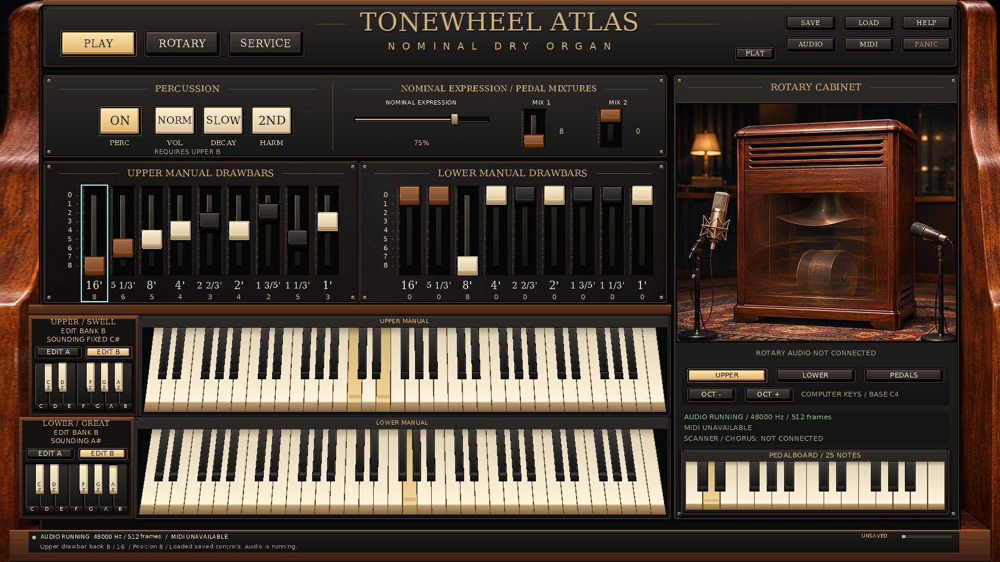
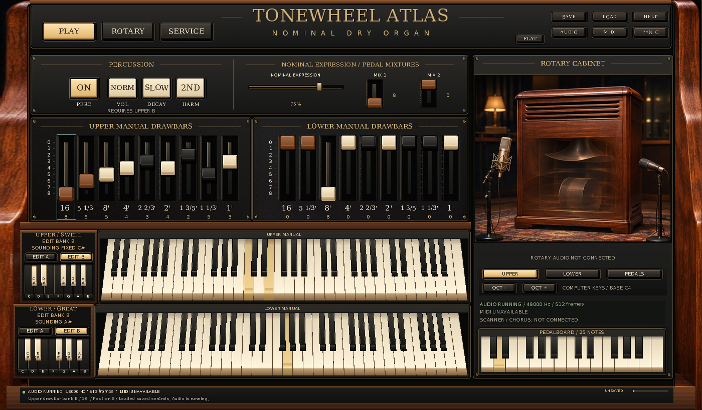

# Lower-rack material: actual application captures

These two full-window images come from the actual standalone application after the Lower-panel material change. The [provenance record](provenance.json) binds the executable, base and production overlay, input state/replay, diagnostics and decoded pixels. This gallery precedes the next typography slice.

## Reference size — 1672 × 941



## Minimum active size — 1400 × 820



The darker right side and nonperiodic grain follow the reviewed Lower material field. All controls are live; their geometry and musical meanings are preserved. The warmer lower reflection, mixed-footage typography and other whole-window differences remain visible. Literal whole-interface 1:1 is not established by this gallery.

The original v1 measurement remains failed because its right strip includes a fixed foreground border. The [independently admitted sampling correction](../../../docs/reviews/LOWER_RACK_MATERIAL_V2_ADMISSION.md) retains the failure, keeps the numerical thresholds and adds explicit border/focus preservation. The [versioned comparison result](../../../docs/reviews/LOWER_RACK_COMPARISON_V2_RESULT.md) records the separate acceptance outcome. These live captures have varying counters and are not substituted for identical-state raster pairs.

## Reproduce the scene

Use a coherently built Lower-stage executable matching the provenance hash. The copied inputs are byte-identical to the actual command inputs retained in provenance. From the repository root, choose a fresh output directory:

```sh
mkdir -p ../lower-gallery-replay
SDL_AUDIODRIVER=dummy SDL_VIDEODRIVER=dummy \
  ../build-native/apps/standalone/hammond_standalone \
  --state examples/demos/lower-rack-material-v2/inputs/controls.b3controls \
  --input-script examples/demos/lower-rack-material-v2/inputs/play-dimensional.b3uireplay \
  --width 1672 --height 941 \
  --screenshot ../lower-gallery-replay/play-reference.bmp \
  --diagnostics ../lower-gallery-replay/play-reference.json
```

The environment above selects dummy SDL for reproducible automation. A normal desktop launch uses the [README setup](../../../README.md#build-and-launch-the-native-application) with native backends enabled. This gallery qualifies neither a physical display/DPI journey, audio hardware nor semantic accessibility.
