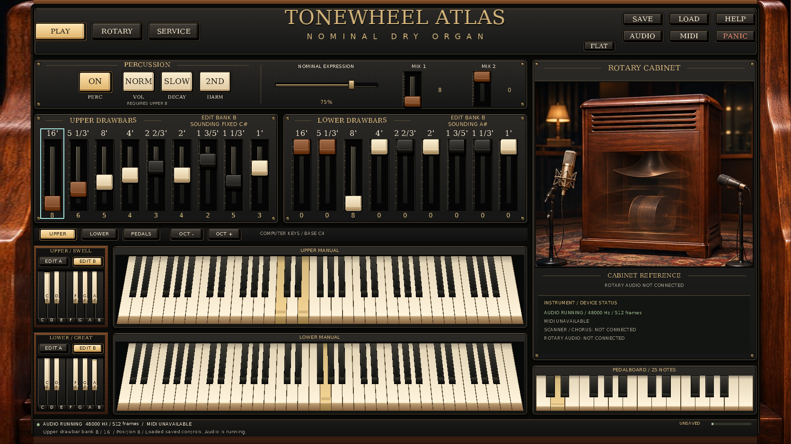

# Native audio-continuation interface captures

Eight actual application captures from the source and executable identified in
[the build receipt](../../../docs/development/2026-11-15-audio-continuation/reports/w03-source.json).
The capture tool ran the real standalone with explicit SDL dummy audio/video and
software rendering, identical logical/drawable dimensions, scripted controls and
retained native diagnostics. The recorded Git base was `276664ee8570c208bb007cca59f496963ca13ef5`;
the implementation was a dirty working tree, whose exact relevant source hashes
are recorded. This is not a claim that the base commit contains the new controls.

| Actual view | Image |
| --- | --- |
| Reference-size Play | [1672×941](images/play-reference-1672x941.png) |
| Default Play | [1280×900](images/play-default-1280x900.png) |
| Minimum Play | [960×700](images/play-minimum-960x700.png) |
| Flat Play | [960×700](images/flat-minimum-960x700.png) |
| Rotary | [1672×941](images/rotary-reference-1672x941.png) · [960×700](images/rotary-minimum-960x700.png) |
| Service | [1672×941](images/service-reference-1672x941.png) · [960×700](images/service-minimum-960x700.png) |

[Provenance](provenance.json) retains commands, source/executable/input identities,
state observations and decoded-pixel hashes; [manifest](manifest.json), `inputs/`
and `diagnostics/` retain the actual capture data. Original receipt bytes are
preserved when this directory is copied into the repository. Its recorded
scratch location describes where capture happened, not the present location.

At wide Dimensional Play the percussion caps use the reference horizontal grouping
and exterior captions PERC / VOL / DECAY / HARM, with correct live value domains.
The stored ON state can remain visible while a fixed Upper registration makes
percussion ineligible; the copied applied route drives REQUIRES UPPER B.
The original concept has incorrect value labels. Its tablets begin near y177;
this scoped implementation begins at y150 inside the existing performance strip.
Whole-interface 1:1 remains unmet and unwaived.

These time-running application frames do not prove inactive pixel equality:
phase/frame/status fields may change between runs. The separate identical-state
[66-pair raster qualification](../../../docs/development/2026-11-15-audio-continuation/reports/w04-a23-paired-final.json)
compares genuine old/current UI sources and requires exact inactive equality plus
zero active pixel changes outside the admitted percussion regions. It passed
208,102,766 compared pixels, zero escaping pixels and 28 exact inactive pairs.
Independent full-gallery admission and published-source binding are subsequent
recorded gates. No native display, physical audio/MIDI or whole-product fidelity
claim follows from dummy-driver captures.
