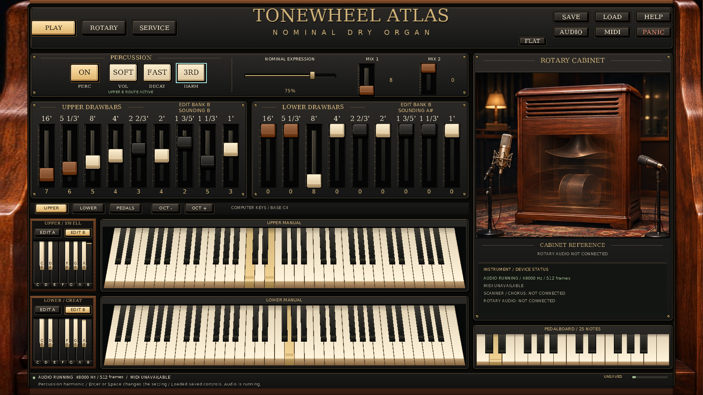

# Actual native percussion states

Three additional captures from the frozen standalone executable, recorded on
15 November 2026 through its real SDL keyboard replay and audio callback path.
These images extend the [eight-view gallery](../README.md). They do not replace
its PNGs, input files, diagnostics or original receipts.



| Actual frame | Applied Upper route | Visible PERC / VOL / DECAY / HARM | Focus |
| --- | --- | --- | --- |
| [Eligible Upper B, 1672×941](images/eligible-upper-b.png) | Enabled, adjustable B, no fixed registration | ON / SOFT / FAST / 3RD; UPPER B ROUTE ACTIVE | HARM, semantic index 1 |
| [Fixed D, 1400×820](images/fixed-d-off.png) | Enabled, fixed D; remembered adjustable bank B | OFF / NORM / SLOW / 2ND; REQUIRES UPPER B | PERC, semantic index 0 |
| [Cancel with stored ON, 1400×820](images/cancel-stored-on.png) | Disabled by Upper Cancel; remembered adjustable bank B | ON / SOFT / FAST / 3RD; REQUIRES UPPER B | DECAY, semantic index 3 |

All route and switch changes after loading the common input state use real
Tab/Shift+Tab and Space/Enter input. Four playing keys remain held in each final
frame: Upper MIDI notes 60 and 64, Lower note 67 and pedal ID 3. Desired controls
and the copied applied snapshot agree before capture. Normal shutdown releases
the remaining owners. The Cancel frame deliberately distinguishes stored ON
from the applied route's eligibility.

## Receipts and replay

[Provenance](provenance.json) contains each exact command, replay/input identities,
complete endpoint controls, native diagnostics, executable/source/build hashes,
PNG hashes and decoded RGBA hashes. [Manifest](manifest.json) covers the original
capture outputs and the exact [capture script](reproduce.py). The manifest was
written when capture completed; this README and the later read-only verifier are
documented separately in [A28's report](../../../../docs/development/2026-11-15-audio-continuation/reports/A28-gallery.json).

The admitted executable SHA-256 is
`32cea4a90bfc3d742550ad3725c1bf007c2fdc72e111b8b5ab1e95026033daf6`.
Its 115 production input identities and 13 build input identities match the
original gallery; all 16 source entries in the earlier
[source receipt](../../../../docs/development/2026-11-15-audio-continuation/reports/w03-source.json)
also match. The observed Git base was `276664ee8570c208bb007cca59f496963ca13ef5`
with an uncommitted source overlay. That base commit does not contain this UI.
Any later publication binding must retain these original hash-bound facts.

From the repository root, audit the retained bytes and state against the frozen
source/build with Python 3 and Pillow:

```sh
python3 examples/demos/standalone-audio-preview-v1/percussion-states/verify.py \
  --repo . --build ../build-native \
  --exe ../build-native/apps/standalone/hammond_standalone
```

To reproduce actual application frames, choose a **new, nonexistent** output
directory. This deliberately requires the recorded executable and build inputs;
a rebuild with different identities requires a new qualification receipt.

```sh
python3 examples/demos/standalone-audio-preview-v1/percussion-states/reproduce.py \
  --repo . --build ../build-native \
  --exe ../build-native/apps/standalone/hammond_standalone \
  --output ../percussion-state-recapture
```

The script explicitly sets `SDL_AUDIODRIVER=dummy`, `SDL_VIDEODRIVER=dummy`
and `SDL_RENDER_DRIVER=software`, uses 48 kHz stereo with 512-frame buffers,
and limits each run to 15 seconds. Every successful frame comes from the real
native renderer's BMP screenshot. Conversion to PNG preserves its decoded pixels
exactly; BMP hashes are retained, and the large BMP intermediates are then removed.
There is no generated, retouched or mocked application image. Audio clocks and
status rendering can differ between reruns, so replay is not a promise of identical
whole-frame hashes.

## Visual scope and limitations

These are 1× logical-to-drawable software captures, not physical display or audio
device observations. The cyan outlines were inspected in the actual images;
their replay targets and pixel locations identify HARM, PERC and DECAY. The native
diagnostics do **not** expose the ordinary semantic focus ID. They do establish
the final painted view, current acknowledged snapshot, held targets, clean
shutdown and zero recorded queue/render/nonfinite/overrange failures for these runs.

The [refinement guide](../../../../docs/AUDIO_VISUAL_REFINEMENT.md) explains the
tablet body, scale, layout and separate acceptance evidence. Caps start at y150
in the unchanged performance strip; the reference begins near y177. The roughly
27-pixel vertical residual and other full-interface differences remain. The
user's whole-interface 1:1 requirement is **unmet and unwaived**. This capture
author's inspection is not the independent reference-fidelity review.
