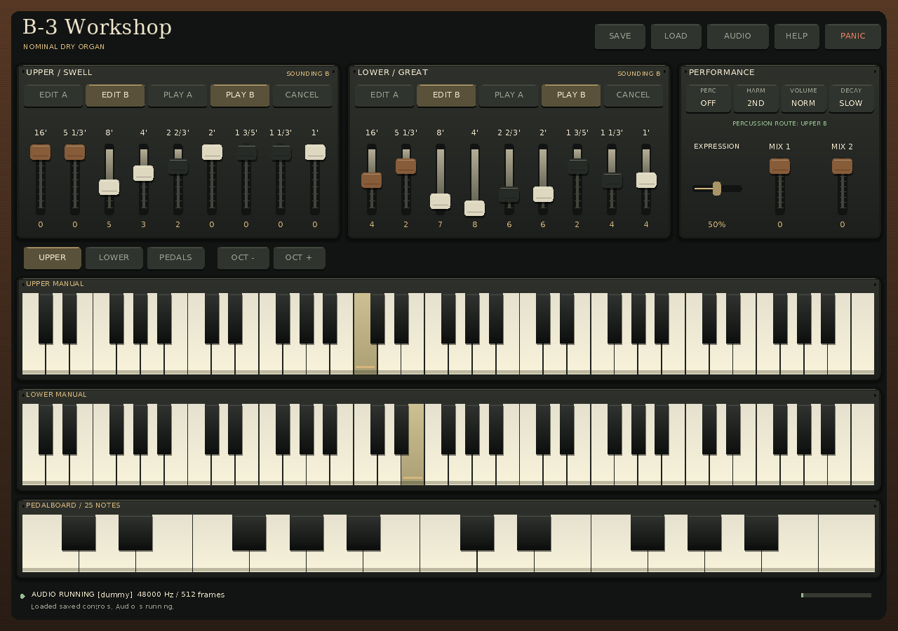
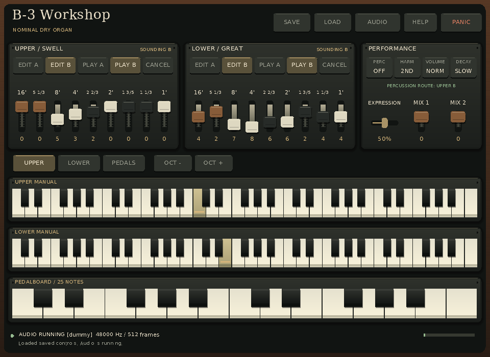

# Actual chapel registration audition

These two images are lossless PNG copies of actual `hammond_standalone`
backbuffers from the final-source candidate below. Both show the same explicitly
exported documentary chapel registration, with **Upper C4 (MIDI 60)** and
**Lower E4 (MIDI 64)** held at the acknowledged replay endpoint. The application
then closes and joins its audio callback with no held notes remaining.

| View | Actual window/drawable size | Retained output |
| --- | --- | --- |
| Reference | 1280 × 900 | [Image](reference.png), [unaltered diagnostics](reference.json) |
| Minimum | 960 × 700 | [Image](minimum.png), [unaltered diagnostics](minimum.json) |





The explicitly selected audio/video drivers are `dummy`, and the renderer is
`software`. These are real application renders, not desktop photographs or
generated mockups. No physical output, listening comparison, latency/deadline,
high-DPI, native screen-reader or Hammond/Leslie fidelity result follows.

## Registration and musical expectation

The [292-byte control file](chapel-pair.b3controls) was generated by the public
[chapel exporter](../../../tools/chapel_controls.py) from the compiled catalog.
It exactly matches an independently declared complete B3CONTROLS3 document:

| Control | Explicit value |
| --- | --- |
| Upper documentary row | Catalog key **C#**, digits **005320000** |
| Lower documentary row | Catalog key **A**, digits **427866244** |
| Both sounding banks | B; both manual routes enabled |
| Upper A / Lower A | Each `000000000` |
| Expression | `0.5`, the current normalized nominal gain control |
| Pedal mixtures | `00` |
| Percussion | Off / Second / Normal / Slow |

Digits use physical drawbar order: 16′, 5⅓′, 8′, 4′, 2⅔′, 2′, 1⅗′, 1⅓′, 1′.
The row labels C# and A identify catalog rows; they are not the notes played in
this demonstration. The source is atlas page 122, with all 162 documentary taps
preserved in the [catalog](../../../docs/CHAPEL_PRESETS_CATALOG.md). Its underlying
factory Table IV and specimen wiring remain unverified. The export translates
tap digits into existing nominal drawbar positions; it implements no physical
preset latch, loaded gain, interlock or factory timbre.

The [eight-action replay](held-manuals.b3ui) runs for 1400 ms. It selects Upper,
presses A for Upper C4, selects Lower and presses D for Lower E4, then returns
the destination for future presses to Upper. It intentionally sends no musical
key-up before the screenshot. The original Upper ownership survives both target
changes. Both runs report exactly **2 accepted On / 0 Off** commands, complete
controls and both held notes at final acknowledged sequence **3**. Normal joined
shutdown clears the notes afterward; saved controls contain no held state.

## Exact source and observed results

Published source: [`0085e338388f2c7516a7d455f11692b94e9451f4`](https://github.com/tomasedisonn80/Hammond-B3-Organ/commit/0085e338388f2c7516a7d455f11692b94e9451f4).
Git tree: `19c763503f67e1f054d2d27b6ec3d8fca2e36474`.
Equivalent local commit: `fa6df9d04916da8e23938cc3e85f524e3707e7d8`.
The fresh Release build belongs to assignment 55; this demonstration independently
verified all **894** archived source blobs/modes and used the finished outputs
read-only. GCC 14.2.0, CMake 4.4.4, GNU Make 4.4.1, pinned SDL 2.32.10 and embedded
DejaVu 2.37 glyphs identify that build. The actual 2,598,768-byte executable has
SHA-256 `def97cef70b3eafcd108170a985c61215b878c918debde6ff2fb236a2a9c3416`.

| Observed execution | Reference | Minimum |
| --- | ---: | ---: |
| Actual callbacks | 130 | 129 |
| Rendered audio frames | 66,560 | 66,048 |
| Painted images | 34 | 50 |
| Scheduled / pushed events | 8 / 8 | 8 / 8 |
| Final acknowledged script sequence | 3 | 3 |
| Audio faults / recovery events / app errors | 0 / 0 / 0 | 0 / 0 / 0 |
| Held notes after joined shutdown | None | None |

Both runs obtained 48,000 Hz, 512-frame native float32 stereo output, retained
their state/script bytes, and exited zero with empty stdout/stderr. The one
discarded command per run is the allowed redundant automatic shutdown release;
the script prefix was already fully acknowledged. Source/binary/input identities
were checked before and after; no capture was retried.

[provenance.json](provenance.json) retains the exact environment, arguments,
timings, source/profile/catalog/dependency identities, original BMP hashes,
decoded pixel hashes, observed holds and literal pixel samples.
[manifest.json](manifest.json) hashes the other nine files, including this README
and verifier; it intentionally cannot hash itself. These records identify bytes
and observations, not a signed source-to-binary attestation.

Pillow 13.0.0 saved PNG directly from each decoded RGBA BMP, without resizing,
cropping, retouching or mode conversion. Dimensions, mode and **every decoded
pixel byte** were equal. The original BMPs and process logs remain in the private
capture workspace. Literal samples below the accidentals distinguish held Upper
C4 and Lower E4 from their neighboring unheld white keys at both sizes. Direct
visual inspection found no clipped panel edges, overlapping control labels or
footer collisions in these views; the minimum-size footage/footer text remains
small and has no real-display usability qualification.

## Reproduce the audition and images

Build the named source in a separate checkout using the
[native prerequisites](../../../docs/STANDALONE_HANDOFF.md). Build both the app
and `hammond_chapel_catalog`. Keep this bundle available from the checkout that
contains it: the evidence files were added after the captured source commit.
Run the following Bash block from the repository containing this README,
replacing the three absolute paths with the matching frozen source/build:

```sh
set -eu
HAMMOND_CHAPEL_SOURCE=/absolute/path/to/source
HAMMOND_CHAPEL_BUILD=/absolute/path/to/build
HAMMOND_CHAPEL_APP="$HAMMOND_CHAPEL_BUILD/apps/standalone/hammond_standalone"
HAMMOND_CHAPEL_BUNDLE="$(pwd)/examples/demos/standalone-chapel-v1"
HAMMOND_CHAPEL_RUN="$(mktemp -d)"
export HAMMOND_CHAPEL_RUN

python3 -B "$HAMMOND_CHAPEL_SOURCE/tools/chapel_controls.py" \
  --catalog "$HAMMOND_CHAPEL_BUILD/chapel-catalog.json" \
  --upper 'C#' --lower A --bank B --expression 0.5 \
  --output "$HAMMOND_CHAPEL_RUN/chapel-pair.b3controls"
cmp "$HAMMOND_CHAPEL_BUNDLE/chapel-pair.b3controls" \
  "$HAMMOND_CHAPEL_RUN/chapel-pair.b3controls"

capture_chapel() (
  chapel_case="$1"; chapel_width="$2"; chapel_height="$3"
  mkdir "$HAMMOND_CHAPEL_RUN/$chapel_case"
  cp "$HAMMOND_CHAPEL_RUN/chapel-pair.b3controls" "$HAMMOND_CHAPEL_RUN/$chapel_case/"
  cp "$HAMMOND_CHAPEL_BUNDLE/held-manuals.b3ui" "$HAMMOND_CHAPEL_RUN/$chapel_case/"
  cd "$HAMMOND_CHAPEL_RUN/$chapel_case"
  env -i PATH= LANG=C.UTF-8 LC_ALL=C.UTF-8 \
    SDL_AUDIODRIVER=dummy SDL_VIDEODRIVER=dummy SDL_RENDER_DRIVER=software \
    "$HAMMOND_CHAPEL_APP" --state chapel-pair.b3controls \
    --width "$chapel_width" --height "$chapel_height" \
    --sample-rate 48000 --buffer-frames 512 --input-script held-manuals.b3ui \
    --screenshot capture.bmp --diagnostics diagnostics.json
)
capture_chapel reference 1280 900
capture_chapel minimum 960 700
python3 - <<'PY'
import os
from pathlib import Path
from PIL import Image
root = Path(os.environ['HAMMOND_CHAPEL_RUN'])
for name in ('reference', 'minimum'):
    folder = root / name
    with Image.open(folder / 'capture.bmp') as bmp:
        bmp.load()
        expected = bmp.mode, bmp.size, bmp.tobytes()
        bmp.save(folder / 'capture.png')
    with Image.open(folder / 'capture.png') as png:
        assert (png.mode, png.size, png.tobytes()) == expected
print(root)
PY
```

Python/Pillow are needed for this authoring conversion and the retained artifact
verifier, not for application runtime. Windows multi-configuration builds use the
selected configuration subdirectory and `.exe` suffix; the block above is the
executed Linux shell recipe. Callback counts, meters, peak observations and image
hashes may vary on another run because replay scheduling uses wall time.

Verify this retained bundle independently, without rebuilding or launching SDL:

```sh
python3 examples/demos/standalone-chapel-v1/verify_demo.py
```

That checks all file identities, exact control/script literals, musical snapshots,
note counts, final acknowledgment, joined shutdown and full decoded PNG pixels.
The [review](../../../docs/reviews/STANDALONE_CHAPEL_DEMO.md) retains this
assignment's evidence boundary. Real display/device/controller and assistive
technology work remain separate next gates.
