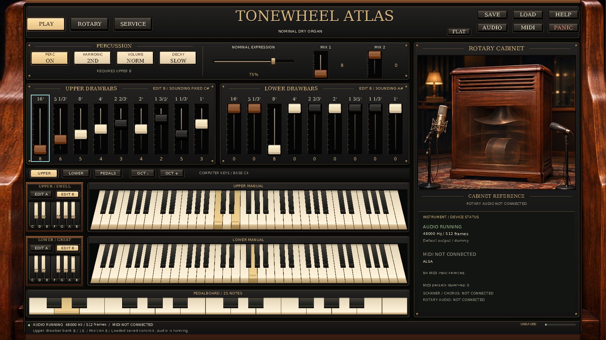
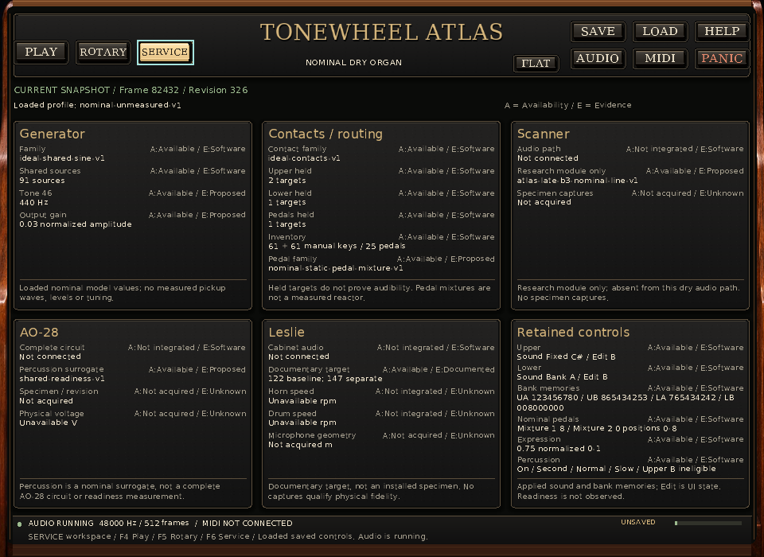
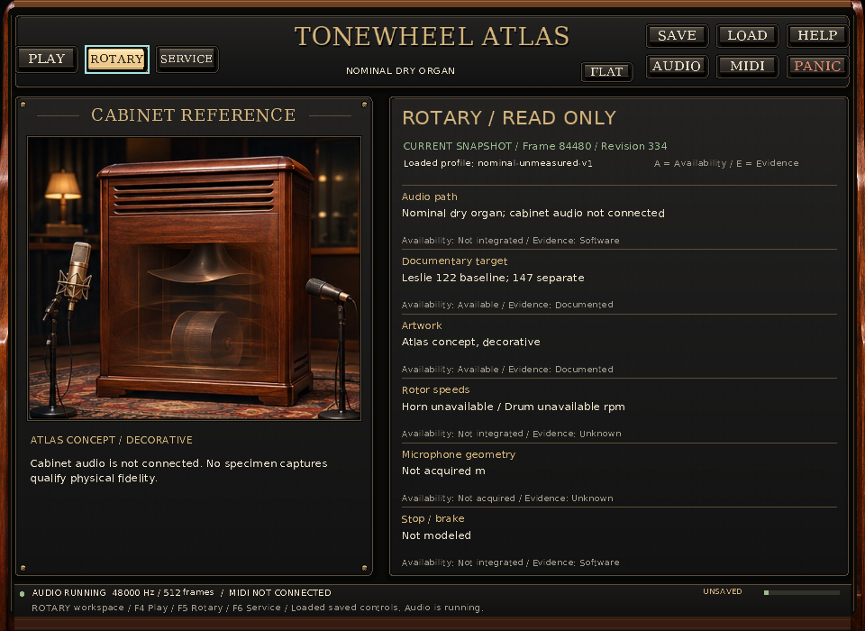
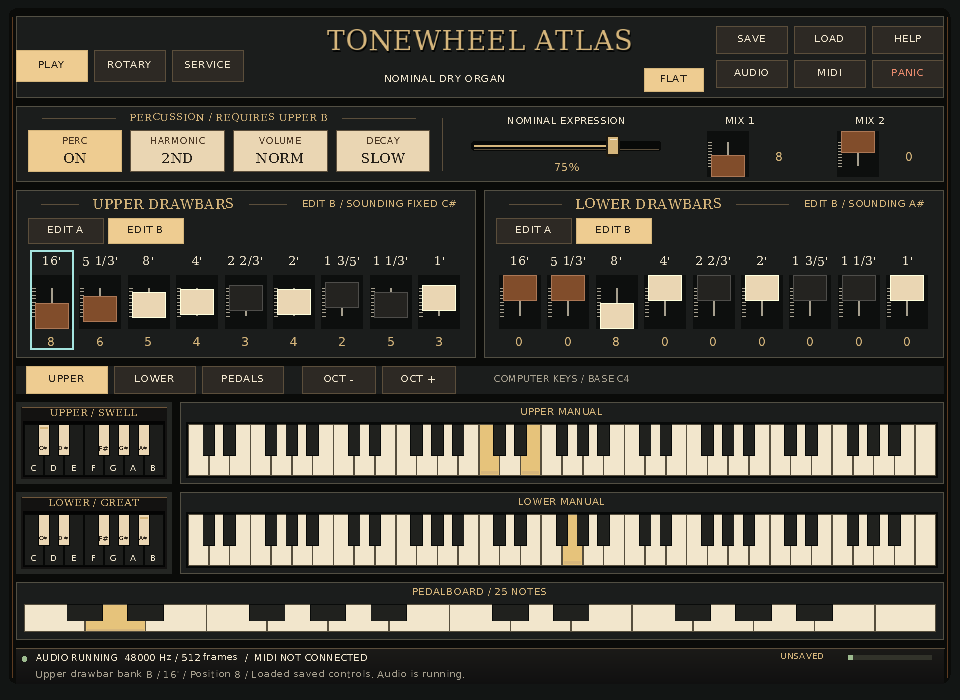

# Actual native interface preview: Play, Service, Rotary and Flat

These eight PNGs come from the actual native standalone application, captured
on 14 November 2026 with the A20 material renderer. All eight processes exited
0 and passed the capture harness's diagnostics, control-state, painted-view,
dimension, held-note and shutdown checks. This is a **provisional source-overlay
preview**; the final coherent publication will receive its own new gallery.

The runs explicitly used **SDL dummy audio and video, with the software
renderer**. They did not open or enumerate a physical MIDI input. SDL 2.32.10,
48 kHz stereo float audio and 512-frame buffers were observed. The configured
RtMidi backend is ALSA, while this local SDL build has `SDL_ALSA=OFF`.

## Actual captures

| Workspace and presentation | Reference 1672 × 941 | Default 1280 × 900 | Minimum 960 × 700 |
| --- | --- | --- | --- |
| Play, dimensional | [Reference](images/play-reference-1672x941.png) | [Default](images/play-default-1280x900.png) | [Minimum](images/play-minimum-960x700.png) |
| Service, dimensional | [Reference](images/service-reference-1672x941.png) | — | [Minimum](images/service-minimum-960x700.png) |
| Rotary, dimensional | [Reference](images/rotary-reference-1672x941.png) | — | [Minimum](images/rotary-minimum-960x700.png) |
| Play, Flat | — | — | [Minimum](images/flat-minimum-960x700.png) |

### Play at the reference size



### Service at the supported minimum



### Rotary at the supported minimum



### Flat at the supported minimum



## What is live in these frames

Every run starts in Play with the same explicit
[B3CONTROLS4 state](inputs/controls.b3controls). Replayed SDL keyboard events hold
Upper notes 60 and 64, Lower note 67 and pedal ID 3. While all four notes remain
held, keyboard focus reaches the Upper B 16-foot drawbar and changes its retained
position from **7 to 8**. Upper fixed C# continues sounding; Lower sounds
adjustable bank A while its edited bank remains B. The final retained banks are
`UA 123456780 / UB 865434253 / LA 765434242 / LB 008000000`.

The replay then selects the requested workspace using F4/F5/F6, or toggles Flat
with F7. The frame is captured at the acknowledged end of the 1,800 ms replay,
with all four original owners still held. The harness checks the entire applied
and desired control state, an observed held state before the edit, the actual
painted screenshot record and the later joined shutdown cleanup. The original
control file remains unchanged: the scripts do not Save. The visible `UNSAVED`
state follows the real drawbar edit.

Service reports current copied software state, including 2/1/1 held targets.
At minimum size all six cards and their 28 rows are visible, including the four
bank memories, retained percussion eligibility, unavailable V/rpm values and
unacquired microphone geometry in m. Rotary describes the cabinet image as
decorative, states that cabinet audio is not connected, and provides no fake
speed or microphone controls. The dimensional manuals have sloped silhouettes
and visible fronts; Flat uses rectangular keys and plain control surfaces.

## Source, executable and pixel provenance

The exact executable SHA-256 is
`005db1e2006bd1929e07dff3acaa40a5a6e6fa60a2bc8f07eb992d972b04b364`.
The source was an implementation overlay on HEAD
`5d81199a9822874b55f3b0a124715cbd6eadf0e5`; **that commit alone does not contain
or identify this UI**. The harness checked every source digest and the binary
digest in the [copied A20 author report](inputs/source-qualification.json).
It additionally observed 98 production source/resource files and 13 generated
or library build inputs before and after the matrix. Their hashes were unchanged.
The observed production inventory digest is
`6eb61ab582aaa01b92f84ded0b49db6896b22eebb4b67bdabc49134acaf6a7bf`.

This checks the supplied author build report against actual files; it is not
an independent rebuild or hermetic source-to-binary attestation. Concurrent
tests, install rules and unrelated documentation are outside the production
inventory. The older A17 integration report cannot qualify this renderer.

[provenance.json](provenance.json) records the complete source/build inventories,
exact commands, environment, Python/Pillow versions, executable before/after
digests, input hashes, assertions and per-case output identities.
[manifest.json](manifest.json) hashes all 39 captured payload/provenance files;
it excludes itself and this subsequently authored review. Full native JSON and
empty stdout/stderr logs are retained under `diagnostics/`.

Each PNG preserves the original BMP's decoded mode, dimensions and every pixel
byte. Only after reopening and comparing the PNG did the harness delete its
own newly produced BMP. Original BMP hashes and decoded-pixel hashes remain in
the provenance. There is no generated imagery or composited application frame.
The gallery occupies less than 2.86 MB, including this review.

## Reproduce into a fresh directory

Use Python 3.10 or later and Pillow in an authoring environment. Pillow is an
optional capture-authoring dependency, imported only when capture begins; it
is not an application runtime dependency. The recorded authoring versions were
Python 3.12.14 and Pillow 13.0.0. From the repository root, with the recorded
native build still available:

```sh
python3 tools/capture_standalone_interface.py \
  --exe ../build-native/apps/standalone/hammond_standalone \
  --source-root . --build-root ../build-native \
  --source-qualification docs/development/2026-11-14-interface-continuation/reports/a20-material-refinement.json \
  --expected-exe-sha256 005db1e2006bd1929e07dff3acaa40a5a6e6fa60a2bc8f07eb992d972b04b364 \
  --dummy-sdl --output out/interface-preview-a20-fresh
```

Create the parent `out/` directory first if necessary. The output directory
itself must not exist, even if empty. The default process timeout is 12 seconds;
`--timeout-seconds` accepts finite values from 4 through 60. The eight fixed
capture sizes and bounded replay avoid retaining extreme-size bitmaps.

A later renderer needs its own current qualification report with matching
`binary_sha256` and `source_sha256` members, including the renderer, drawing,
UI model, inspection model, main and original reference. Never reuse the A20
report after those inputs change. Source/executable drift during the matrix or
changed recorded build/input identities marks the entire output failed. Use a
new output directory for every run; historical galleries remain intact.
Wall-clock callback frame/revision counters can differ between successful runs,
so this is a repeatable capture procedure, not a claim of byte-identical frames
across separate executions.

## Visual review and remaining differences

The [A22 review](../../../docs/development/2026-11-14-interface-continuation/session22-capture-harness.md)
inspected the eight-view contact sheet and full-size Play reference, minimum
Play, Service, Rotary and Flat images against the unchanged
[atlas cover/page-409 concept](../../../docs/design/atlas-cover-reference.jpg).
The walnut/charcoal/brass treatment, dimensional keys, six Service cards and
Flat distinction are visible. **Literal 1:1 reference equality remains open.**
Panel proportions, lighting/material detail, keyboard row heights and cabinet
composition still differ. The application retains two full 61-key manuals,
24 reversed preset keys, 25 pedals, correct musical legends and functional
header tools; the concept has a different inventory and decorative controls.

These captures do not qualify physical audio/MIDI, native display/DPI behavior,
callback deadlines, screen-reader access, measured instrument fidelity or
integrated scanner/AO-28/Leslie sound. The final coherent source/publication and
independent interaction/raster gates remain separate evidence.
