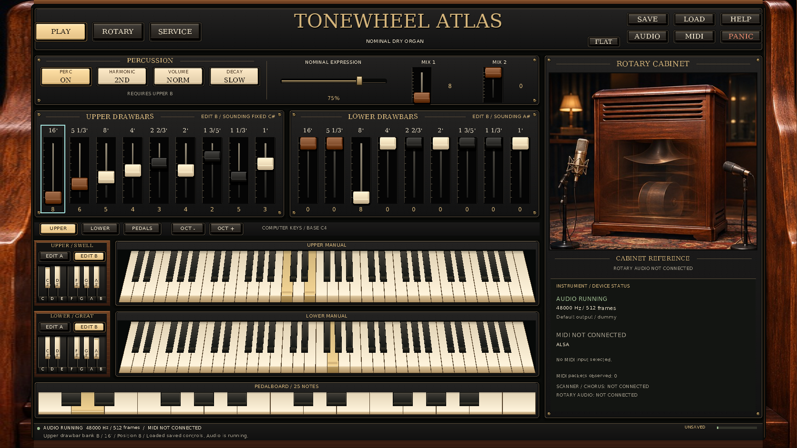
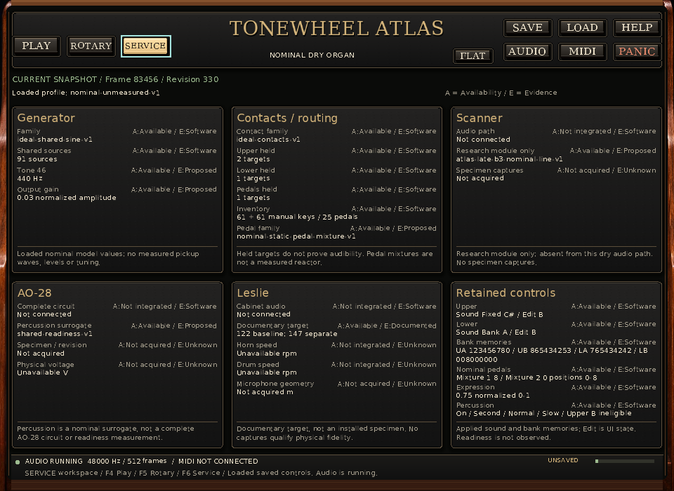
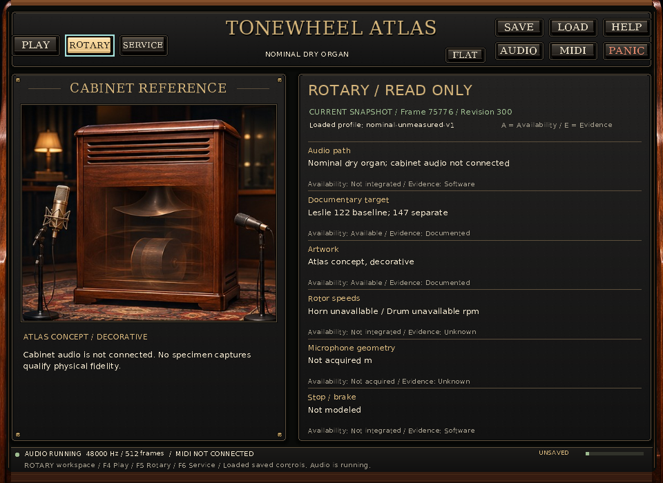
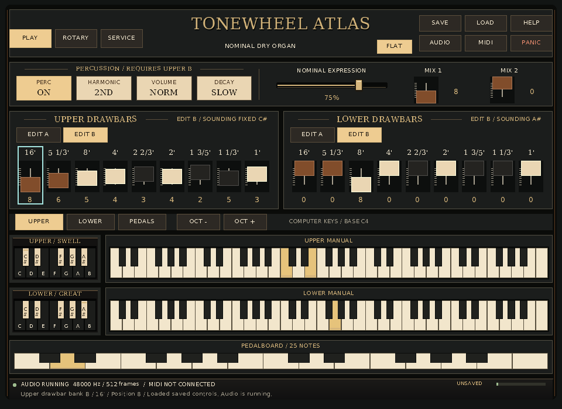

# Final native interface gallery: Play, Service, Rotary and Flat

These **eight actual native application captures** were made on 14 November
2026 from the final product inputs published at
`8673713a484c40e26ac7810c7c4cbc22fa874426`, tree
`e11bd68d6051f663631579ef235325a8775f8133`. They include the later surface,
accidental-preset legend, title-centering and Load-feedback changes. Every
process exited 0 and passed the capture harness's native diagnostics, complete
control-state, actual painted-view, dimension, held-note and shutdown checks.
The [provisional v1 gallery](../standalone-interface-preview-v1/README.md) remains
unchanged; it identifies the earlier A20 renderer and source overlay.

The runs explicitly used **SDL dummy audio and video with the software
renderer**. SDL 2.32.10, 48 kHz stereo float and 512-frame buffers were observed.
RtMidi/ALSA was compiled, but no physical MIDI input was selected, opened or
enumerated. This local SDL configuration has `SDL_ALSA=OFF`. These are logical
and drawable 1:1 native captures; physical devices, native display/DPI and
persistent pointer capture are outside this gallery's executed scope.

## Actual captures

| Workspace and presentation | Reference 1672 × 941 | Default 1280 × 900 | Minimum 960 × 700 |
|---|---|---|---|
| Play, dimensional | [Reference](images/play-reference-1672x941.png) | [Default](images/play-default-1280x900.png) | [Minimum](images/play-minimum-960x700.png) |
| Service, dimensional | [Reference](images/service-reference-1672x941.png) | — | [Minimum](images/service-minimum-960x700.png) |
| Rotary, dimensional | [Reference](images/rotary-reference-1672x941.png) | — | [Minimum](images/rotary-minimum-960x700.png) |
| Play, Flat | — | — | [Minimum](images/flat-minimum-960x700.png) |

### Play at the reference size



### Service at the supported minimum



### Rotary at the supported minimum



### Flat at the supported minimum



## Live state and executed behavior

Every run loads the same explicit [B3CONTROLS4 input](inputs/controls.b3controls)
and starts in Play/Dimensional. Replayed SDL keyboard events hold Upper notes
60 and 64, Lower note 67 and pedal ID 3. While those four original owners remain
held, 25 Tab steps reach the Upper B 16-foot drawbar and Up changes its retained
position from **7 to 8**. Upper fixed C# continues sounding. Lower sounds
adjustable **bank A, selected by preset A#**, while its displayed edit bank
remains B. Final retained memories are
`UA 123456780 / UB 865434253 / LA 765434242 / LB 008000000`.

Expression stays at 0.75 and the nominal pedal positions stay 8/0. Stored
percussion is On / Second / Normal / Slow; the fixed Upper route makes Upper B
ineligible. F4/F5/F6 then selects Play/Rotary/Service, or F7 toggles Flat. The
requested final frame is captured at the acknowledged end of each 1,800 ms
replay, with all four notes still held. Seven plans deliver 66 events each;
Flat delivers 68. All native stdout/stderr logs are empty.

Validation checks an observed held state before the edit, the final desired and
applied controls, all final note arrays, command acknowledgment, current copied
inspection state, the actual screenshot paint record, and later joined shutdown
cleanup. `presentation.screenshot` equals `last_painted` and the presentation
record before shutdown. Startup flags and the cleared shutdown state do not
substitute for the captured frame. The input file stays byte-identical; no Save
is requested. The visible `UNSAVED` indicator follows the real edit. Save/Load,
all 47 sound parameters and native pointer behavior are not exhaustively tested
by this eight-case keyboard scenario; their separate source-qualified gates
remain in the [final review](../../../docs/reviews/INTERFACE_FINAL_GALLERY.md).

Play preserves two full 61-key manuals, 25 pedals and 24 reversed preset keys.
Service shows six cards and 28 rows, including 2/1/1 held targets, applied sound
versus edited-bank selection, all four bank memories, unavailable V/rpm values
and unacquired microphone geometry in m. Rotary labels the cabinet artwork
decorative and the audio path unconnected; Stop/brake is not modeled. Flat
retains the same musical controls, notes and focused drawbar using rectangular
keys and plain panels/caps.

## Exact source, executable and pixel identity

| Recorded identity | SHA-256 |
|---|---|
| Executable, before and after | `bd4991a3b45543a01c9ce435da140af848d45f28ff535699397706e5d3925dc2` |
| 98 production files, A44 path/NUL/SHA/newline digest | `ddf4f7658cfa9ed49ddac87902788c65531697551faab4dadd1dd57709d9e9ad` |
| Same 98 files, harness size-and-SHA JSON digest | `6addb1ff056e07a8dd50d587552814a99fd05921a1512ace39396a232efdfd4c` |
| 13 generated/profile/static-library inputs | `7188e8d9a7c994e3072bda1cd52d4b200cf26dc16a776d34cc0476d869e70b67` |
| Capture harness | `17aafb70e87a2fd557317e04802e62a4d935d2f2b93bf65a2df0d688c5a16545` |
| Gallery provenance | `361b61decc1b8b5e756ca3755db2bb340f76e70ec5f1f82e115045e31a92926b` |
| Capture manifest | `d2e6c6308eea5aa04948dcc282ae0552e71f943a0501ba1283c2736cb6fe84fe` |

The executable is 3,707,640 bytes. A44's configured Release target build and
MIDI-on package/relocation records identify this same binary; its MIDI-on
target-build invocation was already up to date. A46 did not configure or
rebuild. The [copied qualification](inputs/source-qualification.json) derives
its binary and ten mandatory source digests from those records: renderer,
drawing, UI model, inspection model, main and the original reference. Those
**ten admitted source files are a subset**, not a complete build attestation.

Separately, preflight checked **all 98 observed production files against their
committed blobs** and A44's source snapshot. They all matched the published
commit named above. All 98 files, 13 selected build inputs, selected CMake
configuration, executable, harness, qualification and replay/state inputs
stayed unchanged through capture. Four additional cache/link/flags/capability
identities also matched before and immediately after capture. Concurrent
workflow, CMake test-timeout and documentation changes did not alter these
product inputs. Their presence means this was not a clean checkout of the
entire tree. The harness's generic “observed production overlay” boundary is
qualified by this explicit committed-product comparison: **no uncommitted
product overlay was captured**.

The 98-file inventory excludes tests, install rules and unrelated documentation;
the 13 build files are selected generated headers, profile and static libraries.
Compiler/dependency completeness, clean rebuild reproducibility and signed
source-to-binary provenance are not claimed. See the linked
[before](../../../docs/development/2026-11-14-interface-continuation/reports/a46-source-before.json)
and [after](../../../docs/development/2026-11-14-interface-continuation/reports/a46-source-after.json)
snapshots and [A44 final package record](../../../docs/development/2026-11-14-interface-continuation/reports/a44-final-package-result.json).

[provenance.json](provenance.json) retains exact commands/environment,
Python 3.12.14 and Pillow 13.0.0, all source/build inventories, per-case native
diagnostics and original BMP/decoded-pixel identities. Each newly produced BMP
was converted losslessly to PNG, reopened and compared for mode, size and every
decoded byte before that BMP was removed. The PNGs were not composited,
retouched or generated. The native renderer itself draws the retained source
artwork as decoration. No full reference picture replaces a live app frame.

[manifest.json](manifest.json) identifies 39 capture payload/provenance files;
it excludes itself and this subsequently authored README. The
[independent reader](../../../docs/development/2026-11-14-interface-continuation/reports/a46-gallery-verification.json)
recomputed all 39 file sizes/hashes and every decoded PNG identity, then
rechecked the retained native records. All 41 files in v1 still equal their
published blobs. The eight PNGs total **2,677,186 bytes**; the complete gallery
remains below 3 MB. No raw BMP, application binary or build cache is retained.

## Reproduce into a new directory

Use Python 3.10 or later and Pillow in the capture-authoring environment. Pillow
is a lazy optional authoring dependency, not an application runtime dependency.
From the repository root, with the recorded A44 native build still available:

```sh
python3 -B tools/capture_standalone_interface.py \
  --exe ../build-native/apps/standalone/hammond_standalone \
  --source-root . --build-root ../build-native \
  --source-qualification examples/demos/standalone-interface-preview-v2/inputs/source-qualification.json \
  --expected-exe-sha256 bd4991a3b45543a01c9ce435da140af848d45f28ff535699397706e5d3925dc2 \
  --dummy-sdl --output out/interface-final-fresh
```

Create the parent `out/` directory first if needed. The output directory must
not already exist. The default per-process timeout is 12 seconds; the accepted
override range is 4–60 seconds. The current report admits only its named
executable and source digests. A changed product or binary requires new source
qualification and a fresh gallery. Preserve this gallery and all previous
versions. Callback clocks and revision text can vary across separate runs;
the procedure does not promise byte-identical images across executions.

To verify the retained output without another native launch:

```sh
python3 -B docs/development/2026-11-14-interface-continuation/reports/a46-verify-gallery.py
```

The reader checks existing bytes and writes its verification report. It does
not require the live build tree or mutate gallery payloads.

## Visual comparison and remaining work

All eight PNGs and the original 1672 × 941 reference were visually inspected.
The unchanged [atlas cover/page-409 image](../../../docs/design/atlas-cover-reference.jpg)
has SHA-256 `9d802c3577367a904516fdd90dd51effb73bc3d0c692c1c7a2fa29699d54a187`.
It is design concept art, not a hardware photograph or calibration reference.

**Literal 1:1 equality remains unmet.** Native panels have smoother gradients,
thinner bevels and simpler lighting than the source's textured, softly lit
surfaces. The extra computer-key row, 24 preset keys and 25 pedals compress the
full manuals into shallower rows. The reference's large left-hand tablets do
not contain the application's complete preset inventory. Real header tools,
expression/pedal controls and status text alter the composition. The Play
cabinet panel contains an artwork crop and honest runtime information instead
of the concept's microphone/rotor controls; it disappears at narrow sizes.
Service and read-only Rotary have their own functional layouts.

The centered title and two-line accidental legends are visible in the final
native frames. The six minimum-size Service cards and wrapped bank memory row
fit within their panels; small text still requires native display/DPI review.
The [detailed comparison](../../../docs/reviews/INTERFACE_FINAL_GALLERY.md#comparison-with-the-original-reference)
keeps these material, proportion and inventory differences concrete. A31's
injected renderer scale proof remains separate from these full-application
captures. No physical-device, audio deadline, screen-reader, host, scanner/
AO-28/Leslie integration or specimen-fidelity pass follows from this gallery.

### A50 provenance reconciliation — 14 November 2026

An independent provenance review verified the original PDF/reference/assets,
all 98 observed product files against both `8673713` and published `cdbb2be`,
and every retained PNG's file and decoded-pixel identity. The ten-file capture
admission, 98-file product observation and 13-file selected build observation
remain distinct; this is not a complete source-to-binary rebuild attestation.

The capture's copied qualification pins an earlier 3,486-byte A44 package
result, SHA-256 `738ac4970c5cb225e9b3fda8933f6145eebb557e0c2d5ecb46de08a8b9095047`.
The published final report is 3,509 bytes, SHA-256
`332055972738e624a9ca75bae87557a96b45a8b4426c70006bcf1c906e9e12fd`.
[A50's reconciliation](../../../docs/development/2026-11-14-interface-continuation/reports/a50-a46-a44-edge-reconciliation.json)
reproduces the earlier hash exactly by changing only two top-level keys:
`runtime_packages` → `packages` and
`build_install_drift_during_runtime` → `build_install_drift`.
All values agree. The [retained reconstruction](../../../docs/development/2026-11-14-interface-continuation/reports/a50-reconstructed-a44-at-capture.json)
is derived from the final report, not an independently archived original.
The original capture records and manifest remain unchanged; the discrepancy
does not change the recorded executable, product inputs or PNGs. See the
[independent provenance review](../../../docs/reviews/INTERFACE_FINAL_PROVENANCE.md)
for the exact scope and remaining limits.
