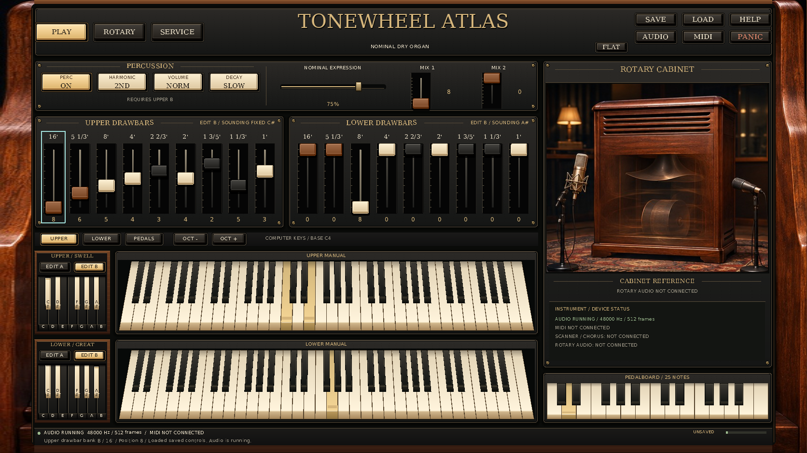
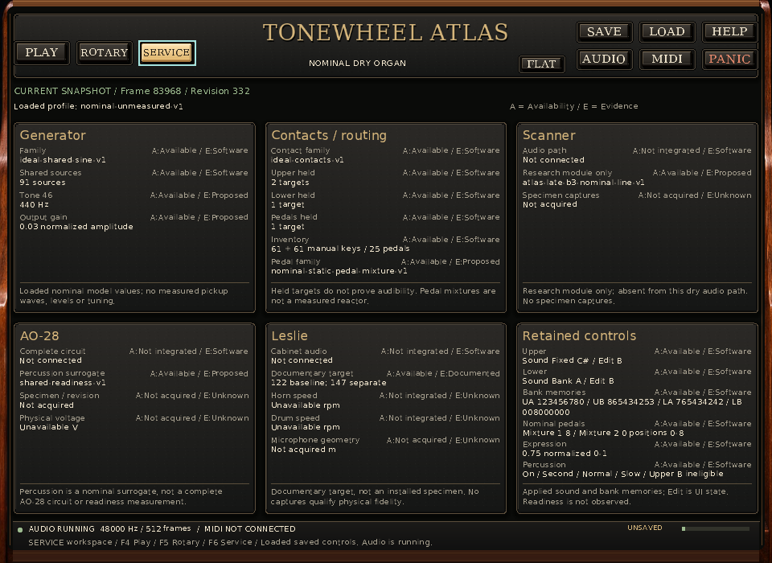
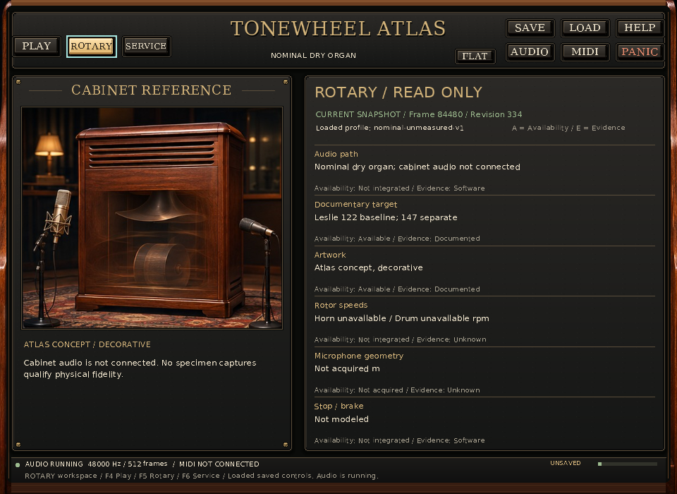
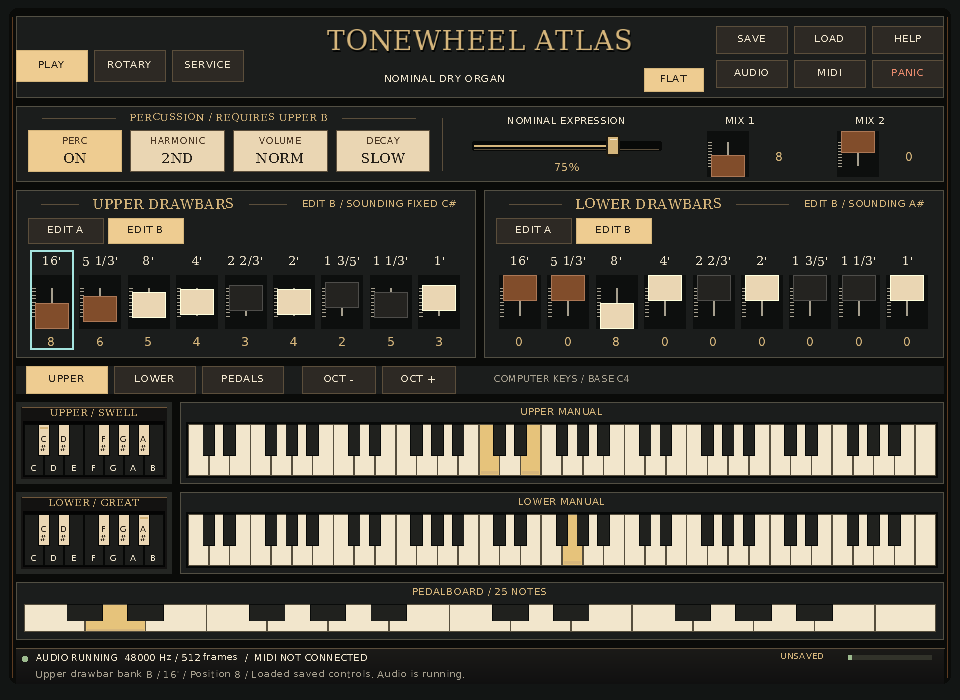

# Reference refinement: eight actual native interface views

These eight captures show the native application from published product commit
`2e161dc3a60fc3442051799574feed37bffbfc5c`, tree
`17f8e4d698f903c37bff09deee196ea73e0da108`. A31 rebuilt the standalone target
and captured the views on 14 November 2026. Every process exited zero and passed
the retained control-state, replay, painted-view, held-note, dimension and
joined-shutdown checks. The [v1](../standalone-interface-preview-v1/README.md)
and [v2](../standalone-interface-preview-v2/README.md) galleries remain unchanged.

The runs explicitly used **SDL dummy audio and video with the software
renderer**, with equal logical and drawable dimensions. Observed audio was
48 kHz stereo native float32 with 512-frame buffers, using SDL 2.32.10.
The Release executable includes RtMidi 6.0.0/ALSA and an X11-capable SDL build;
these captures selected no MIDI input and made no device-discovery request.
`SDL_ALSA=OFF`, `SDL_X11=ON` and `HAMMOND_ENABLE_MIDI=ON` are separate build
settings. No physical audio/MIDI or native display qualification follows.

## Actual captures

| Workspace and presentation | Reference 1672 × 941 | Default 1280 × 900 | Minimum 960 × 700 |
|---|---|---|---|
| Play, dimensional | [Reference](images/play-reference-1672x941.png) | [Default](images/play-default-1280x900.png) | [Minimum](images/play-minimum-960x700.png) |
| Service, dimensional | [Reference](images/service-reference-1672x941.png) | — | [Minimum](images/service-minimum-960x700.png) |
| Rotary, dimensional | [Reference](images/rotary-reference-1672x941.png) | — | [Minimum](images/rotary-minimum-960x700.png) |
| Play, Flat | — | — | [Minimum](images/flat-minimum-960x700.png) |

### Play at the reference size



### Service at the supported minimum



### Rotary at the supported minimum



### Flat at the supported minimum



## Live state and verified behavior

Every process loads the same [B3CONTROLS4 input](inputs/controls.b3controls),
starts in Play/Dimensional, and receives the retained SDL keyboard replay.
Upper notes 60 and 64, Lower note 67 and pedal ID 3 remain held. While these
four original owners are held, 25 Tab steps reach the Upper B 16-foot drawbar;
Up changes its retained position from **7 to 8**. Upper fixed C# continues
sounding. Lower sounds adjustable **bank A, selected by preset A#**, while
its independently chosen edit bank remains B.

Final bank memories are `UA 123456780 / UB 865434253 / LA 765434242 /
LB 008000000`. Expression remains 0.75, pedal mixtures remain 8/0, and stored
percussion remains On / Second / Normal / Slow. Upper B is ineligible while
the fixed Upper registration sounds. F4/F5/F6 selects the requested workspace;
F7 selects Flat for the eighth case. The seven dimensional plans deliver
66 events each and the Flat plan delivers 68, all within the same 1,800 ms
replay contract. No Save is requested, the input remains byte-identical, and
the visible `UNSAVED` state follows the real edit.

The final screenshot is the acknowledged endpoint with a current copied
snapshot. The capture utility checks an observed held state before the edit,
complete final desired/applied controls, exact note arrays, command
acknowledgment, the actual painted view and subsequent joined cleanup. Its
producer version records the newer painted hold/capture fields without
asserting them; A31's [supplemental verification](../../../docs/development/2026-11-14-reference-refinement/reports/A31-native-gallery.json)
explicitly checks **Upper 2 / Lower 1 / Pedals 1** in every painted screenshot,
equality with the final painted/before-shutdown records, and false/zero pointer
capture flags and counters for this keyboard-only scenario. All eight native
stdout/stderr pairs are empty. Audio progressed without reported sample,
format or render faults; shutdown stopped the session and cleared held notes.

## Visual review and remaining differences

A31 directly opened all eight original PNGs, plus the unchanged original
[reference](../../../docs/design/atlas-cover-reference.jpg) and v2 reference
Play frame. The reference-size Play capture visibly deepens both complete
manuals and places all 25 pedals in a separate panel below the cabinet.
Cabinet/status ink stays clear of the pedals. Warmer cap faces, darker key
fronts and restrained charcoal materials retain readable legends, the focused
drawbar and held-key marks. Default/minimum Play retains its compact allocation.

Both Service frames show all six cards and 28 rows, including correct singular
`1 target` labels, applied sound versus Edit B, all four bank memories and
explicit unavailable electrical/rotary values. The minimum bank-memory text
wraps within its card. Both Rotary frames show the six read-only facts and
label the cabinet image decorative and its audio unconnected. Flat retains
the playing inventory, held marks and focus with plain panels/caps and
rectangular keys. No cropped content or panel overlap was observed in these
eight frames.

Literal reference-image equality remains unmet. Live tools, correct key/preset
inventory, the pedalboard and truthful status create deliberate composition
differences; the concept's surface texture and lighting also differ. Tiny
preset legends still require real display/DPI assessment. These are settled
captures; the separate [A18 evidence](../../../docs/development/2026-11-14-reference-refinement/notes/A18-pending-raster-implementation.md)
owns the genuine pending-state rendering gate. Modal overlays, OS pointer
capture, accessibility, physical devices and acoustic fidelity are outside
this gallery's executed scope.

## Exact source, build and pixel identity

| Recorded input or artifact | SHA-256 |
|---|---|
| Executable, before and after capture | `97ed35cbf618792155c15106862d8bc5f416b7cf6d073c9e37e94babdf8bc9a9` |
| Accepted `InstrumentView.cpp` | `428f74c4b2aae72e1ee048d1fa878575d0cd2edc064b1a3865ba40c446c30da2` |
| 111-file author qualification inventory | `6b11122ee676bb0a7fb3d535a6f9403028b8dbdb687dec6d07b7e5e919c97dcc` |
| 100-file capture production inventory | `2fbf6fc46edcfb7300c078b70350a0c2caf53357fa2609b6322642aaab97f991` |
| 13 selected generated/profile/static-library inputs | `4799c5b0dcf4d1d95e4f71f032449670cd355fa99f05a0e4375df381b48f6113` |
| Capture producer | `17aafb70e87a2fd557317e04802e62a4d935d2f2b93bf65a2df0d688c5a16545` |
| Gallery provenance | `32b111d1001a75b89d6b50267bb1f81c9203af23df11e3866c0c168844503f0f` |
| Capture manifest | `1d486225c8eff4c3f19461f6188cb99be464d40d7e41ab921981e949d06ddcf4` |

The executable is **3,856,304 bytes**. The
[copied author qualification](inputs/source-qualification.json) pins all
100 files in the producer's production inventory plus eleven CMake source
files. The repository files reported by the native Ninja input closure add
no further distinct paths to that set. Every one of these 111 files matched
the published commit before and after the actual target rebuild/capture.
The rebuild used GCC 14.2.0 and CMake 4.4.5 in the existing Release desktop
tree; it compiled the changed painter and linked the executable.
[Build](../../../docs/development/2026-11-14-reference-refinement/reports/A31-build.log)
and [capture](../../../docs/development/2026-11-14-reference-refinement/reports/A31-capture.log)
logs retain the actual outcomes. A31 did not configure a new clean build or
rerun the integrator's full CTest suite.

All 100 production files, 13 selected build inputs, selected configuration,
executable, capture producer, qualification and replay/state files stayed
unchanged through capture. Nine additional cache/build-plan/capability/prepared
RtMidi identities also stayed unchanged. These are named observed file sets,
not a compiler/dependency-complete, hermetic or independently signed
source-to-binary attestation. The complete repository may have concurrent
documentation or later tool edits outside the captured product.

[provenance.json](provenance.json) retains exact commands, environment,
source/build inventories, Python 3.12.14/Pillow 13.0.0, diagnostics and native
BMP/decoded-pixel identities. Each fresh BMP was encoded losslessly as PNG,
reopened and compared byte-for-byte at the decoded-pixel level, then removed.
The PNGs were neither generated nor composited, cropped or retouched. Reference
art is drawn only by the native application's existing decorative surfaces.

[manifest.json](manifest.json) hashes 39 capture payload/provenance files,
excluding itself and this later README. A31 recomputed all 39 identities and
all eight decoded PNG hashes. The PNGs total **2,707,580 bytes**, and the entire
gallery remains below 3 MB. All 41 files in each prior gallery still match
their published blobs. No raw BMP, binary or build cache is retained here.

## Reproduce into a fresh directory

Use Python 3.10+ and Pillow, the identified executable/build tree and matching
product source. From the repository root, create `out/` if needed, then:

```sh
python3 -B tools/capture_standalone_interface.py \
  --exe ../build-desktop/apps/standalone/hammond_standalone \
  --source-root . --build-root ../build-desktop \
  --source-qualification examples/demos/standalone-interface-preview-v3/inputs/source-qualification.json \
  --expected-exe-sha256 97ed35cbf618792155c15106862d8bc5f416b7cf6d073c9e37e94babdf8bc9a9 \
  --dummy-sdl --output out/interface-v3-repeat
```

The original producer identity is retained above and in the capture commit.
The output directory must not already exist. A changed executable or qualified
source requires a new observed build qualification; do not reuse this digest
for a different binary. Callback clocks and revision text can vary across
executions, so the procedure does not promise byte-identical images.
