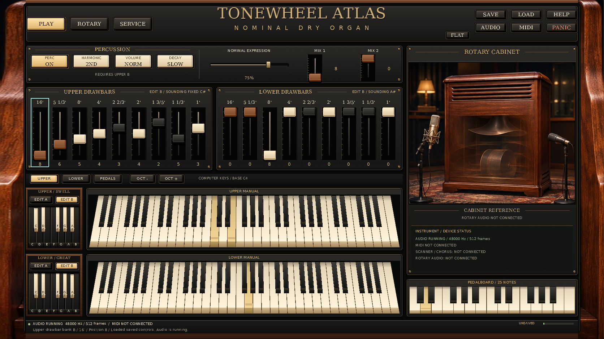
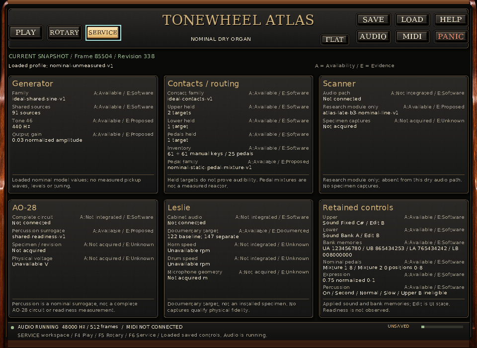
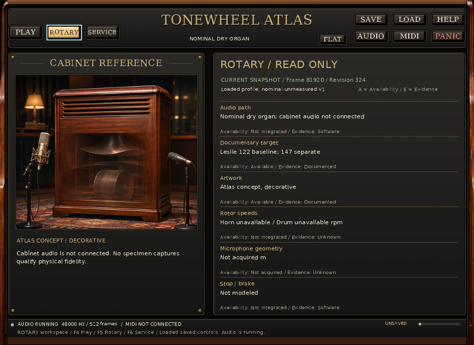
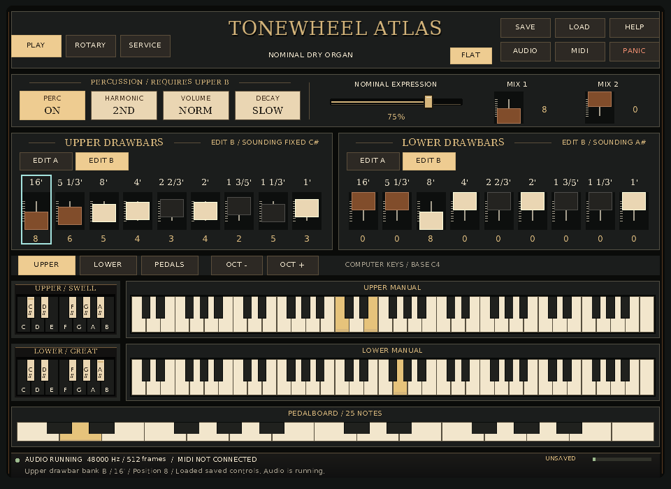

# Final reference refinement: eight actual native interface views

These eight captures show the native application from published product commit
`0881d1f4c5a26ce9c75dda7a3adde46382e5ab6b`, tree
`f8144b771cda1264a8788f8297f5bfec999f4a08`. A46 executed the existing desktop
target build and all eight native processes on 14 November 2026. Every process
exited zero and passed the strengthened producer's actual painted-view,
held-target, owner, control-state, replay, dimension and joined-shutdown checks.
The [v1](../standalone-interface-preview-v1/README.md),
[v2](../standalone-interface-preview-v2/README.md) and
[v3](../standalone-interface-preview-v3/README.md) galleries remain unchanged.

The captures use **SDL dummy audio and video with the software renderer**.
They are actual native application screenshots, distinct from the separately
recorded real OS-window/input journey. Logical and drawable dimensions match.
Observed audio is 48 kHz stereo native float32 with 512-frame buffers, using
SDL 2.32.10. The Release executable includes RtMidi 6.0.0/ALSA and uses an
X11-capable SDL build; these captures selected no MIDI input and made no
device-discovery request. `SDL_ALSA=OFF`, `SDL_X11=ON` and
`HAMMOND_ENABLE_MIDI=ON` describe separate build settings. These dummy-driver
runs do not qualify a physical audio/MIDI device, a native display or DPI.

## Actual captures

| Workspace and presentation | Reference 1672 × 941 | Default 1280 × 900 | Minimum 960 × 700 |
|---|---|---|---|
| Play, dimensional | [Reference](images/play-reference-1672x941.png) | [Default](images/play-default-1280x900.png) | [Minimum](images/play-minimum-960x700.png) |
| Service, dimensional | [Reference](images/service-reference-1672x941.png) | — | [Minimum](images/service-minimum-960x700.png) |
| Rotary, dimensional | [Reference](images/rotary-reference-1672x941.png) | — | [Minimum](images/rotary-minimum-960x700.png) |
| Play, Flat | — | — | [Minimum](images/flat-minimum-960x700.png) |

### Play at the reference size



### Service at the supported minimum



### Rotary at the supported minimum



### Flat at the supported minimum



## Live state and strict validation

Each process loads the same [B3CONTROLS4 input](inputs/controls.b3controls),
starts in Play/Dimensional and receives the retained SDL keyboard replay.
Upper notes 60 and 64, Lower note 67 and pedal ID 3 remain held. While those
four original owners are held, 25 Tab steps reach the Upper B 16-foot drawbar;
Up changes its retained value from **7 to 8**. Upper fixed C# continues
sounding. Lower sounds adjustable **bank A, selected by preset A#**, while
its independently selected edit bank remains B. No Save operation occurs.

F4/F5/F6 select the requested workspace; F7 selects Flat for the final case.
The native diagnostics observe the initial held state before the live edit,
the full desired and applied final controls, a current acknowledged copied
snapshot and the final painted frame. Seven scripts deliver 66 events and
Flat delivers 68. Strict validation requires exactly **Upper 2 / Lower 1 /
Pedals 1**, using integer counts, in the screenshot observation. It requires
equality with the last-painted and before-shutdown observations and exact
false/zero pointer-capture flags and counters for this keyboard-only replay.

All eight native stdout/stderr pairs are empty. Audio callbacks and native
rendering progressed with zero reported sample, format, overrange, nonfinite
or render faults. No queue overflow, rejected command, recovery or session
fault was recorded. Joined shutdown stopped the session, cleared held owners
and left MIDI closed and quiescent. A46 repeated the unchanged producer's
strict endpoint validation over the retained diagnostics after capture.

## Direct visual review

A46 opened all eight original PNGs, the unchanged original
[reference](../../../docs/design/atlas-cover-reference.jpg) and the immutable
v3 reference Play image. The wide reference-size Play, Service and Rotary
frames visibly contain the accepted larger title and widely spaced truthful
`NOMINAL DRY ORGAN` caption. The measured header acceptance belongs to the
source-specific [A40 implementation](../../../docs/development/2026-11-14-reference-refinement/notes/A40-reference-header-refinement.md)
and [A41 independent review](../../../docs/development/2026-11-14-reference-refinement/notes/A41-header-independent-acceptance.md);
this gallery supplies actual native frames from their published source.

Reference Play retains both complete manuals, all preset rails, the focused
Upper B drawbar and four held-note marks. Its sidebar pedalboard remains
separate from cabinet/status ink. Default and minimum Play retain compact
geometry, complete manuals and their bottom pedalboard. Both Service frames
show all six cards and 28 rows, singular `1 target` labels and the distinction
between applied sound and Edit B; minimum bank-memory text wraps within its
card. Both Rotary frames retain all six read-only facts, decorative artwork,
unavailable rotor speeds/geometry and unconnected cabinet audio. Flat retains
the playing inventory, held marks and focus with plain panels and rectangular
keys. No cropped content or panel overlap was observed in these eight images.

**Literal whole-interface reference equality remains unmet.** Live tools,
correct key/preset inventory, the pedalboard and truthful status differ from
the concept; materials, lighting and bevels also retain visible differences.
Tiny preset legends still need real display/DPI review. These are settled,
acknowledged captures; [A18's genuine pending-state rendering evidence](../../../docs/development/2026-11-14-reference-refinement/notes/A18-pending-raster-implementation.md)
is separate. No modal-overlay, OS pointer-capture, native accessibility,
physical device, audio-deadline or calibrated acoustic claim follows. R4
waveform work remains a separate track; no rotary audio enters this dry path.

## Exact source, build and pixel identity

| Recorded input or artifact | SHA-256 |
|---|---|
| Executable, before build and after build/capture | `01fe78a55b7a9bc72228dafe175f5a8eb48481c063f217606474d4dff682320f` |
| Accepted `InstrumentView.cpp` | `f323c8c2f5529b03c25deccb74f482d8b6312487492a45d14b94ef0e24cfbb6a` |
| 111-file qualified source inventory | `bffd31d6a2caa65872ece2cb4614902608c30c3dffc9af0c21aa4bd0a3a110fd` |
| 100-file production inventory | `af45e17d8b9a32bac44d4d1d356ab9d73e8c0a90f8fd4d97acb1cfaa5610e341` |
| Eleven CMake source files | `1ca5abb055d73f34384c59b62719ff1a70c1075a7b3e3ad82028e2d8b530cf67` |
| Seven font/atlas source files | `7de010d5247f3d41f6655645712adb8248a9b5bd6c2b3bdcb7a0d550fd9f6509` |
| Thirteen selected generated/profile/static-library inputs | `4799c5b0dcf4d1d95e4f71f032449670cd355fa99f05a0e4375df381b48f6113` |
| Strengthened capture producer | `92ae0be31a6ef21eb696c87d4f9dacd8ea8a6732d6c1033e0d7457ca3a76d16b` |
| Gallery provenance | `f106efc20838c1acb3a392e3d39989ed34b770829a3859deaa95e64cd8a657be` |
| Capture manifest | `2ed031aa1ecda5a67fa32a4268676602d709250c596ed2be0a24b69c682da5e8` |

The executable is **3,860,368 bytes**. The
[copied author qualification](inputs/source-qualification.json) pins all 111
qualified product/CMake source files. Every entry matched its blob in the
named published commit before and after the build/capture. The existing
GCC 14.2.0/CMake 4.4.5 Release desktop target build completed in **1.02 seconds**.
Ninja automatically refreshed CMake after discovering the published
`tests/test_refinement_session.py` glob addition, then reported **no work to
do**: no compile or link command ran, and the existing executable was unchanged.
There was no separate configure request, clean rebuild or full CTest run.
The [build log](../../../docs/development/2026-11-14-reference-refinement/reports/A46-build.log)
retains the automatic refresh and SDL deprecation warning; the
[capture log](../../../docs/development/2026-11-14-reference-refinement/reports/A46-capture.log)
records eight successful captures in **19.14 seconds**.

[A46's report](../../../docs/development/2026-11-14-reference-refinement/reports/A46-final-native-gallery.json)
links exact before-build, after-build and after-capture snapshots. All 100
production files, eleven CMake source files, seven font/atlas files, thirteen
selected build inputs, nine additional cache/build-plan/capability/prepared
RtMidi files, selected configuration, executable and producer stayed unchanged
at those observations. Concurrent documentation was present; **no clean
whole-worktree claim is made**. These are named observed inputs, not a
compiler/dependency-complete, hermetic or independently signed build attestation.

[provenance.json](provenance.json) preserves exact commands, environment,
source/build inventories, Python/Pillow versions, diagnostics and native
BMP/decoded-pixel identities. Each fresh BMP was losslessly encoded as PNG,
reopened and compared byte-for-byte at the decoded-pixel level, then removed.
The PNGs were neither generated nor composited, cropped or retouched. The
application draws its existing source artwork only on decorative surfaces.

[manifest.json](manifest.json) hashes 39 capture payload/provenance files,
excluding itself and this later README. A46 recomputed all 39 file identities
and all eight decoded PNG hashes. The PNGs total **2,722,450 bytes** and this
single gallery remains below 3 MB. All 41 files in each of v1/v2/v3 still match
their published blobs. No raw BMP, executable or build-cache archive is retained.

## Reproduce into a fresh directory

Use Python 3.10+ with Pillow, the identified executable/build tree and matching
product source. From the repository root, create `out/` if needed, then run:

```sh
python3 -B tools/capture_standalone_interface.py \
  --exe ../build-desktop/apps/standalone/hammond_standalone \
  --source-root . --build-root ../build-desktop \
  --source-qualification examples/demos/standalone-interface-preview-v4/inputs/source-qualification.json \
  --expected-exe-sha256 01fe78a55b7a9bc72228dafe175f5a8eb48481c063f217606474d4dff682320f \
  --dummy-sdl --output out/interface-v4-repeat
```

The output directory must not already exist. Changed executable or qualified
source bytes require a new observed build qualification. Callback clocks and
revision text may vary, so repeated execution does not promise byte-identical
images. Preserve this gallery and every earlier result as originally captured.
