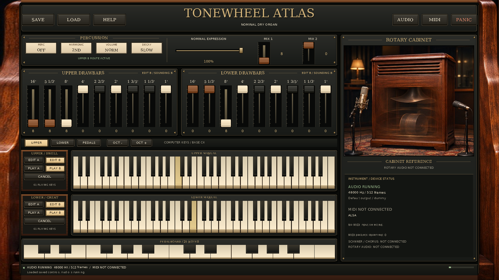
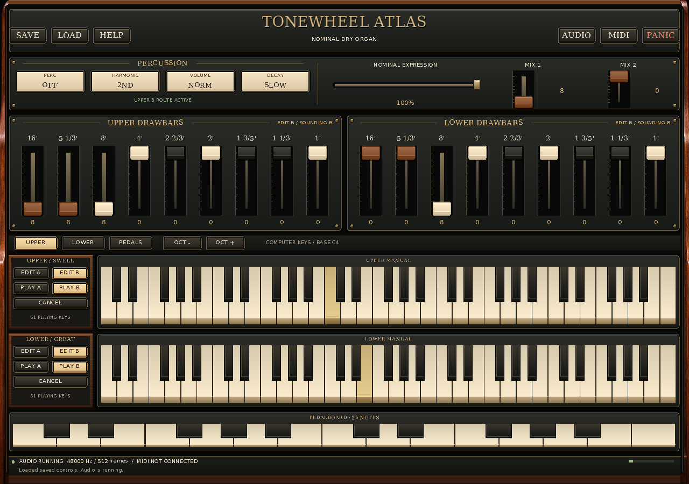
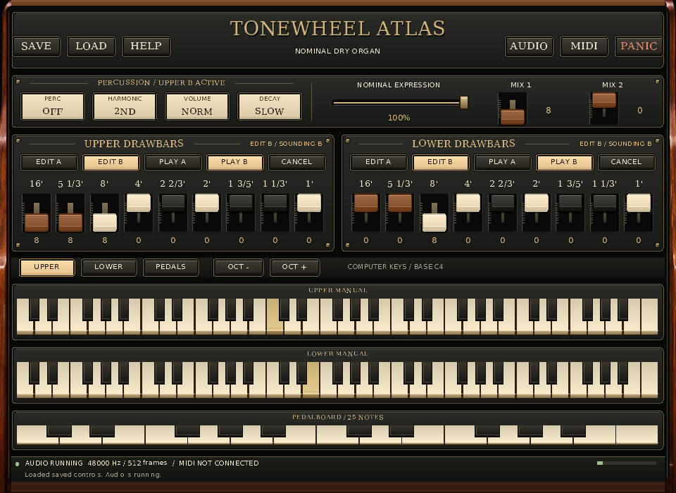
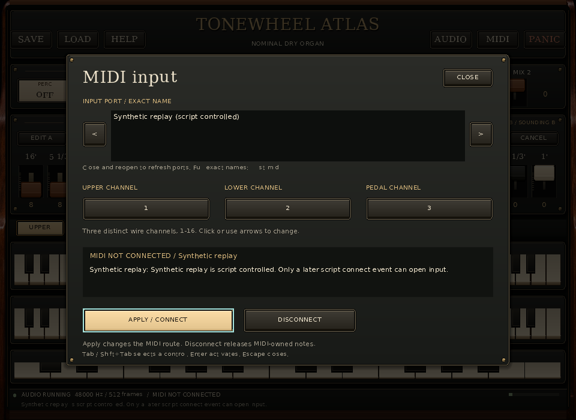

# Initial native MIDI/UI gallery — before the typography repair

These are **four actual `hammond_standalone` backbuffer captures** from
2026-11-14 UTC. Three player views show live **Upper C4 / MIDI 60** and
**Lower E4 / MIDI 64** held through the real `B3UIREPLAY1` input path. The fourth
shows the actual MIDI modal at minimum size, opened and applied through UI
replay while an explicit `B3MIDIREPLAY1` source holds the same notes.

This is an **initial edition**. The known narrow-glyph dropout remains visible
in small instructions and footer text. It precedes A29's typography correction;
the later refined gallery belongs in a new edition. It is not a complete
legibility pass or a pixel-identical reproduction of the atlas concept.

| Actual state | Logical and drawable pixels | Image | Unmodified native diagnostics |
| --- | --- | --- | --- |
| Reference-size player | 1672 × 941 | [PNG](images/reference-1672x941.png) | [JSON](diagnostics/reference-1672x941.json) |
| Default-size player | 1280 × 900 | [PNG](images/default-1280x900.png) | [JSON](diagnostics/default-1280x900.json) |
| Minimum-size player | 960 × 700 | [PNG](images/minimum-960x700.png) | [JSON](diagnostics/minimum-960x700.json) |
| **Synthetic MIDI** modal | 960 × 700 | [PNG](images/midi-synthetic-960x700.png) | [JSON](diagnostics/midi-synthetic-960x700.json) |









## Qualification and musical state

Every process explicitly used **SDL dummy audio, SDL dummy video and the software
renderer**. These are application renders, not desktop photographs, generated
replacement screens or physical instrument captures. The application executed
its normal UI, Session and audio callback paths. No physical MIDI port was opened
or enumerated: the three players select no input and never open the MIDI modal;
the modal uses `--midi-script`, whose native application path bypasses enumeration.
Native MIDI generation and every native device callback counter remain zero.

The modal's visible `Synthetic replay (script controlled)` and `MIDI NOT
CONNECTED / Synthetic replay` labels describe the real source. The synthetic
decoder is active; no native hardware connection is implied. Its UI script opens
Ctrl+M, moves focus to Apply and presses Return. Apply leaves the script route
unchanged. The generic native Apply instruction and duplicated synthetic status
prefix are initial presentation residuals.

The [player script](inputs/held-manuals.b3ui) contains eight events over 1400 ms.
It selects Upper, holds C4, selects Lower, holds E4 and returns the destination
for future presses to Upper without releasing either original owner. The modal
has a [14-event UI script](inputs/midi-modal.b3ui) and an equally long
[three-record MIDI script](inputs/midi-modal.b3midi): one explicit connect and
two note packets. Opening a modal releases UI owners, so the modal deliberately
uses MIDI owners for its retained notes.

Each run reads its own explicit `state/*.b3controls` file. All four use the
existing nominal audition values: Upper B `888000000`, Lower B `008000000`,
both routes enabled, both A banks zero, expression `1`, pedal mixtures `80`,
and percussion Off / Second / Normal / Slow. These are normalized dry-core
controls, not a measured factory registration. All state/script bytes remained
unchanged; the app never uses a default preference path.

| Observed result | Reference | Default | Minimum | Synthetic modal |
| --- | ---: | ---: | ---: | ---: |
| Exit code / application errors | 0 / 0 | 0 / 0 | 0 / 0 | 0 / 0 |
| Audio callbacks | 140 | 135 | 132 | 133 |
| Rendered audio frames | 71,680 | 69,120 | 67,584 | 68,096 |
| Painted images | 23 | 29 | 43 | 35 |
| Delivered UI events | 8 | 8 | 8 | 14 |
| Accepted note On / Off commands | 2 / 0 | 2 / 0 | 2 / 0 | 2 / 0 |
| Final acknowledged script sequence | 3 | 3 | 3 | 4 |
| Maximum MIDI packets drained in a turn | 0 | 0 | 0 | 2 |
| Held notes after joined shutdown | None | None | None | None |

All four diagnostics report `[[60],[64]]` and no pedals at the acknowledged
pre-shutdown endpoint. Every replay passed and completed delivery; the modal's
MIDI replay also passed with 3/3 records and 2/2 packets. Its observed producer
maximum was two records against the declared 512-record budget; the common
drain maximum was two against the 32-packet budget. This small gallery does not
exercise either maximum capacity boundary. Obtained audio was 48,000 Hz,
512 frames, native float32 stereo, with positive callback progress and zero
audio faults, Session recoveries, queue overflows or application errors.

## Exact source and retained evidence

The executable is **3,583,376 bytes**, SHA-256
`e8871447021a1373e2bfdc262a513d12487e49fd0e833bad068f226a6938ed2d`.
Root supplied the coherent linked build. Before the concurrent typography work,
A28 copied the executable and selected source/configuration files to a private
snapshot and compared original, copied and original-after-copy hashes. Captures
ran that private executable. All recorded executable/source/build/dependency
identities matched again after the captures.

The local base was `e09107414896c2c53dad124a74f60c8043fadfe4`, tree
`1f117a17cf561fae8978adeb612abf9ad29d7b64`, **plus the captured uncommitted
MIDI-replay and fixture changes**. The base commit alone does not contain the
captured application. The integrator's
[checkpoint record](../../../docs/development/2026-11-14-midi-ui/reports/publication-checkpoints.json)
identifies prepared repository-equivalent `e918b332ccc64d0307e60f53bf7c7f53ffd141e9`;
this gallery does not independently attest its publication or a remote branch.

| Captured source input | SHA-256 |
| --- | --- |
| `apps/standalone/main.cpp` | `22719975ed910b0b23db841617446e492890d89f2106cc04279fc9e46824f42e` |
| Initial `Drawing.cpp` | `4d13a5eb312799b341e44a41f52960e44c04da1a7b05ecfdda86bc635e1ecda9` |
| `InstrumentView.cpp` | `82c7171626f16039ac4877a8cafc12928941d51fb295a37d0f23ac6c294c6e8e` |
| `UiModel.cpp` | `ac1a381367cfee7cce61e27ebd0b094c76a730806383e9ead609622687993e28` |
| Prepared RtMidi source | `240705532b17e593dc17434259233a586c9136808724124f1d3af649eadea17a` |
| Generated reference-art header | `d94cefd9ad69726c267d4674acd66912f4764ee9f88d1c21ecce4ed7befcbac6` |

[provenance.json](provenance.json) retains exact commands, working directories,
environment, timings, per-run inputs, diagnostics/image hashes, decoded RGB
hashes, all 191 selected source-file identities, 157 selected build/configuration
identities and 1,881 dependency/compiler/library identities before and after.
The tool/source identities identify the actual files; this is not a signed or
hermetic source-to-binary attestation. [metadata](metadata/source-context.json)
retains the earlier copy receipt and actual dirty-worktree context.

For exact source recovery, the
[source overlay archive](metadata/source-delta-from-e091074.tar.gz) preserves the
17 actual selected files that differed from the base, including the two new
MIDI-replay source files. [Its receipt](metadata/source-delta.json) lists every
member/hash. Apply it only to a separate checkout of the named base (or a
verified equal tree), then compare all selected files with `source.before` in
the provenance before building. No source was rewritten to produce a screen.

The configuration is Release with GNU C++ 14.2.0, CMake 4.4.4, pinned SDL
2.32.10 and RtMidi 6.0.0 with prepared ALSA 1.2.14. The local build explicitly
has `SDL_ALSA=OFF`; RtMidi's separate ALSA backend remains enabled. This known
local SDL/header workaround and dummy execution do not qualify a physical
platform backend. The exact CMake cache and compilation database are retained.

Pillow **13.0.0** under Python **3.12.14** encoded the native BMPs as PNGs
without resizing, cropping, retouching or changing mode. Every decoded pixel
byte and every decoded RGB byte matched. Each `images/*.bmp.gz` file contains
the original native BMP bytes losslessly; its uncompressed hash is recorded.
[manifest.json](manifest.json) identifies the original 31 generated capture
files. [bundle-manifest.json](bundle-manifest.json) also covers the subsequent
review/README/source-overlay receipts, excluding only itself.

## Reproduce a new bounded gallery

Use an already-built executable and its matching frozen source/build metadata.
The [capture utility](../../../tools/capture_standalone_reference.py) requires
Python 3.10+ and Pillow for authoring only; the native app has no Pillow runtime
dependency. The build must retain its CMake cache and compilation database, and
the configured SDL/RtMidi Git checkouts must remain available for dependency
inventory. The output directory **must not exist**, even if empty.

```sh
python3 -B tools/capture_standalone_reference.py \
  --exe /absolute/path/to/build/apps/standalone/hammond_standalone \
  --source-root /absolute/path/to/matching-frozen-source \
  --build-root /absolute/path/to/matching-build \
  --output /absolute/path/to/new-capture-directory \
  --dummy-sdl --timeout-seconds 12
```

For the exact retained binary, additionally pass
`--expected-exe-sha256 e8871447021a1373e2bfdc262a513d12487e49fd0e833bad068f226a6938ed2d`.
The utility records the actual supplied executable and file inventories; it
does not build, infer a binary's source from its name, download dependencies,
open a physical port, or overwrite an old gallery. It creates separate input,
state, run, image, diagnostic and log paths, runs each child with a finite
timeout, validates the actual endpoint and produces a failed receipt on error.
Its default four runs total 5.6 seconds of declared replay time. Callback counts,
meter state, timings and image hashes may change on a new wall-clock run.

The first author attempt failed during dependency inventory, before launching
any native process, because SDL tracks a symlink to an Android source directory.
The utility now hashes a symlink's target bytes instead of opening it as a file.
The [failed receipt](attempts/dependency-symlink-preflight-failure.json) remains;
the successful gallery followed that concrete correction. Three
[admission checks](attempts/admission-checks.json) also retain rejection of an
existing output, missing dummy acknowledgment and a nonfinite timeout without
launching the application or changing the existing sentinel bytes.

## Visual review and next edition

The original 1672 × 941 atlas JPEG and all four PNGs were opened and inspected.
[visual-review.json](visual-review.json) records the observations and exact
image identities. [pixel-checks.json](pixel-checks.json) independently samples
literal key interiors below the accidentals: Upper C4 and Lower E4 differ from
their unheld neighboring naturals in all three unobscured player views.

The reference-size cabinet/status column, default left bank rails and minimum
compact rack controls fit their respective views. No major panel edge clipping
or control overlap was observed in these exact states. The small manual labels,
footer and MIDI instructions visibly lose narrow glyph strokes. This agrees
with [A21's initial review](../../../docs/development/2026-11-14-midi-ui/21-visual-acceptance.md).
The initial stretched wood crop, flatter rectangular keys/control planes,
different fonts and layout choices also remain unlike the concept image.
`CABINET REFERENCE` and `ROTARY AUDIO NOT CONNECTED` remain factual qualifiers.

A29 owns the narrow-glyph correction; A39 will retain a new gallery from the
later refined source. Keep this initial edition and all earlier demo editions
unchanged. Physical controller/audio behavior, live resize transitions, high-DPI
display usability, screen-reader semantics, latency/deadlines and acoustic
Hammond/Leslie fidelity remain separate gates.
