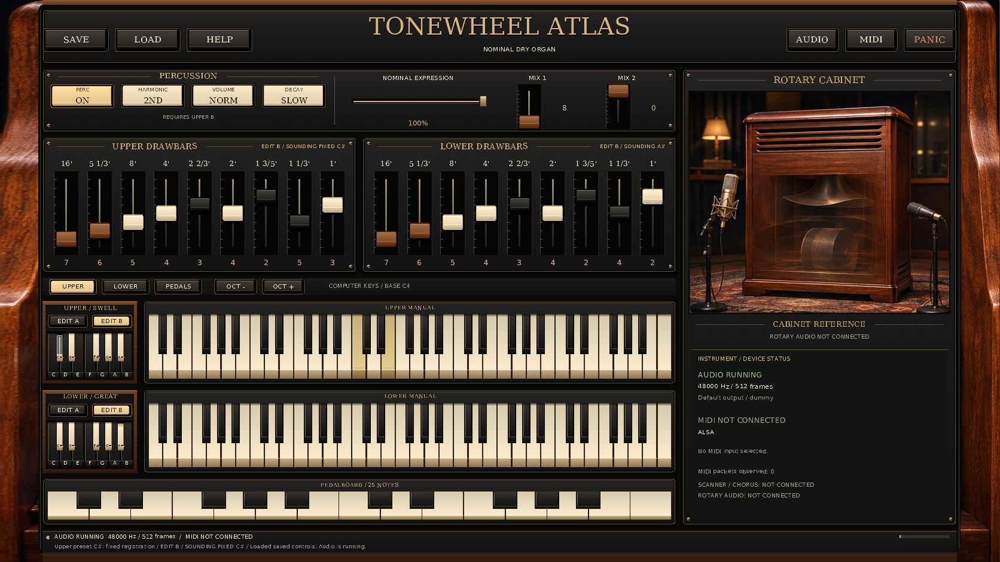

# Actual native preset feature preview

This 1672×941 image was captured from the real standalone application after the
A25 focus repairs. Upper fixed C# sounds while its remembered B bank remains
editable; Lower A# sounds adjustable bank A. Upper MIDI notes 60 and 64 are held.
The stored percussion choice is On, and the visible eligibility caption correctly
requires Upper B. The actual RtMidi ALSA backend is enabled with no input selected.



The application exited 0. Native diagnostic schema 3 reports delivered and
acknowledged replay, `passed=true`, a screenshot while notes were held, SDL
2.32.10, dummy audio/video and software drawing. The PNG preserves every decoded
RGB byte of the original BMP. The input state was unchanged; this script does
not Save. Exact commands, hashes, source identity and limitations are retained
in [provenance.json](provenance.json) and [copied diagnostics](reports/native.json).

The executable SHA-256 is
`557acb27d16cfc77815c278778335f8418b471b563d1b93a47bf3051eae68c82`.
Its source is the [A28 copied-source manifest](../../../docs/development/2026-11-14-preset-continuation/reports/a28-source-final.json),
SHA-256 `72874cd7ceeaada3da152297d265b501dc33517896b14d02883256508d48c6cd`.
The base checkout commit `35554c0` alone does not identify that implementation overlay.
The [A25 review](../../../docs/reviews/PRESET_UI_ACCEPTANCE.md) records both actual
focus defects and their corrected raster tests.

To reproduce with a current built application, use a new output directory:

```sh
mkdir -p out/preset-preview
./build-standalone/apps/standalone/hammond_standalone   --state examples/demos/standalone-presets-preview-v1/inputs/controls.b3controls   --input-script examples/demos/standalone-presets-preview-v1/inputs/input.b3uireplay   --width 1672 --height 941   --screenshot out/preset-preview/frame.bmp   --diagnostics out/preset-preview/native.json
```

The recorded run explicitly set `SDL_AUDIODRIVER=dummy` and
`SDL_VIDEODRIVER=dummy`; set those environment variables when reproducing the
same headless conditions. The app embeds its admitted nominal profile and has
no `--profile` option. An initial incorrect invocation was rejected before SDL
with exit 2; its [error](reports/initial-command-error.txt) is retained separately
from the corrected successful capture.

This preview is an intermediate feature checkpoint. The forthcoming full gallery
will cover additional sizes and states. The source [reference photo](../../../docs/design/atlas-cover-reference.jpg)
remains the target: keyboard perspective, panel proportions, material detail and
small accidental labels still differ. No literal 1:1 match, physical MIDI/audio,
callback deadline or measured instrument fidelity is claimed.
