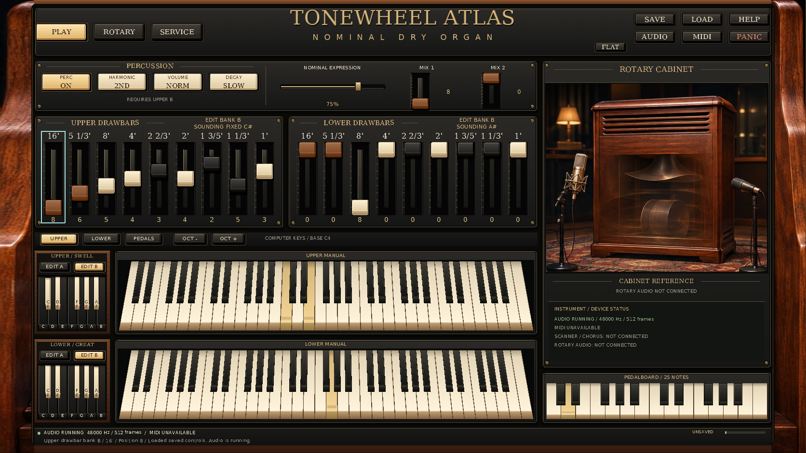
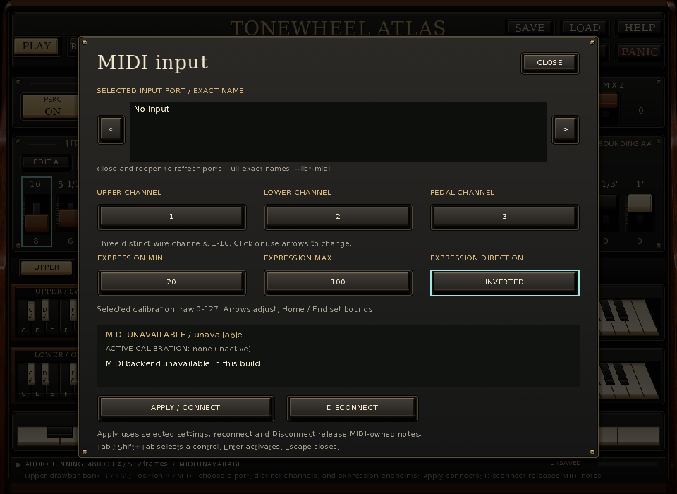

# Native product gallery v1

Eleven actual standalone application screenshots captured on 15 November 2026:
eight instrument/workspace views and three separately qualified MIDI-dialog
views. The capture source is **`d556da017ea0a5d4f2d231416782dbc5066e58c2`**, tree
`a3150fd2489a50a430b02c01eadd5e0c180bc7f9`. The executable SHA-256 is
`7ded143b676e9d51a29549dae12184763042a1f12192f72802db7927fa707852`.

*Play at the atlas reference size: complete footage labels, separate edit and
sounding-registration rows, the focused retained Upper B 16-foot drawbar at 8,
and held targets in both manuals and the pedalboard. The cabinet picture is
decorative atlas artwork inside the actual application; its audio is not connected.*

## Two distinct capture contracts

| Payload | Evidence | Captured endpoint |
| --- | --- | --- |
| Eight normal views | [Provenance](provenance.json), [39-file manifest](manifest.json), [inputs](inputs/controls.b3controls) | No overlay; Upper notes 60/64, Lower 67 and pedal 3 remain held. |
| Three MIDI-dialog views | [Separate provenance](midi-overlay/provenance.json), [18-file manifest](midi-overlay/manifest.json), [capture script](midi-overlay/capture.py) | MIDI overlay open; all four earlier UI owners released and acknowledged; direction control focused. |

The parent manifest remains the unmodified, bounded payload generated by the
normal capture tool. It covers its eight images, inputs, diagnostics and
provenance, and excludes the manifest itself and subsequently authored
README/review files. The later `midi-overlay/` directory is a separate capture
payload with its own manifest; it does not extend or satisfy the normal tool's
no-overlay/held-note admission. No historical gallery was overwritten.

Both runs used Linux Release, SDL 2.32.10 dummy audio/video, the software
renderer and **native MIDI backend OFF**. The obtained audio configuration was
48,000 Hz, 512 frames, stereo native float32. These are software capture settings,
not observations of a physical display, controller or audio device.

The copied [integrator build receipt](inputs/source-qualification.json) pins
108 production inputs and the executable after its observed target build at
`b9d352a82ac1afdec70c76ec5b1987785a37762e`. All 108 still match these later
`d556da0` captures. Both provenance files independently record the capture-time
commit/tree, production inventory, 13 generated/library build inputs, selected
configuration, tools and executable before/after. Every recorded input stayed
unchanged during capture. The receipt's older CMake-rule hashes describe that
earlier observation; later test-only CMake changes are not a fresh full-build-rule
attestation. Neither capture script rebuilds or independently proves compilation.

## Instrument and workspace views

| View | Actual PNG | Caption |
| --- | --- | --- |
| Play, reference | [1672 × 941](images/play-reference-1672x941.png) | Wide Dimensional racks and natural-key materials, full manuals/presets, cabinet column and side pedalboard. |
| Play, default | [1280 × 900](images/play-default-1280x900.png) | Responsive instrument layout with the pedalboard below the manuals and the same acknowledged musical state. |
| Play, minimum | [960 × 700](images/play-minimum-960x700.png) | Compact racks, presets, manuals and pedalboard; focus remains on the edited retained drawbar. |
| Service, reference | [1672 × 941](images/service-reference-1672x941.png) | Current copied snapshot identifies 91 shared sources, held targets, retained controls and explicit unavailable/unconnected models. |
| Service, minimum | [960 × 700](images/service-minimum-960x700.png) | The same six inspection panels at minimum size, with wrapped text and a current acknowledged snapshot. |
| Rotary, reference | [1672 × 941](images/rotary-reference-1672x941.png) | Decorative cabinet reference alongside read-only facts; nominal dry audio and unavailable rotor/microphone data remain explicit. |
| Rotary, minimum | [960 × 700](images/rotary-minimum-960x700.png) | Compact cabinet/reference layout; no connected rotary processing is implied. |
| Flat Play, minimum | [960 × 700](images/flat-minimum-960x700.png) | Flat presentation retains the same controls, held targets and focused live edit. |

Each 1,800 ms replay delivered 66 events, or 68 for Flat. It first established
the four held targets, then changed retained Upper B 16-foot from 7 to 8.
Upper fixed C# remained selected for sounding; Lower used adjustable bank A
(the A# preset). Expression remained 0.75, pedal mixtures 8/0 and percussion
On/Second/Normal/Slow. The complete control snapshot, pending flags and final
command acknowledgment were checked. The original `B3CONTROLS4` input bytes
were unchanged because Save was not invoked.

## MIDI expression dialog

*Illustrative selected/configured calibration: minimum 20, maximum 100,
Inverted. The real dialog reports **MIDI UNAVAILABLE** and **ACTIVE CALIBRATION:
none (inactive)**; the cyan outline is actual keyboard focus on direction.*

| View | Actual PNG | Caption |
| --- | --- | --- |
| Dimensional, reference | [1672 × 941](midi-overlay/images/midi-reference-1672x941.png) | Centered modal over the wide instrument; unavailable backend and inactive calibration are visible. |
| Dimensional, minimum | [960 × 700](midi-overlay/images/midi-minimum-960x700.png) | All channel, endpoint, direction and action controls fit at the minimum window size. |
| Flat, minimum | [960 × 700](midi-overlay/images/midi-flat-minimum-960x700.png) | The same modal values and focus with Flat controls and background. |

Each 4,800 ms replay first performed the normal held-note/live-edit sequence,
then opened MIDI with Ctrl+M. Modal entry submitted the real scoped
`ReleaseUiNotes` command. All four earlier targets became empty and their
release was acknowledged; the individual Note Off counter correctly remained
zero. Every modal focus stop was actually painted. The retained replay focus
path is `0,1,2,3,4,5,6,7,8,9,10,0,10,9,8,7`, exercising forward and reverse
wrap before ending on direction (index 7).

CLI arguments supplied the **illustrative** 20/100/Inverted values; they were
not measured from a pedal. Selected and configured values were equal, active
calibration was null, and reconnect/release pending were false. Native device,
discovery, MIDI packet and decoder activity remained zero. These frames show
an inactive configuration and focus/release behavior; they do not exercise
selected/configured divergence, Apply, reconnection or an active decoder.
The [overlay contract](midi-overlay/README.md) describes the separate checks.

## Pixel preservation and review boundaries

All eleven processes exited 0 with empty stdout/stderr, acknowledged final
state, zero recorded audio/Session faults and clean joined shutdown. Their
screenshot observation exactly equals the final painted/before-shutdown
observation. Each native BMP was decoded, saved as PNG and decoded again;
mode, dimensions and every pixel byte matched. Provenance retains the original
BMP file hash, PNG file hash and decoded-pixel SHA-256. Only each run's own BMP
was removed, after that equality check; no pixel was retouched or generated.

A40 directly inspected all eleven original PNGs and the
[atlas reference](../../../docs/design/atlas-cover-reference.jpg). The frames
retain the accepted full manuals, correct control inventory and explicit
model/device status. The minimum Service text is necessarily dense. The native
rack geometry, controls, key materials and typography still differ from the
concept. See the source-specific
[reference-gap review](../../../docs/design/PRODUCT_REFERENCE_GAPS.md) for the
remaining design boundaries; independent gallery admission is a separate review.

**Literal whole-interface 1:1 equality remains unmet.** These captures do not
qualify hardware MIDI/audio, physical display response, accessibility, latency,
callback deadlines or measured organ/circuit/cabinet fidelity. The playable
Engine remains nominal and dry, with scanner and rotary audio unconnected.

## Reproduction

Original commands and working directories are retained in both provenance
files. Use the identified source, qualified executable/build inputs and Pillow
in the authoring Python environment. Both scripts require a **new** output
directory and refuse overwrite. The normal tool is
[`tools/capture_standalone_interface.py`](../../../tools/capture_standalone_interface.py),
captured at SHA-256
`83c214d6f0d6b0fc06910412f41f13a0f3286bebd034280a19d4e5e397875b1f`.
The [retained overlay script](midi-overlay/capture.py) imports only its identity,
configuration and replay-input helpers, then applies its own explicit modal
admission. Use `--help` for required paths and identity arguments; keep the
two output directories and contracts separate.
