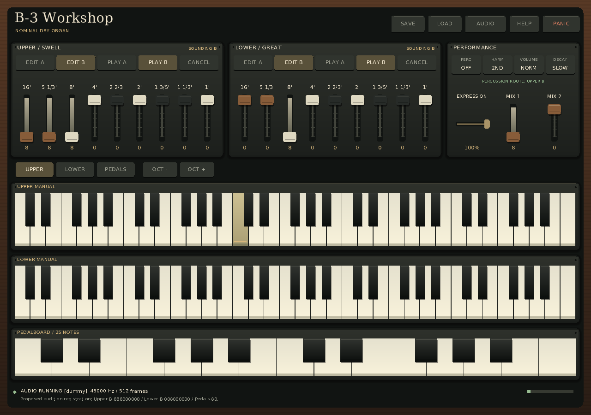
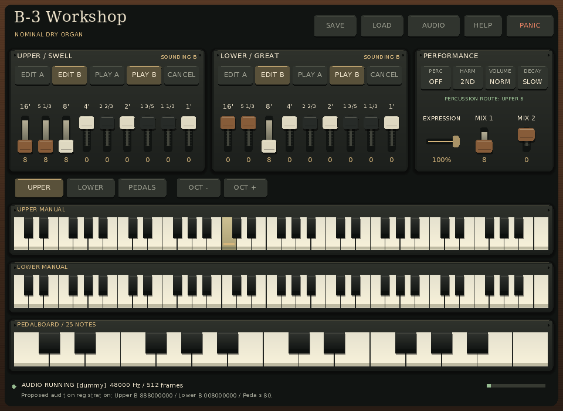
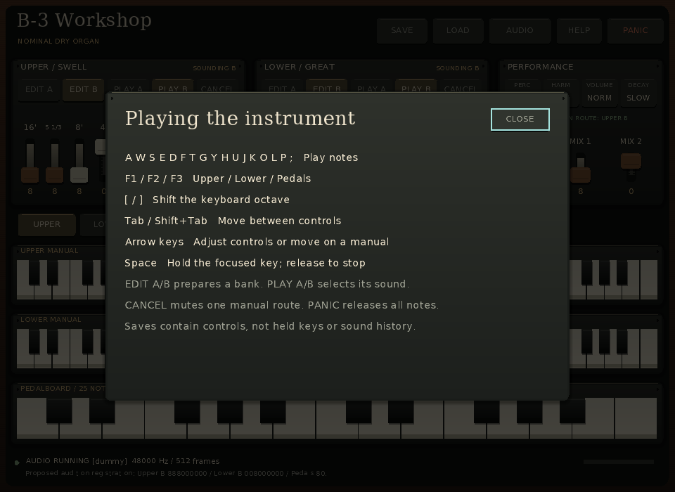
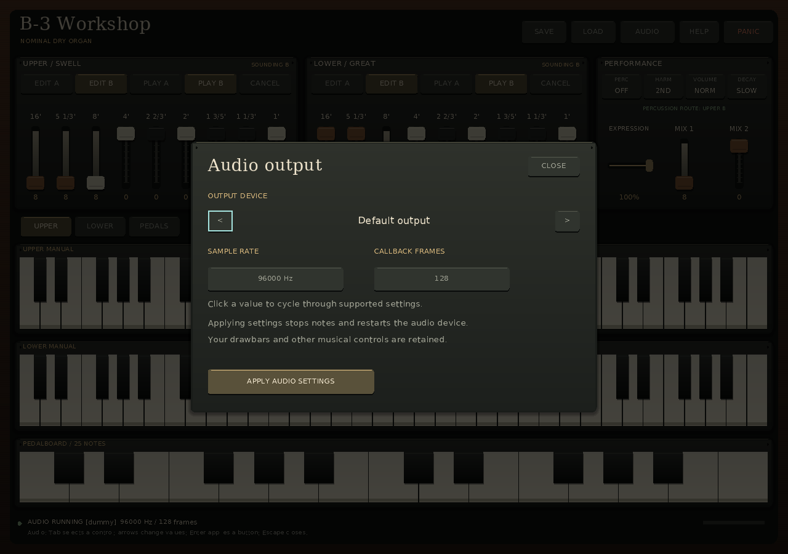

# Actual standalone window demonstration

These four images are lossless PNG copies of backbuffers produced by the linked
`hammond_standalone` executable on 2026-11-13. The executable ran the normal UI,
Session and audio callback paths with explicitly selected SDL dummy video and
audio drivers. The obtained renderer was `software`. These are application
renders, not mockups or photographs of a desktop or physical instrument.

| Capture | Logical/drawable pixels | State and retained evidence |
| --- | --- | --- |
| [Reference](reference.png) | 1280 × 900 | Upper C4 held during a passed 600 ms smoke; [diagnostics](reference.json). |
| [Minimum](minimum.png) | 960 × 700 | Same held-note smoke at the supported minimum; [diagnostics](minimum.json). |
| [Help](help.png) | 960 × 700 | Help opened through Shift+/; [replay](help.b3ui), [diagnostics](help.json). |
| [Audio](audio.png) | 1280 × 900 | Apply 96000 Hz / 128 frames, reopen Audio; [replay](audio.b3ui), [diagnostics](audio.json). |









## Source and meaning

Source commit: `387275289410d12af27cf235d6e45fd91f29bafa`.
Source tree: `0d6da163edd6531338938e12e0d393841d569a80`.
Executable SHA-256: `7377e8c2c146636ef3b4ca28891d257bbfcc9db8b6f42caa257b6857d97d9925`.
The integrator built this frozen source with GCC 14.2.0, CMake 4.4.4, Release,
the pinned SDL 2.32.10 static dependency and the embedded DejaVu 2.37 glyphs.
The executable hash matched before and after all four captures.

Each run began with an absent private control-state file. The displayed
Upper B `888000000`, Lower B `008000000`, pedals `80` are the application's
proposed audition registration. They are not a measured factory registration.
The embedded profile is `nominal-unmeasured-v1`: the existing dry nominal core
feeds identical left/right channels. See the [model guide](../../../docs/STANDALONE_MODEL.md)
and [third-party notices](../../../THIRD_PARTY_NOTICES.md).

[provenance.json](provenance.json) records exact executable/source/dependency/profile
identities, actual arguments and environment, diagnostics hashes, original BMP
hashes/dimensions and PNG hashes. Its absolute paths identify the private capture
inputs; they are not portable prerequisites. The four application JSON files
are unmodified. Original BMPs and process logs stayed outside the repository.
Pillow 13.0.0 saved RGBA PNGs without resizing, cropping or color conversion;
decoded mode, dimensions and every pixel byte were compared equal to each BMP.

## Reproduce the four states

Build the identified source snapshot in a separate checkout using the
[native build instructions](../../../docs/STANDALONE_APP.md) and
[pinned dependency contract](../../../docs/STANDALONE_DEPENDENCY.md).
Use the matching built executable below. Keep this bundle available from the
current checkout because these evidence files were added after the captured
source commit. Python with Pillow is needed only for BMP-to-PNG conversion.

Run this Bash block from the checkout containing this README, replacing the
executable path. All application state/output leaves are private and initially
absent. The function uses the same relative arguments as the retained runs.

```sh
set -eu
HAMMOND_DEMO_APP=/absolute/path/to/build/apps/standalone/hammond_standalone
HAMMOND_DEMO_BUNDLE="$(pwd)/examples/demos/standalone-window-v1"
HAMMOND_DEMO_RUN="$(mktemp -d)"
export HAMMOND_DEMO_RUN
run_demo() (
  demo_case="$1"; demo_width="$2"; demo_height="$3"; shift 3
  mkdir "$HAMMOND_DEMO_RUN/$demo_case"
  cd "$HAMMOND_DEMO_RUN/$demo_case"
  if [ "$#" = 1 ]; then
    cp "$HAMMOND_DEMO_BUNDLE/$1" .
    set -- --input-script "$1"
  fi
  SDL_AUDIODRIVER=dummy SDL_VIDEODRIVER=dummy "$HAMMOND_DEMO_APP" \
    --state controls.b3controls --width "$demo_width" --height "$demo_height" \
    "$@" --screenshot capture.bmp --diagnostics diagnostics.json
)
run_demo reference 1280 900 --smoke-ms 600
run_demo minimum 960 700 --smoke-ms 600
run_demo help 960 700 help.b3ui
run_demo audio 1280 900 audio.b3ui
python3 - <<'PY'
import os
from pathlib import Path
from PIL import Image
root = Path(os.environ['HAMMOND_DEMO_RUN'])
for name in ('reference', 'minimum', 'help', 'audio'):
    folder = root / name
    with Image.open(folder / 'capture.bmp') as bmp:
        bmp.load()
        mode, size, pixels = bmp.mode, bmp.size, bmp.tobytes()
        bmp.save(folder / 'capture.png')
    with Image.open(folder / 'capture.png') as png:
        assert (png.mode, png.size, png.tobytes()) == (mode, size, pixels)
    assert not (folder / 'controls.b3controls').exists()
print(root)
PY
```

Require process exit 0; `errors.count` and audio/session fault counters must be
zero, drivers `dummy`, renderer `software`, and `held_after_shutdown` false.
The two smoke records must pass, observe hold/release and report
`screenshot_while_held: true`. Both replay records must pass and be delivered
and finally acknowledged. Help schedules/pushes 2 events with 1 device start;
Audio schedules/pushes 18 events with 2 starts and obtains 96000 Hz / 128 frames.
These are wall-clock workflows: callback counts, image counts, meters and image
hashes may vary between runs. Hashes identify the retained run, not a promise
of bit-identical renders on other systems or builds.

## Visual review and next gate

All four PNGs were inspected directly. No panel or keyboard edge clipping,
button-label collisions or footer overlaps were observed in these states.
The held upper key is distinct at both sizes. Help text and its cyan Close
focus outline fit at minimum size; Audio labels, values, Apply button and
focused device selector fit at reference size. The minimum-size pitch labels
and footer remain small; usability on a real display is still unqualified.

See the [review](../../../docs/reviews/STANDALONE_WINDOW_DEMO.md) for exact
observations. The next gate is real-display/device use at multiple pixel scales,
with retained platform/device identity, musician review and native assistive
technology evidence. These dummy-only captures establish no physical audio,
latency/deadline, high-DPI, screen-reader, cross-platform or fidelity pass.
