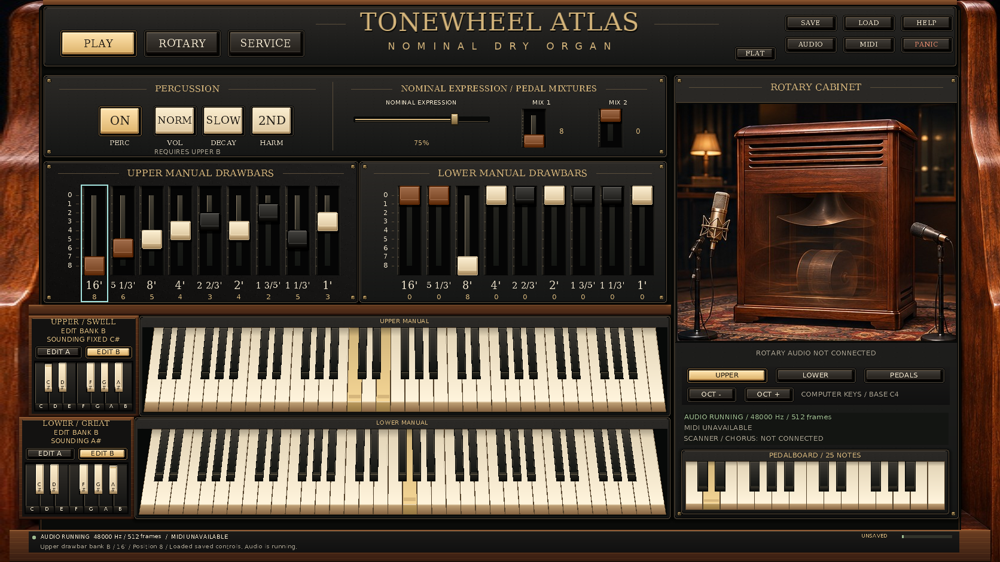
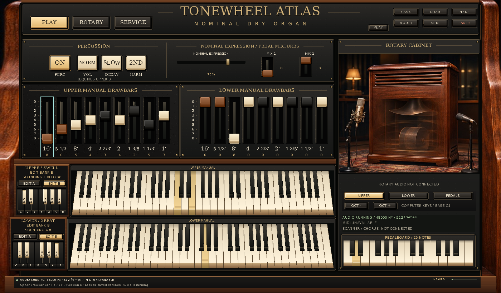

# Actual native Upper-rack material gallery

Twelve actual `hammond_standalone` captures from **16 November 2026,
00:05:52–00:06:21 UTC**. The Upper drawbar rack now has a darker directional
charcoal finish and irregular fine grain. The change applies only to its inner
metal in wide Dimensional Play. The
[independent gallery admission](../../../docs/reviews/UPPER_RACK_GALLERY_ADMISSION.md)
accepts these source-bound captures and full-frame inspection. Literal
whole-interface **1:1 remains unmet and unwaived**.

This README was added after the immutable capture. The [manifest](manifest.json)
covers 57 payload/provenance files; including the manifest, the original capture
contains 58 files totaling 5,466,046 bytes. Its images, diagnostics, inputs and
provenance remain unchanged. The genuine
[previous gallery](../whole-reference-layout-v1/README.md) remains available.

## Complete full-frame gallery

| Actual application screenshot | What to inspect |
| --- | --- |
| [Play reference — 1672×941](images/play-reference-1672x941.png) | New Upper inset, retained drawbar edit, four held owners and cyan drawbar focus |
| [Play minimum active — 1400×820](images/play-minimum-active-1400x820.png) | Activation threshold, small labels, focus and complete wide composition |
| [Play default — 1280×900](images/play-default-1280x900.png) | Established compact composition; material change inactive |
| [Play minimum — 960×700](images/play-minimum-960x700.png) | Minimum compact composition and complete live inventory |
| [Flat reference — 1672×941](images/flat-reference-1672x941.png) | Wide Flat alternative; material change inactive |
| [Flat minimum — 960×700](images/flat-minimum-960x700.png) | Minimum Flat alternative |
| [Play toolbar focus — 1672×941](images/play-toolbar-focus-1672x941.png) | Pedals target activated by Return; added pedal 2 hold |
| [Play pedal focus — 1672×941](images/play-pedal-focus-1672x941.png) | Pedal 25 selected by End and held with Space |
| [Service reference — 1672×941](images/service-reference-1672x941.png) | Current copied controls, owners and model limits |
| [Service minimum — 960×700](images/service-minimum-960x700.png) | Compact read-only inspection |
| [Rotary reference — 1672×941](images/rotary-reference-1672x941.png) | Decorative cabinet with explicit unconnected-audio status |
| [Rotary minimum — 960×700](images/rotary-minimum-960x700.png) | Compact cabinet workspace |





## Scene and preservation

Every replay holds Upper notes 60/64, Lower 67 and pedal 3 while changing the
retained Upper B 16-foot drawbar from 7 to 8. Upper fixed C# continues sounding;
Lower remains on adjustable A. Expression is 0.75, pedal mixtures are 8/0, and
stored percussion is On/Second/Normal/Slow. **REQUIRES UPPER B** truthfully
marks the current fixed Upper route as ineligible. No Save occurs; the
[input controls](inputs/controls.b3controls) remain unchanged. Focus scenes add
pedal 2 or 25 while preserving the original four owners.

The material activates in Dimensional Play at width ≥1400 and height ≥820,
within the supported size range. At 1672×941, the changed inner rectangle is
`(76,273,520,231)`. Panel geometry, borders, child controls, manuals, cabinet,
toolbar and pedals retain their earlier arrangement. All 185,002 RGB pixels of
the reference-size cabinet crop still match the retained decorative asset and
original JPEG crop. That equality concerns artwork, not a measured cabinet.

The [separate comparison admission](../../../docs/reviews/UPPER_RACK_COMPARISON_ADMISSION.md)
accepts A20's 96 frozen-state pairs: 37 required whole frames are identical,
with no differing pixel or channel outside the declared support. Five local
reference-size image screens pass. This is scoped software preservation and
local image evidence. Real application captures have changing frame/revision
labels and footer peak meters; their pixels are not the frozen comparison input.

## Provenance and visible limits

[Provenance](provenance.json), [source qualification](inputs/source-qualification.json),
[diagnostics](diagnostics) and [replays](inputs) bind the commands, source
overlay, executable, selected build inputs, controls and native/PNG pixel
identities. The independent audit passed **641 checks**, including all 57
manifest members, twelve decoded PNGs, 117 production inputs, thirteen selected
build inputs and ten qualified sources.

Executable SHA-256:
`c29495e98148767c0d55cab4adc18a245659cea891deb0f37fa160ea976c3cc1`.
The capture uses base `4aac394cde4da40906b615573a8779aee2d9a37a` plus the recorded
working-source overlay. The base commit alone does not identify this finish.
The capture tool verified lossless BMP-to-PNG conversion before deleting its
own BMP intermediates. Original BMP bytes are unavailable; their hashes and
conversion receipts remain, and every retained PNG pixel hash was rechecked.

Direct inspection of the [original reference](../../../docs/design/atlas-cover-reference.jpg)
and complete active frames found no conspicuous new seam, banding, repeating
grain, sparkle or loss of label/focus readability. The darker Upper inset is
closer to the reference's local illumination. Other panels retain their previous
lighting; wood highlights and depth, key/cap bevels and shadows, title/label
typography and small-label density still differ. Correct live footages, gain
direction, presets, tools, expression/pedals and truthful unconnected-model
labels also differ from illustrative concept content.

These captures use Linux Release, SDL 2.32.10 dummy video/audio, software
rendering, 48 kHz/512-frame stereo callbacks and **MIDI compiled off**. Keyboard
replay and callback progress do not qualify a real display, DPI, controller,
audio device, callback deadline or native semantic accessibility. Scanner and
rotary audio remain unconnected. Physical fidelity and whole-interface visual
equality remain separate requirements.

## Reproduce a fresh capture

From the repository root, use the qualified executable and matching inputs.
Python 3.10+ and Pillow are required; the recorded run used Python 3.12.14 and
Pillow 13.0.0. The destination below **must not already exist**:

```sh
python3 tools/capture_standalone_interface.py \
  --exe ../build-native/apps/standalone/hammond_standalone \
  --source-root . --build-root ../build-native \
  --source-qualification docs/development/2026-11-15-streaming-continuation/reports/native-source-qualification.json \
  --expected-exe-sha256 c29495e98148767c0d55cab4adc18a245659cea891deb0f37fa160ea976c3cc1 \
  --output examples/demos/upper-rack-material-v1-recapture --dummy-sdl
```

Require twelve passed scenes, unchanged inputs, complete focus receipts and no
BMP leftovers, then inspect the new full frames. A later executable needs its
own qualification and expected hash. Keep the new run's identities and variable
runtime counters without replacing this gallery. Normal desktop setup remains
in the [interface runbook](../../../docs/INTERFACE_RUNBOOK.md).
