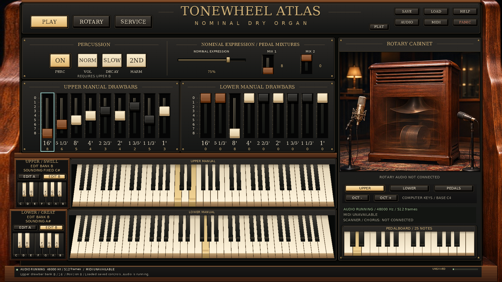
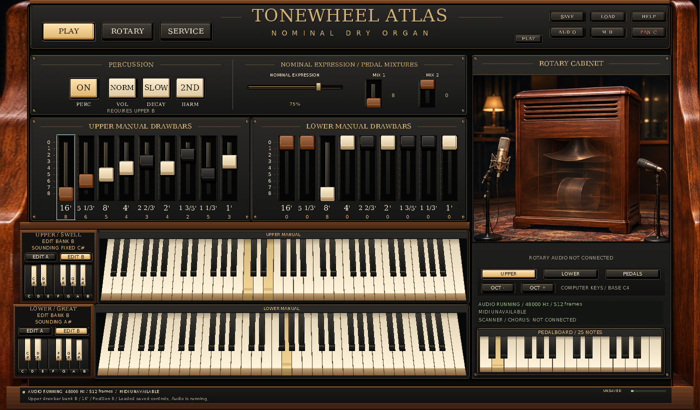

# Actual native whole-reference layout gallery

Twelve actual `hammond_standalone` captures from **15 November 2026,
22:15:44–22:16:12 UTC**. The capture run passed 12/12 scenes; the
[independent admission](../../../docs/reviews/WHOLE_REFERENCE_GALLERY_ADMISSION.md)
accepts their source, state, pixel and scoped composition evidence. All twelve
full frames and the original concept were directly reviewed. Literal
whole-interface 1:1 equality remains unmet.

**This README is interpretation added after the immutable capture manifest.**
The [manifest](manifest.json) covers 57 generated payload/provenance files,
excluding itself and later README/review files. With the manifest, the original
capture contains 58 files totaling 5,402,281 bytes. No captured image, diagnostic,
input, provenance or manifest was changed to add this explanation.

## Complete gallery

| Actual full frame | Presentation and evidence |
| --- | --- |
| [Play reference — 1672×941](images/play-reference-1672x941.png) | Active whole-reference composition; retained drawbar edit and four held owners |
| [Play default — 1280×900](images/play-default-1280x900.png) | Inactive compact composition |
| [Play minimum — 960×700](images/play-minimum-960x700.png) | Inactive minimum composition |
| [Service reference — 1672×941](images/service-reference-1672x941.png) | Current copied model/control/owner inspection |
| [Service minimum — 960×700](images/service-minimum-960x700.png) | Compact read-only inspection |
| [Rotary reference — 1672×941](images/rotary-reference-1672x941.png) | Decorative cabinet and truthful unconnected-model inspection |
| [Rotary minimum — 960×700](images/rotary-minimum-960x700.png) | Compact read-only cabinet workspace |
| [Flat minimum — 960×700](images/flat-minimum-960x700.png) | Inactive Flat presentation with complete controls |
| [Play minimum active — 1400×820](images/play-minimum-active-1400x820.png) | Activation threshold; complete band/racks/manuals/cabinet/toolbar/pedals |
| [Flat reference — 1672×941](images/flat-reference-1672x941.png) | Wide Flat remains outside the new composition |
| [Play toolbar focus — 1672×941](images/play-toolbar-focus-1672x941.png) | Cyan Pedals toolbar focus, activated with Return; added pedal 2 hold |
| [Play pedal focus — 1672×941](images/play-pedal-focus-1672x941.png) | Cyan pedal 25 focus and Space hold |





## What the frames establish

The whole-reference allocation activates only in Dimensional Play at
width ≥1400 and height ≥820. At 1672×941 its logical performance bottom is y264,
percussion top y177, racks y269…508, and manual key starts y548/y718. The cabinet
crop occupies `(1132,174,466,397)`; those 185,002 RGB pixels exactly match the
retained decorative asset and original crop. The minimum active view contains
that asset without changing its aspect ratio. Toolbar and pedal focus remain
visible beneath it.

These logical landmarks do not identify every shaded edge. For example, the
native cap's outer black edge begins at y177 while its bright face begins at
y182; the manual dark boundaries are y548/y718 while bright naturals begin at
y549/y719. The admission records the raster probe method and separates these
measurements from the original JPEG's approximate edges.

Every replay retains Upper notes 60/64, Lower 67 and pedal 3 while changing the
retained Upper B 16-foot drawbar from 7 to 8. Upper fixed C# continues sounding;
Lower's sounding route stays adjustable A. Expression is 0.75, pedal mixtures
8/0 and stored percussion On/Second/Normal/Slow. **REQUIRES UPPER B** is truthful
because the current fixed Upper route is ineligible. No Save occurs; the
[input controls](inputs/controls.b3controls) remain unchanged.

Toolbar focus adds pedal 2; pedal focus adds pedal 25. Both preserve the original
four owners and have complete cyan edge probes: top/bottom/left/right counts
256/256/36/36 and 38/38/140/140 respectively. Ordinary focus IDs are not exported;
the retained evidence combines actual pixel probes, replay action and held state.

The separate genuine old/new comparison passes 66 pairs with 28 entire inactive
frames identical and zero escaping changes. Its active mask protects as few as
34 pixels, so it establishes narrow containment. The original 17-pixel failure
and separately reviewed SDL wood-line extent correction remain linked from the
admission. It does not prove equality to the concept.

## Provenance and limits

[Provenance](provenance.json), [source qualification](inputs/source-qualification.json),
the [manifest](manifest.json), [diagnostics](diagnostics) and [replays](inputs)
retain the actual commands, controls, source/build identities, native BMP hashes,
PNG hashes and decoded pixel hashes. The
[A32 audit](../../../docs/development/2026-11-15-execution-continuation/reports/A32-gallery-admission.json)
passed 383 checks, including all 115 production inputs, thirteen selected build
inputs and ten qualified sources.

The executable is SHA-256
`eb9a501ec60d5a90a398ffbf14e21a21967712589c155b54c8be164a71bd823c`.
The recorded base commit is `33fa95d51e44234eef47ee21c03d29b2b311a5ee` **plus
the identified production worktree overlay**, not that commit alone. Inputs
remained unchanged throughout capture. The utility verified decoded native
BMP/PNG equality before removing only its own BMP files. Original BMP bytes
are no longer available; their identities and lossless-conversion receipts are
retained, and all PNG decoded hashes were independently rechecked.

This run used Linux Release, SDL 2.32.10 dummy video/audio, software rendering,
48 kHz/512-frame stereo callbacks and **MIDI compiled off**. It used keyboard
replay, not a physical controller. Callback progress is not an audio-device,
deadline or fidelity qualification. Native display/DPI, semantic accessibility,
physical-device and literal 1:1 acceptance remain separate gates.

Material lighting, wood/key/cap bevels, typography and small-label density still
differ. Correct live footages, gain direction, presets, tools, expression/pedals
and truthful scanner/rotary status also differ from illustrative concept content.
The [original reference](../../../docs/design/atlas-cover-reference.jpg) remains
the visual comparison source; this gallery preserves actual application pixels.

## Reproduce a fresh capture

Use the already qualified executable and matching source/build inputs from the
repository root. Python 3.10+ and Pillow are required (recorded run: Python
3.12.14, Pillow 13.0.0). The destination below **must not already exist**:

```sh
python3 tools/capture_standalone_interface.py \
  --exe ../build-native/apps/standalone/hammond_standalone \
  --source-root . --build-root ../build-native \
  --source-qualification docs/development/2026-11-15-execution-continuation/reports/native-source-qualification.json \
  --expected-exe-sha256 eb9a501ec60d5a90a398ffbf14e21a21967712589c155b54c8be164a71bd823c \
  --output examples/demos/whole-reference-layout-v1-recapture --dummy-sdl
```

Require twelve passed scenes, unchanged inputs, complete focus receipts and no
BMP leftovers, then review the new full frames. A later executable/source needs
its own qualification and expected digest. Runtime snapshot counters can differ
on another capture; retain its new identities rather than replacing this gallery.
