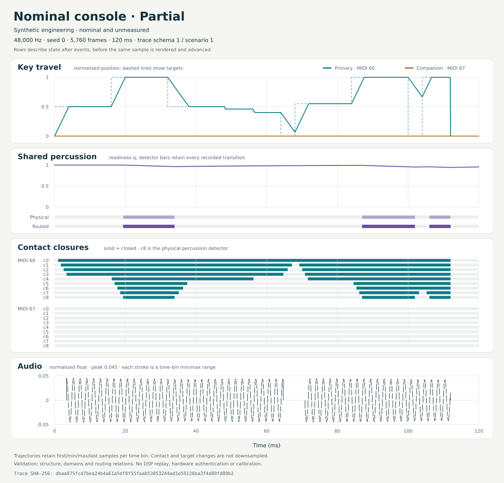

# Two-second nominal console demonstration

[Listen to the WAV](bundle/render.wav), then inspect the
[original score](console-demo.events) and the [partial-key plot](trace/partial-48000.svg).
The WAV is two seconds of stereo PCM16 at 48 kHz, with identical dry channels.
It was generated from the unchanged, nominal source profile and the explicit
linear-travel/shared-percussion console models. These are synthetic engineering
examples with unmeasured parameters.

## What the audio demonstrates

The upper B bank starts at `008000008`: the 8-foot and retained 1-foot drawbars
are at eight. Percussion starts On / Second / Normal / Fast. The lower B bank
has only its 8-foot drawbar at eight. Seed is zero; velocity 100 is a full-press
command, not a loudness multiplier.

| Time | Score action and resulting nominal behavior |
| --- | --- |
| 0.00–0.12 s | Upper MIDI 60 (C4) travels to target 0.5. Its sustained 8-foot and second-harmonic percussion contacts speak while the physical ninth-contact detector remains open. |
| 0.12–0.80 s | C4 completes its press; E4 and G4 join at 0.32 and 0.48 s. They share the existing percussion readiness. The three keys release at 0.64, 0.72 and 0.80 s. |
| 0.88–1.20 s | Lower MIDI 48 (C3) begins. A fresh upper C/E/G chord starts at 1.00 s after the previous upper release and recovery interval. |
| 1.20–1.32 s | Cancel disconnects the upper route while its keys stay held. The lower C3 continues alone. Selecting B at 1.32 s reconnects the held upper keys with their current phases and readiness. |
| 1.48–1.60 s | Percussion Off restores the retained upper 1-foot branch and removes Normal sustain compensation. On restores the percussion routing, compensation and 1-foot mask. |
| 1.76–2.00 s | Upper AllNotesOff performs an immediate manual panic. The lower key releases normally at 1.80 s; the final 160 ms measurement window is exactly silent. |

This short original pattern makes the implemented transitions easy to locate.
It does not isolate every simultaneous routing/gain change as a physical
measurement. The [console contract](../../../docs/CONSOLE_DYNAMICS.md) defines
the algorithms, proposed parameters and their replacement path.

## Separate 120 ms diagnostic view



The retained [CSV](trace/partial-48000.csv) and SVG use the trace tool's built-in
`partial` scenario at 48 kHz, seed zero, with **all sustained drawbars zero**.
Their schedule and registration differ from the two-second audio demonstration.
Both examples use the same compiled profile and source checkpoint.

The plot exposes the four-versus-five closed contacts at the same 0.5 target
approached from opposite directions, the shared readiness, incomplete return,
and partial harmonic output before the ninth contact closes. Its 5,760 CSV rows
record state after current-frame events and before that frame's render/advance.
Contact and target transitions retain their sample boundaries. Other trajectories
and audio use the documented extrema-preserving drawing reduction; the CSV is the
exact record. See [trace format](../../../docs/CONSOLE_TRACE.md) and
[plotting policy](../../../docs/CONSOLE_TRACE_PLOTS.md).

The CSV and SVG match the exact hashes of assignment 42's independently rendered
and visually inspected example. Assignment 49 verified that byte identity.

## Observed verification

The untouched producer-created [schema-2 bundle](bundle/manifest.json) passed the
[independent verifier](analysis/verification.json), including all six artifacts,
input compilation, score grammar, raw logs, WAV bytes and numerical assertions.
An additional actual render with block size 64 produced the **same 384,044 WAV
bytes** as the retained block-size-127 render. No normalization or post-processing
was applied.

The renderer reported float peak `0.19528882205486298`, float RMS
`0.037407620567908695`, and zero clipped frames/channel samples. The independent
PCM analyzer measured the following normalized integer-sample statistics:

| Window, half-open frames | Time | PCM peak | PCM RMS | Observation |
| --- | --- | ---: | ---: | --- |
| [Whole file](analysis/whole.json), `[0, 96000)` | 0–2.00 s | 0.1952819824 | 0.0374076314 | Identical channels; zero full-scale endpoint codes |
| [Partial hold](analysis/partial-hold.json), `[1920, 4800)` | 0.04–0.10 s | 0.0624084473 | 0.0353851019 | Audible modeled branches during the partial hold |
| [Legato](analysis/legato.json), `[26880, 29760)` | 0.56–0.62 s | 0.0899658203 | 0.0305662154 | Three upper keys share one readiness history |
| [Lower only](analysis/lower-only.json), `[58560, 62400)` | 1.22–1.30 s | 0.0299987793 | 0.0212382503 | Upper routing is cancelled; lower C3 continues |
| [Tail](analysis/tail.json), `[88320, 96000)` | 1.84–2.00 s | 0 | 0 | All 7,680 frames are zero on both channels |

The declared single-tone lower-only window gives a crossing-rate estimate of
`130.81348746905118 Hz`, compared with source 25's profile value
`130.8127826502993 Hz`: error `0.0007048187518705618 Hz`, inside this synthetic
sanity check's `0.01 Hz` tolerance. That estimate uses nine complete periods and
the WAV header's clock; the mixed/decaying windows receive no pitch claim.
PCM endpoint counts alone do not establish pre-quantization clipping; the
renderer supplies the separate clipping observation above.

## Source and retained identities

The recorded build used an exact archive of commit
[`9a5c99a862daf26a2bab9b05613c98803727a3e7`](https://github.com/tomasedisonn80/Hammond-B3-Organ/tree/9a5c99a862daf26a2bab9b05613c98803727a3e7),
tree `a85f1bcb43d2815b6f661172f7ab394ad34bee7e`. All 296 committed file blobs
were checked before the build and after artifact generation. GCC 14.2 Release
built the core and the two requested native tools with the repository's strict
warning flags. The source archive has no Git metadata, so the genuine producer
manifest correctly leaves its Git HEAD/dirty observations unavailable.

[provenance.json](provenance.json) separately retains the observed source/archive
identity, compiler and CMake versions, the twelve actual translation-unit
commands, executable/tool hashes, exact invocation lists and artifact inventory.
It does not rewrite the manifest or turn a local execution record into a signed
attestation. The profile's raw JSON hash and its canonical authoring identity
are distinct and both remain preserved.

| Artifact | SHA-256 |
| --- | --- |
| Two-second WAV | `3cbfc2a80ee5ed014782d9abe33d5afc2cd7e494f3efdba280939b4d3d8f56b5` |
| Compiled profile | `b36b0773fa06aac3ee267362f97ce798d0c1f41695e666f71c4a8a52ae36389f` |
| Partial CSV | `dbaa075fcd7bea24b4a61a5df8f55faab53053244ad1e59126ba3f4d80fd89b2` |
| Partial SVG | `76d8583e00977856e54e61fbb1691ff2f7ffb3e2e9f86e0ee5f807e9bdc203a4` |

## Verify and replay

From the repository root, verify the retained bundle without executing its
historical command:

```sh
python tools/verify_render.py examples/rendered/nominal-console-v2/bundle
```

To rebuild the recorded source in a separate checkout, leave this checkout's
retained inputs in place and use fresh worktree, build and output paths:

```sh
git worktree add --detach ../hammond-console-source 9a5c99a862daf26a2bab9b05613c98803727a3e7
cmake -S ../hammond-console-source -B ../hammond-console-build -DCMAKE_BUILD_TYPE=Release
cmake --build ../hammond-console-build --config Release --parallel 2 --target hammond_render hammond_console_trace
cmake -E make_directory out
python ../hammond-console-source/tools/render_fixture.py \
  --renderer ../hammond-console-build/hammond_render \
  --profile-json examples/rendered/nominal-console-v2/bundle/profile.json \
  --output-dir out/nominal-console-replay --frames 96000 --sample-rate 48000 \
  --block-size 127 --seed 0 --drawbars 008000008 --contacts nominal \
  --percussion second --percussion-volume normal --percussion-decay fast \
  --events examples/rendered/nominal-console-v2/console-demo.events
python ../hammond-console-source/tools/verify_render.py out/nominal-console-replay
```

For a multi-configuration build, use the executable's configuration subdirectory
and platform suffix, such as `../hammond-console-build/Release/hammond_render.exe`.
The genuine replay manifest will have new paths, timestamps and build context.
Identical bytes across arbitrary compilers, libraries or platforms are not
required by this example; the exact block-partition comparison above used one
coherent local build.

Generate the separate trace and plot with that same build:

```sh
../hammond-console-build/hammond_console_trace \
  --profile ../hammond-console-build/nominal.b3p --scenario partial \
  --sample-rate 48000 --seed 0 --output out/partial-replay.csv
python ../hammond-console-source/tools/plot_console_trace.py \
  --input out/partial-replay.csv --output out/partial-replay.svg
```

Every output name must be new. Retained historical absolute paths are evidence
of the original run and are not instructions to execute. If its external
renderer disappears, bundle verification can still pass with renderer status
`unavailable`; a present executable whose bytes differ fails that check.
The verifier does not replay audio or establish source/build authentication.

These examples close no measured-instrument, native host/device, subjective
listening, callback-deadline or physical-calibration gate. The wider project
continues at the scoped nominal M3 stage recorded in
[STATUS.md](../../../docs/STATUS.md).
